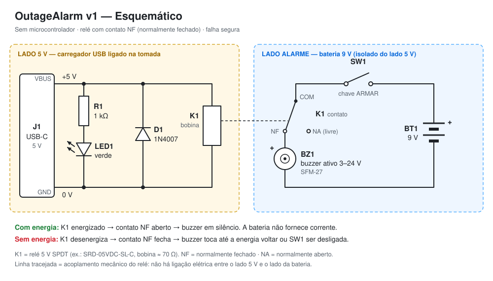

# OutageAlarm

Alarme sonoro de **falta de energia elétrica**. Quando a energia da tomada cai, um buzzer alimentado por uma bateria recarregável dispara na hora.

> **Status:** v1, versão simples. Não tem microcontrolador nem firmware: são um relé, um módulo carregador, uma bateria 18650 e um buzzer.


## Como funciona



Um carregador USB comum, ligado na tomada, alimenta o alarme pelo conector USB-C do módulo **TP4056** (U1). Os 5 V do USB fazem duas coisas ao mesmo tempo:

1. **Mantêm a bateria 18650 sempre carregada.** O TP4056 recarrega a bateria e a protege contra sobrecarga, descarga profunda e curto.
2. **Mantêm energizada a bobina do relé K1.** O buzzer é ligado na bateria **através do contato NF (normalmente fechado) do relé**.

| Situação                  | Relé K1       | Contato NF | Buzzer   | Bateria      |
|---------------------------|---------------|------------|----------|--------------|
| Energia presente          | energizado    | aberto     | silêncio | carregando   |
| Falta de energia          | desenergizado | fechado    | **toca** | alimenta o buzzer |
| Botão TESTE pressionado   | desenergizado | fechado    | **toca** | alimenta o buzzer |

Princípios do projeto:

- **Falha segura.** Qualquer falha do lado da rede dispara o alarme: queda de energia, disjuntor desarmado, carregador queimado ou cabo solto.
- **Bateria sempre pronta.** O próprio USB mantém a bateria cheia. Em espera, ela não alimenta nada. Tocando, ela sustenta o alarme por dias.
- **Teste de verdade.** O botão TESTE corta a bobina do relé, exatamente como numa queda de energia. Se o buzzer toca, bateria, relé, chave e buzzer estão funcionando.
- **Sem 127/220 V na placa.** A tensão da rede fica dentro do carregador USB certificado. Você só manuseia 5 V e a bateria de 3,7 V.

## Lista de materiais (v1)

| Qtd | Ref  | Componente                                         | Observação |
|----:|------|----------------------------------------------------|------------|
| 1   | U1   | Módulo carregador TP4056 **USB-C com proteção** (DW01 + 8205A) | pads IN±, B±, OUT±; veja a nota sobre os resistores CC em [eletronica.md](docs/eletronica.md) |
| 1   | BT1  | Bateria Li-ion 18650, 2000–3500 mAh, sem proteção  | de marca conhecida; o U1 já protege a bateria |
| 1   | —    | Suporte para 1 × 18650 com fios                    | ≈ 77 × 21 × 20 mm |
| 1   | K1   | Relé 5 V SPDT: SRD-05VDC-SL-C                      | bobina ≈ 70 Ω, consome ≈ 72 mA |
| 1   | D1   | Diodo 1N4007 (ou 1N4148)                           | diodo de roda-livre da bobina |
| 1   | R1   | Resistor 1 kΩ, 1/4 W                               | limita a corrente do LED |
| 1   | LED1 | LED verde 5 mm                                     | indica "REDE OK" |
| 1   | BZ1  | Buzzer ativo SFM-27, 3–24 V                        | funciona direto na bateria de 3,7 V |
| 1   | SW1  | Chave alavanca MTS-101 (liga/desliga)              | ARMAR: arma e desarma o alarme |
| 1   | SW2  | Botão pulsador **NF** (normalmente fechado), PBS-11B, furo de 12 mm | TESTE |
| 1   | —    | Placa perfurada 6 × 4 cm                           |  |
| 4   | —    | Parafuso M2 × 6 mm autoatarraxante                 | fixa a placa na caixa |
| 1   | —    | Carregador USB 5 V **≥ 1,5 A** + cabo              | **ligue direto na tomada, nunca num nobreak** |
| —   | —    | Fios, solda, termo-retrátil, cola quente, fita dupla-face de espuma |  |

## Estrutura do repositório

```
OutageAlarm/
├── README.md
├── CLAUDE.md                       # contexto para o Claude Code
├── docs/
│   ├── eletronica.md               # circuito, cálculos, ligações, testes
│   ├── mecanica.md                 # caixa, impressão 3D, montagem
│   └── img/                        # imagens renderizadas da caixa
├── hardware/
│   ├── eletronica/
│   │   └── esquematico.svg
│   └── mecanica/
│       ├── caixa.scad              # caixa paramétrica (OpenSCAD), fonte da verdade
│       └── stl/                    # STLs prontos para fatiar
└── .github/workflows/
    └── render-caixa.yml            # gera STLs e imagens quando o .scad muda
```

## Montagem rápida

1. Imprima `hardware/mecanica/stl/caixa_base.stl` e `caixa_tampa.stl` em PLA ou PETG, sem suporte. Detalhes em [docs/mecanica.md](docs/mecanica.md).
2. Monte o circuito seguindo a tabela de ligações em [docs/eletronica.md](docs/eletronica.md).
3. Coloque tudo na caixa:
   - suporte da 18650 atrás, placa perfurada na frente à esquerda e módulo TP4056 no berço da parede direita (USB-C para fora);
   - chave ARMAR e botão TESTE na frente;
   - buzzer e LED na tampa.
4. Faça o teste abaixo e feche a tampa.

## Teste

1. Coloque a bateria e ligue o carregador. O LED **REDE** acende, o relé dá um clique e o LED do TP4056 mostra a carga (vermelho = carregando, azul = carregada).
2. Ligue a chave **ARMAR**. Não deve haver som.
3. Segure o botão **TESTE**. O buzzer toca enquanto o botão estiver apertado.
4. Tire o carregador da tomada. O buzzer toca em menos de 1 segundo. Recoloque o carregador e o buzzer para.

**Uma vez por mês, aperte o botão TESTE.** Se o buzzer tocar forte, o alarme está pronto.

## Limitações da v1

- Avisa só no local, com som. Não envia notificação.
- Detecta a falta de energia apenas no circuito (disjuntor) da tomada onde o carregador está ligado.
- Toca até a energia voltar ou até a chave ARMAR ser desligada.
- Na bateria de 3,7 V, o SFM-27 toca mais baixo do que em 12 V. Se precisar de mais volume, veja a opção com conversor elevador em [eletronica.md](docs/eletronica.md#alternativas).
- Não mostra o nível da bateria. O botão TESTE é a forma de conferir.
- Também dispara se o carregador ou o cabo falharem. Isso é intencional (falha segura).

## Próximas versões

- **v2:** ESP32 com notificação por Wi-Fi (Telegram, push ou e-mail), registro do horário em que a energia caiu e voltou, medição do nível da bateria, botão para silenciar sem desarmar e bipe curto quando a energia volta.
- **v3:** PCB própria. Opcionalmente, detecção direta da rede com isolamento adequado.

## Segurança

- Use um carregador USB de marca e certificado (selo do Inmetro). Ele é a única parte ligada à rede elétrica.
- Não abra o carregador e não ligue nada deste projeto direto em 127/220 V.
- Se a casa tem nobreak, ligue o carregador numa tomada **fora** do nobreak. Senão o alarme não percebe a queda.
- Use bateria 18650 de marca conhecida e em bom estado. Não use baterias amassadas, estufadas ou de origem duvidosa ("9900 mAh").

## Licença

[MIT](LICENSE)
