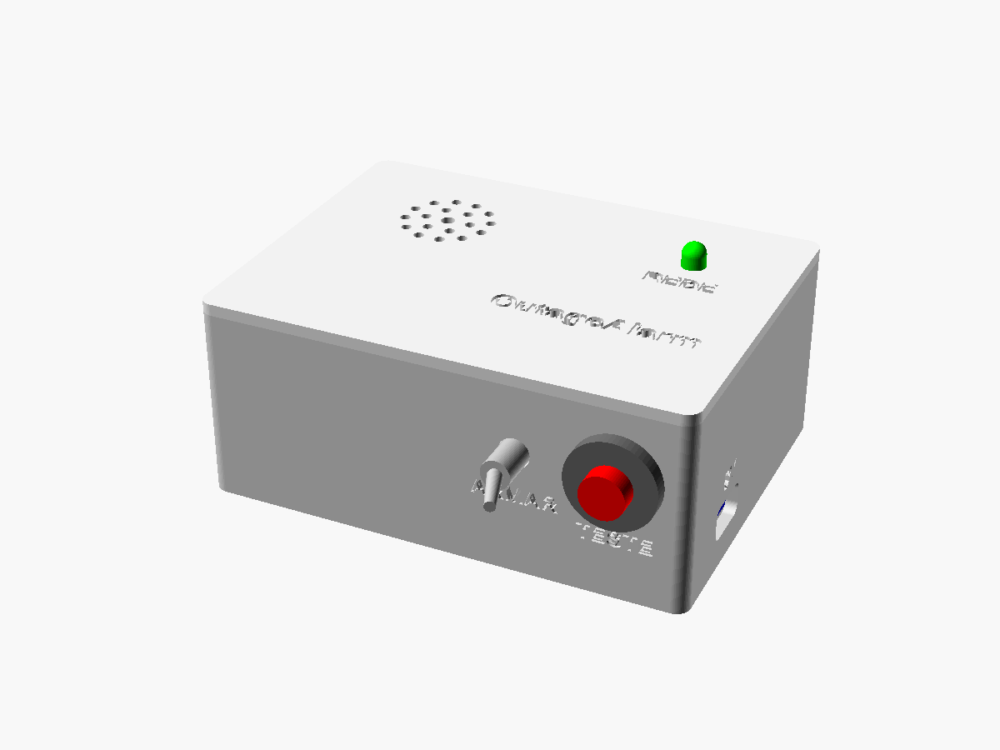
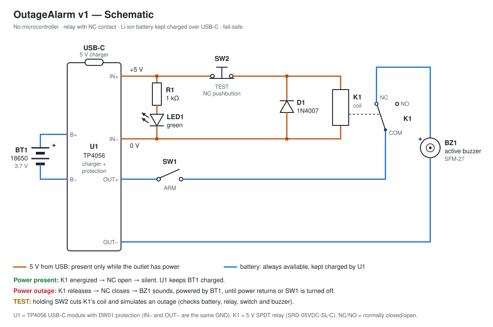

# OutageAlarm

An audible **power outage alarm**. When the wall outlet loses power, a buzzer running on a rechargeable battery goes off immediately.

> **Status:** v1, the simple version. No microcontroller and no firmware: just a relay, a charger module, an 18650 battery and a buzzer.



## How it works



A regular USB charger plugged into the wall powers the alarm through the USB-C connector of the **TP4056** module (U1). The 5 V from USB does two things at once:

1. **Keeps the 18650 battery charged.** The TP4056 recharges the battery and protects it against overcharge, over-discharge and short circuits.
2. **Keeps relay K1's coil energized.** The buzzer is connected to the battery **through the relay's NC (normally closed) contact**.

| Situation              | Relay K1     | NC contact | Buzzer     | Battery          |
|------------------------|--------------|------------|------------|------------------|
| Power present          | energized    | open       | silent     | charging         |
| Power outage           | released     | closed     | **sounds** | powers the buzzer |
| TEST button held down  | released     | closed     | **sounds** | powers the buzzer |

Design principles:

- **Fail-safe.** Any failure on the mains side sets off the alarm: power outage, tripped breaker, dead charger or loose cable.
- **Battery always ready.** USB keeps the battery full. On standby it powers nothing. When the alarm sounds, the battery keeps it going for days.
- **A real test.** The TEST button cuts the relay coil, exactly like an outage does. If the buzzer sounds, the battery, relay, switch and buzzer all work.
- **No 120/230 V on the board.** Mains voltage stays inside the certified USB charger. You only handle 5 V and the 3.7 V battery.

## Bill of materials (v1)

| Qty | Ref  | Part                                               | Notes |
|----:|------|----------------------------------------------------|-------|
| 1   | U1   | TP4056 charger module, **USB-C, with protection** (DW01 + 8205A) | IN±, B±, OUT± pads; see the CC resistor note in [electronics.md](docs/electronics.md) |
| 1   | BT1  | 18650 Li-ion cell, 2000–3500 mAh, unprotected      | reputable brand; U1 already protects the cell |
| 1   | —    | 1 × 18650 holder with wire leads                   | ≈ 77 × 21 × 20 mm |
| 1   | K1   | 5 V SPDT relay: SRD-05VDC-SL-C                     | coil ≈ 70 Ω, draws ≈ 72 mA |
| 1   | D1   | 1N4007 diode (or 1N4148)                           | coil flyback diode |
| 1   | R1   | 1 kΩ resistor, 1/4 W                               | LED current limit |
| 1   | LED1 | Green LED, 5 mm                                    | "POWER" indicator |
| 1   | BZ1  | SFM-27 active buzzer, 3–24 V                       | runs directly from the 3.7 V cell |
| 1   | SW1  | MTS-101 toggle switch (on/off)                     | ARM: arms and disarms the alarm |
| 1   | SW2  | **NC** (normally closed) momentary pushbutton, PBS-11B, 12 mm hole | TEST |
| 1   | —    | 6 × 4 cm perfboard                                 |  |
| 4   | —    | M2 × 6 mm self-tapping screws                      | hold the perfboard |
| 1   | —    | 5 V USB charger **≥ 1.5 A** + cable                | **plug it straight into the wall, never into a UPS** |
| —   | —    | Wire, solder, heat-shrink, hot glue, foam double-sided tape |  |

## Repository layout

```
OutageAlarm/
├── README.md
├── CLAUDE.md                       # context for Claude Code
├── docs/
│   ├── electronics.md              # circuit, calculations, wiring, tests
│   ├── mechanical.md               # enclosure, 3D printing, assembly
│   └── img/                        # rendered images of the enclosure
├── hardware/
│   ├── electronics/
│   │   └── schematic.svg
│   └── mechanical/
│       ├── enclosure.scad          # parametric enclosure (OpenSCAD), source of truth
│       └── stl/                    # ready-to-slice STLs
└── .github/workflows/
    └── render-enclosure.yml        # renders STLs and images when the .scad changes
```

## Quick build

1. Print `hardware/mechanical/stl/enclosure_base.stl` and `enclosure_lid.stl` in PLA or PETG, no supports. Details in [docs/mechanical.md](docs/mechanical.md).
2. Build the circuit following the wiring table in [docs/electronics.md](docs/electronics.md).
3. Put everything in the enclosure:
   - 18650 holder at the back, perfboard at the front left, TP4056 module in the cradle on the right wall (USB-C facing out);
   - ARM switch and TEST button on the front;
   - buzzer and LED on the lid.
4. Run the test below and close the lid.

## Test

1. Insert the battery and plug in the charger. The **POWER** LED lights up, the relay clicks, and the TP4056 LED shows the charge state (red = charging, blue = full).
2. Turn the **ARM** switch on. There should be no sound.
3. Hold the **TEST** button. The buzzer sounds for as long as the button is pressed.
4. Unplug the charger from the wall. The buzzer sounds in under 1 second. Plug it back in and the buzzer stops.

**Press TEST once a month.** If the buzzer sounds loud, the alarm is ready.

## v1 limitations

- Local, audible alert only. No notifications.
- Only detects outages on the circuit (breaker) of the outlet the charger is plugged into.
- Keeps sounding until power returns or the ARM switch is turned off.
- On the 3.7 V cell the SFM-27 is quieter than at 12 V. If you need more volume, see the boost converter option in [electronics.md](docs/electronics.md#alternatives).
- No battery level indicator. The TEST button is how you check it.
- Also goes off if the charger or cable fails. This is intentional (fail-safe).

## Roadmap

- **v2:** ESP32 with Wi-Fi notifications (Telegram, push or e-mail), logging when power went out and came back, battery level measurement, a button to silence without disarming, and a short beep when power returns.
- **v3:** Custom PCB. Optionally, direct mains sensing with proper isolation.

## Safety

- Use a reputable, certified USB charger (e.g. Inmetro in Brazil, UL/CE elsewhere). It is the only part connected to mains.
- Do not open the charger and do not connect anything in this project directly to 120/230 V.
- If your home has a UPS, plug the charger into an outlet **not** backed by the UPS. Otherwise the alarm will never see the outage.
- Use a reputable 18650 cell in good condition. Never use dented, swollen or dubious cells ("9900 mAh").

## License

[MIT](LICENSE)
