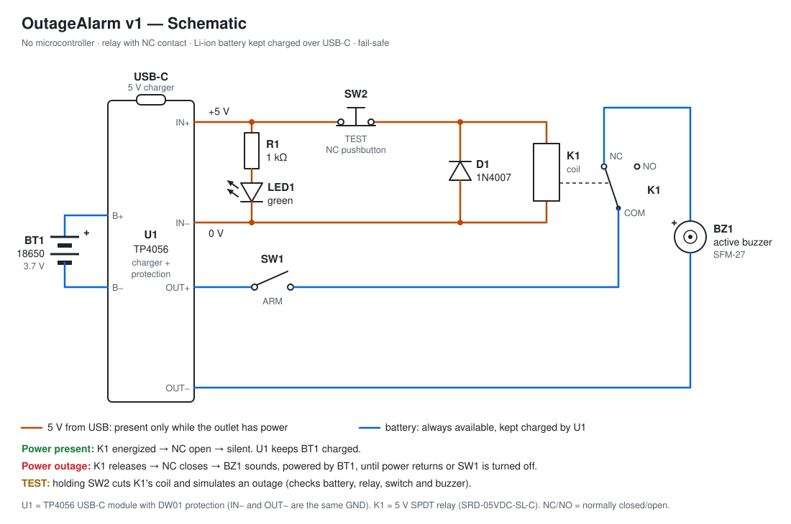
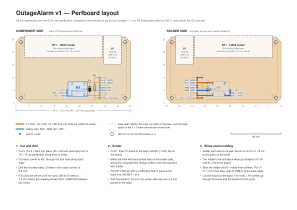

# Electronics — OutageAlarm v1

## Principle

The circuit has two parts, linked by relay K1:

- **Mains detection (orange wires):** the 5 V from USB powers the POWER LED and, through the TEST button (SW2), K1's coil. This 5 V only exists while the outlet has power.
- **Alarm (blue wires):** the 18650 cell (BT1), through U1's protected output, powers the buzzer via the ARM switch (SW1) and K1's **NC** contact.

With power present, the coil pulls in, the NC contact opens and the buzzer stays silent. Meanwhile U1 keeps the battery charged. When power fails, the coil releases, the NC contact closes and the buzzer sounds, powered by the battery.

This arrangement is **fail-safe**: any loss of the 5 V sets off the alarm, whether it's an outage, a tripped breaker, a dead charger or a loose cable.

### The TEST button

SW2 is an **NC** pushbutton in series with the relay coil. At rest it conducts and the coil stays energized. Pressing it opens the coil circuit, the relay releases and the buzzer sounds, exactly as in a power outage. The test checks the battery, the relay contact, the ARM switch and the buzzer all at once.

The POWER LED sits **before** the button, so it stays lit during the test. That shows USB power is present and the sound came from the button, not from an outage.

## Bill of materials

| Qty | Ref  | Part | Specification | Notes |
|----:|------|------|---------------|-------|
| 1 | U1   | TP4056 USB-C module with protection | TP4056 + DW01A + 8205A, 1 A charge, ≈ 29 × 17 mm | IN+, IN−, B+, B−, OUT+, OUT− pads |
| 1 | BT1  | 18650 Li-ion cell | 3.7 V, 2000–3500 mAh, unprotected | reputable brand (Samsung, LG, Sony/Murata, Panasonic) |
| 1 | —    | 1 × 18650 holder with wire leads | ≈ 77 × 21 × 20 mm | "protected" cells are longer and may not fit. Stuck on the perfboard |
| 1 | K1   | SRD-05VDC-SL-C relay | 5 V / 0.36 W coil (≈ 70 Ω), 10 A SPDT contact | any 5 V relay with an NC contact works |
| 1 | D1   | 1N4007 diode | 1 A, 1000 V | 1N4148 also works |
| 1 | R1   | Resistor | 1 kΩ, 1/4 W | 470 Ω for a brighter LED |
| 1 | LED1 | Green LED | 5 mm | its base flange stops against the control face |
| 1 | BZ1  | SFM-27 active buzzer | 3–24 V, < 20 mA | **active** (built-in oscillator) and **polarized** |
| 1 | SW1  | KCD1-101 rocker switch | SPST on/off, 2 pins, 21 × 15 mm bezel, snaps into a 19.2 × 12.9 mm cutout | ARM |
| 1 | SW2  | PBS-11B pushbutton | **NC** (normally closed), momentary, 12 mm hole | TEST. Check with a multimeter: conducts when **released**, opens when **pressed** |
| 1 | —    | Perfboard | 2.54 mm pitch, single-sided with a pad on each hole, 10 × 15 cm | cut to 114.3 × 66.0 mm: see [Perfboard](#perfboard) |
| — | —    | Bare tinned copper wire | ≈ 0.5 mm, or leftover component leads | the links on the board |
| 1 | —    | 5 V USB charger | ≥ 1.5 A | certified, plugged straight into the wall |

> **5.1 kΩ CC resistors on USB-C.** A USB-C charger only turns on its 5 V after it detects a connected device, which it does through 5.1 kΩ resistors on the CC pins. Not every TP4056 USB-C module has them. If your module stays dark on a USB-C ↔ USB-C cable, use a **USB-A → USB-C cable**: the 5 V always comes through with it.

> **Why the SFM-27?** It accepts 3 to 24 V, so it runs directly from the 3.7 V cell. Small 12 mm "5 V" buzzers don't work well below 4 V.

## Calculations

| Item | Math | Result |
|------|------|--------|
| K1 coil current | 0.36 W ÷ 5 V | ≈ 72 mA |
| LED current (green, Vf ≈ 2.1 V) | (5 − 2.1) V ÷ 1 kΩ | ≈ 2.9 mA |
| Battery charge current | TP4056 program resistor (1.2 kΩ) | up to 1 A |
| Peak USB charger load | 1 A + 72 mA + 3 mA | ≈ 1.1 A → use a **≥ 1.5 A** charger |
| Battery standby drain | protection circuit only | a few µA, replenished by USB |
| Buzzer current at 3.7 V | estimate for the SFM-27 | 5–10 mA |
| Run time while sounding (2500 mAh cell) | 2500 mAh ÷ 10 mA | **> 100 h** (several days) |
| Recharge time after a long outage | 2500 mAh ÷ 1 A | ≈ 3 h |

**Response time.** When power fails, the charger's output capacitors hold the output up for a few milliseconds and feed the coil as they discharge. The relay releases once the voltage drops below ≈ 1–2 V. In practice the alarm goes off in under 1 second. A useful side effect: very short mains blips (under ~0.1 s) are usually ignored.

**What D1 does.** When the coil switches off (during an outage or when TEST is pressed), it produces a reverse voltage spike. D1 absorbs it, protecting the charger output and preventing arcing on SW2's contact. It will also be mandatory in v2, when a transistor drives the coil.

**Deep discharge.** If an outage lasts long enough for the cell to reach ≈ 2.5 V, U1's protection cuts the output and the alarm stops. This preserves the cell. When power returns, U1 recharges it normally.

**Heat.** Charging at 1 A, the TP4056 dissipates about 1 W and warms up inside the enclosure (it has thermal regulation and throttles the current on its own). Since the battery is almost always full, this only happens for a few hours after an outage. For less heat, replace the module's program resistor (usually marked R3, 1.2 kΩ) with 2.4 kΩ: charge current drops to ≈ 500 mA.

## Wiring table

| Net | Connected points |
|-----|------------------|
| `+5V`  | U1 IN+ · R1 (one lead) · SW2 (one terminal) |
| `COIL` | SW2 (other terminal) · K1 coil (one pin) · D1 cathode (banded end) |
| `0V`   | U1 IN− · K1 coil (other pin) · D1 anode · LED1 cathode (short leg, flat side) |
| `LED`  | R1 (other lead) · LED1 anode (long leg) |
| `CELL+` | U1 B+ · BT1 + (holder red wire) |
| `CELL−` | U1 B− · BT1 − (holder black wire) |
| `BAT+` | U1 OUT+ · SW1 (one terminal) |
| `ARM`  | SW1 (other terminal) · K1 COM |
| `BZ+`  | K1 NC · BZ1 + (red wire) |
| `BAT−` | U1 OUT− · BZ1 − (black wire) |
| —      | K1 NO: **not connected** |

Precautions:

- **Nothing but the cell goes on B+ and B−.** The buzzer and the rest of the alarm connect to OUT+ and OUT−, which go through the protection.
- On the module, IN− and OUT− are the same GND. Still, connect each return to the pad listed in the table: it makes the build easier to check.
- Mind the cell polarity. A reversed cell destroys the module.

### Identifying the relay pins

The SRD-05VDC has 5 pins. To identify them with a multimeter on continuity or resistance:

1. **Coil:** the two pins that measure ≈ 70 Ω between them.
2. **COM:** the lone pin at one end, usually between the two coil pins.
3. **NC:** the pin with continuity to COM when the relay is **off**.
4. **NO:** the pin that only connects to COM when you apply 5 V to the coil.

## Perfboard

All the electronics sit on one perfboard that covers the floor of the enclosure:
- the 18650 holder and U1 at the back;
- K1, D1 and R1 at the front;
- a pad for every wire.

The four screws that close the enclosure pass through its corners, so the screw posts clamp it to the base. It needs no screws or standoffs of its own.

The layout is drawn 1:1 on an A4 page. Print it at 100 % and check the 50 mm bar: then it is also a template for cutting and drilling. The drawing comes from [`perfboard.py`](../hardware/electronics/perfboard.py), which holds the layout as data.

### Cutting and drilling

1. Cut a 114.3 × 66.0 mm piece (45 × 26 hole spacings) from a 10 × 15 cm perfboard. Cut along lines of holes, so that the edges run through the outer holes: score both sides with a knife and snap it, or saw it.
2. Cut each corner at 45°, through the second hole along each edge, so the corners clear the rounded inner corners of the enclosure.
3. Drill the four screw holes to 3.2 mm. They are the holes 2 in from each corner, along both edges.
4. Drill K1's five holes to 1.3 mm, where the layout shows them. The SRD relay's pins are not on the 2.54 mm grid: four of them sit about 0.4 mm off a hole, and COM falls between two holes.

### Soldering

- **Identify K1's pins first** (see [Identifying the relay pins](#identifying-the-relay-pins)). The layout puts NC at the front, as on the SRD footprint. If NC is the back contact pin on your relay, run the BZ1 + link to that one instead.
- **Fit K1, D1 and R1.** D1's band (cathode) goes to the back, on the COIL row. D1 and R1 lie flat.
- **Make the links** on the solder side with bare tinned wire or leftover leads, along the coloured lines in the layout. COM has no pad of its own, so bridge it to the hole next to it with solder.
- **Trim every lead to 1.5 mm or less.** The solder side sits over a 2 mm pocket in the base.
- **Keep clear:** don't solder in the outer row of holes, or in the 3 × 3 holes around each screw hole. The outer row rests on the rim of the base's pocket, and the screw posts press on the board around the screws.

What the board connects (holes as (i, j), counted from the front-left corner: i to the right, j to the back):

| Net | On the board |
|-----|--------------|
| `+5V`  | pads U1 IN+ (33, 10) and TEST (33, 9) · R1 back lead (31, 10) |
| `COIL` | pad TEST (33, 8) · K1 back coil pin · D1 cathode (29, 8) |
| `0V`   | pads U1 IN− (33, 4) and LED1 − (33, 3) · K1 front coil pin · D1 anode (29, 3) |
| `LED`  | pad LED1 + (33, 2) · R1 front lead (31, 2) |
| `BAT+` | pads U1 OUT+ (33, 7) and ARM (33, 6) |
| `ARM`  | pad ARM (33, 5) · K1 COM |
| `BZ+`  | pad BZ1 + (20, 3) · K1 NC (front contact pin) |
| `BAT−` | pads U1 OUT− (20, 5) and BZ1 − (20, 4) |
| —      | K1 NO (back contact pin): soldered, not connected |

### Wires to the board

| From | Wires | Pads | Suggested length |
|------|-------|------|------------------|
| U1 (IN+, IN−, OUT+, OUT−) | 4 | labelled U1 | 10 cm |
| SW1 (ARM, shell) | 2 | ARM | 15 cm |
| SW2 (TEST, shell) | 2 | TEST | 15 cm |
| LED1 (shell) | 2 | LED1 + (long leg), LED1 − | 15 cm |
| BZ1 (shell) | 2 (the buzzer's own leads) | BZ1 + (red), BZ1 − (black) | 15 cm |

- Everything on the shell (switch, button, LED, buzzer) needs about 15 cm of wire, so the shell can lie next to the base while you work on it.
- The battery holder connects **directly** to U1's B+ and B−, not through the board.
- A dab of hot glue where the wires meet the pads keeps them from breaking as the shell is opened and closed.

### Mounting the holder and U1

- **Holder:** at the back left of the board, inside its outline, with thin double-sided tape. Thick foam tape would raise it too close to the buzzer.
- **U1:** at the back right, on 1 mm double-sided foam tape, with its USB-C toward the back. It overhangs the board's back edge by 1.5 mm, which puts the receptacle 0.5 mm from the back wall and 5.4 mm above the base, centered on the opening.

## Bench test (before closing the enclosure)

1. **Without the cell**, plug in USB. The POWER LED lights up and the relay clicks. Measure ≈ 5 V between IN+ and IN−.
2. With USB plugged in, measure COM–NC: it should be **open**. Hold TEST: COM–NC should **close** and the relay clicks.
3. Insert the cell with USB plugged in. The TP4056 LED turns red (charging), then blue (full). Measure ≈ 3.7–4.2 V between OUT+ and OUT−.
4. Turn SW1 on. With USB, silence. Hold TEST: the buzzer sounds. Unplug USB: the buzzer sounds.

> Some DW01-based modules keep OUT switched off right after the cell is inserted, until USB is plugged in for the first time. If there's no voltage on OUT, plug in USB once.

## Troubleshooting

| Symptom | Likely cause | What to do |
|---------|--------------|------------|
| LED doesn't light | Module lacks the CC resistors (C ↔ C cable); LED reversed; R1 open | Use a USB-A → C cable; flip the LED; measure R1 |
| LED lights but relay doesn't click | SW2 is NO instead of NC; bad coil solder joint | Measure SW2 released (should conduct); measure ≈ 70 Ω across the coil |
| Buzzer sounds **with** power and stops **without** it | Buzzer wired to NO instead of NC | Move the wire from NO to NC |
| Buzzer sounds all the time | Relay is not energizing | See the two rows above |
| TEST doesn't make the buzzer sound | SW1 off; cell flat or missing; buzzer reversed (it's polarized) | Turn SW1 on; measure OUT+/OUT− (> 3.3 V); check the buzzer's + lead |
| No voltage on OUT with a good cell | DW01 protection latched | Plug in USB once |
| TP4056 LED never turns blue | Bad cell or weak charger | Replace the cell; use a ≥ 1.5 A charger |
| Alarm doesn't sound in a real outage | Charger plugged into a UPS or a battery-backed stabilizer | Plug the charger straight into a wall outlet |

## Alternatives

- **More volume:** add an MT3608 boost converter set to 12 V **after** the NC contact (between K1 NC and BZ1 +, with GND on OUT−). It only powers up when the alarm goes off, so it draws nothing on standby. The SFM-27 gets much louder, but run time drops to about 1 day.
- **LiPo cell** (e.g. 1000–2000 mAh) instead of the 18650: works with the same module and takes less space, but needs a different enclosure layout.
- **Signal relay** (e.g. Omron G5V-1, gold contacts): draws less (≈ 30 mA) and has a more reliable contact at very low currents. Requires adjusting the layout.
