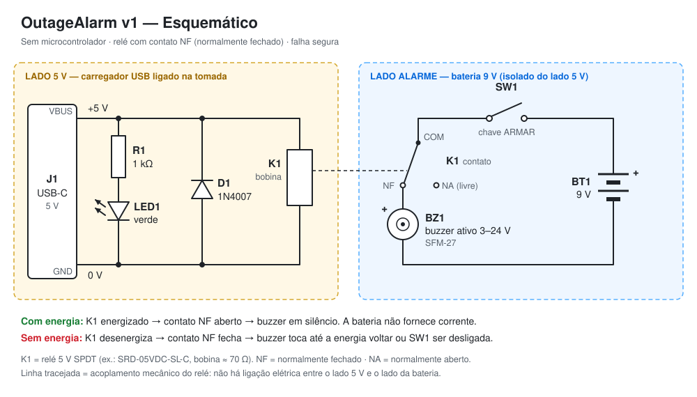

# Eletrônica — OutageAlarm v1

## Princípio

O circuito tem duas partes, ligadas pelo relé K1:

- **Detecção de rede (fios laranja):** os 5 V do USB alimentam o LED REDE e, passando pelo botão TESTE (SW2), a bobina de K1. Esses 5 V só existem enquanto há energia na tomada.
- **Alarme (fios azuis):** a bateria 18650 (BT1), por meio da saída protegida do módulo U1, alimenta o buzzer passando pela chave ARMAR (SW1) e pelo contato **NF** de K1.

Com energia, a bobina puxa o contato, o NF abre e o buzzer fica mudo. Enquanto isso, o U1 mantém a bateria carregada. Quando a energia cai, a bobina solta, o NF fecha e o buzzer toca, alimentado pela bateria.

O arranjo é **falha segura**: qualquer interrupção dos 5 V dispara o alarme, seja queda de energia, disjuntor, carregador queimado ou cabo solto.

### O botão TESTE

SW2 é um pulsador **NF** em série com a bobina do relé. Em repouso ele conduz e a bobina fica energizada. Ao apertar, ele abre o circuito da bobina, o relé solta e o buzzer toca, exatamente como numa queda de energia. O teste confere de uma vez a bateria, o contato do relé, a chave ARMAR e o buzzer.

O LED REDE fica **antes** do botão. Por isso ele continua aceso durante o teste: isso mostra que o USB está presente e que o som veio do botão, não de uma queda.

## Lista de materiais

| Qtd | Ref  | Componente | Especificação | Observação |
|----:|------|------------|---------------|------------|
| 1 | U1   | Módulo TP4056 USB-C com proteção | TP4056 + DW01A + 8205A, carga 1 A, ≈ 29 × 17 mm | pads IN+, IN−, B+, B−, OUT+, OUT− |
| 1 | BT1  | Bateria Li-ion 18650 | 3,7 V, 2000–3500 mAh, sem proteção | de marca conhecida (Samsung, LG, Sony/Murata, Panasonic) |
| 1 | —    | Suporte 1 × 18650 com fios | ≈ 77 × 21 × 20 mm | baterias "com proteção" são mais compridas e podem não caber |
| 1 | K1   | Relé SRD-05VDC-SL-C | bobina 5 V / 0,36 W (≈ 70 Ω), contato SPDT 10 A | qualquer relé 5 V com contato NF serve |
| 1 | D1   | Diodo 1N4007 | 1 A, 1000 V | 1N4148 também serve |
| 1 | R1   | Resistor | 1 kΩ, 1/4 W | 470 Ω se quiser o LED mais forte |
| 1 | LED1 | LED verde | 5 mm | tem uma aba na base que trava na tampa |
| 1 | BZ1  | Buzzer ativo SFM-27 | 3–24 V, < 20 mA | **ativo** (oscilador interno) e **polarizado** |
| 1 | SW1  | Chave alavanca MTS-101 | SPST liga/desliga, furo M6 | ARMAR |
| 1 | SW2  | Pulsador PBS-11B | **NF** (normalmente fechado), momentâneo, furo de 12 mm | TESTE. Confira com o multímetro: conduz **solto** e abre **apertado** |
| 1 | —    | Placa perfurada | 6 × 4 cm | |
| 1 | —    | Carregador USB 5 V | ≥ 1,5 A | certificado, ligado direto na tomada |

> **Resistores de 5,1 kΩ no CC do USB-C.** Um carregador USB-C só libera os 5 V depois que detecta um aparelho conectado, e faz isso por meio de resistores de 5,1 kΩ ligados nos pinos CC. Nem todo módulo TP4056 USB-C tem esses resistores. Se o seu módulo não acender com um cabo USB-C ↔ USB-C, use um **cabo USB-A → USB-C**: com ele os 5 V chegam sempre.

> **Por que o SFM-27?** Ele aceita de 3 a 24 V, então funciona direto na bateria de 3,7 V. Os buzzers pequenos de 12 mm "5 V" não funcionam bem abaixo de 4 V.

## Cálculos

| Item | Conta | Resultado |
|------|-------|-----------|
| Corrente da bobina de K1 | 0,36 W ÷ 5 V | ≈ 72 mA |
| Corrente do LED (verde, Vf ≈ 2,1 V) | (5 − 2,1) V ÷ 1 kΩ | ≈ 2,9 mA |
| Corrente de carga da bateria | resistor de programação do TP4056 (1,2 kΩ) | até 1 A |
| Consumo máximo do carregador USB | 1 A + 72 mA + 3 mA | ≈ 1,1 A → use carregador de **≥ 1,5 A** |
| Consumo da bateria em espera | só o circuito de proteção | poucos µA, e o USB repõe |
| Corrente do buzzer tocando em 3,7 V | estimativa para o SFM-27 | 5–10 mA |
| Autonomia tocando (bateria de 2500 mAh) | 2500 mAh ÷ 10 mA | **> 100 h** (vários dias) |
| Tempo de recarga após uma queda longa | 2500 mAh ÷ 1 A | ≈ 3 h |

**Tempo de resposta.** Quando a energia cai, os capacitores do carregador seguram a saída por alguns milissegundos e alimentam a bobina enquanto descarregam. O relé solta quando a tensão fica abaixo de ≈ 1–2 V. Na prática o alarme dispara em menos de 1 segundo. O efeito colateral é bom: piscadas muito curtas da rede (menos de ~0,1 s) costumam ser ignoradas.

**Função do D1.** Ao desligar (numa queda ou ao apertar TESTE), a bobina gera um pico de tensão reversa. D1 absorve esse pico, protege a saída do carregador e evita faísca no contato do SW2. Ele também será obrigatório na v2, quando um transistor acionar a bobina.

**Descarga profunda.** Se a energia ficar fora por tanto tempo que a bateria chegue a ≈ 2,5 V, a proteção do U1 corta a saída e o alarme para. Isso preserva a bateria. Quando a energia volta, o U1 recarrega a bateria normalmente.

**Aquecimento.** Carregando a 1 A, o TP4056 dissipa cerca de 1 W e esquenta dentro da caixa (ele tem regulação térmica e reduz a corrente sozinho). Como a bateria quase sempre está cheia, isso só acontece por algumas horas depois de uma queda. Se quiser menos calor, troque o resistor de programação do módulo (geralmente marcado R3, 1,2 kΩ) por 2,4 kΩ: a carga cai para ≈ 500 mA.

## Tabela de ligações

| Rede | Pontos ligados |
|------|----------------|
| `+5V`  | U1 IN+ · R1 (um terminal) · SW2 (um terminal) |
| `BOB`  | SW2 (outro terminal) · K1 bobina (um pino) · D1 catodo (lado da faixa) |
| `0V`   | U1 IN− · K1 bobina (outro pino) · D1 anodo · LED1 catodo (perna curta, lado chanfrado) |
| `LED`  | R1 (outro terminal) · LED1 anodo (perna longa) |
| `CEL+` | U1 B+ · BT1 + (fio vermelho do suporte) |
| `CEL−` | U1 B− · BT1 − (fio preto do suporte) |
| `BAT+` | U1 OUT+ · SW1 (um terminal) |
| `ARM`  | SW1 (outro terminal) · K1 COM |
| `BZ+`  | K1 NF · BZ1 + (fio vermelho) |
| `BAT−` | U1 OUT− · BZ1 − (fio preto) |
| —      | K1 NA: **sem ligação** |

Cuidados:

- **Nada além da bateria vai em B+ e B−.** O buzzer e o resto do alarme ligam em OUT+ e OUT−, que passam pela proteção.
- No módulo, IN− e OUT− são o mesmo GND. Mesmo assim, ligue cada retorno no pad indicado na tabela: isso deixa a montagem mais fácil de conferir.
- Respeite a polaridade da bateria. Bateria invertida queima o módulo.

### Identificando os pinos do relé

O SRD-05VDC tem 5 pinos. Para identificar cada um com o multímetro na escala de continuidade ou de resistência:

1. **Bobina:** os dois pinos que medem ≈ 70 Ω entre si.
2. **COM:** o pino isolado numa das pontas, normalmente entre os dois pinos da bobina.
3. **NF:** o pino que mostra continuidade com o COM com o relé **desligado**.
4. **NA:** o pino que só fecha com o COM quando você aplica 5 V na bobina.

## Montagem

- **Na placa perfurada:** K1, D1, R1 e ilhas para os fios externos.
- **Posição do relé:** coloque o relé na **metade direita** da placa, na faixa do meio. O buzzer, preso na tampa, desce sobre a parte de trás à esquerda da placa: ali só cabem peças com menos de 16 mm de altura.
- **Fios que saem da placa:**

  | Para | Fios | Comprimento sugerido |
  |------|------|----------------------|
  | U1 (IN+, IN−, OUT+, OUT−) | 4 | 10 cm |
  | SW1 (ARMAR) | 2 | 10 cm |
  | SW2 (TESTE) | 2 | 10 cm |
  | LED1 (tampa) | 2 | 15 cm, com folga para abrir a tampa |
  | BZ1 (tampa) | 2 (os fios do próprio buzzer) | 15 cm |

- O suporte da bateria liga **direto** em B+ e B− do U1, sem passar pela placa.
- Isole as emendas com termo-retrátil. Uma gota de cola quente nos fios evita que eles quebrem com o abre-e-fecha da tampa.

## Teste na bancada (antes de fechar a caixa)

1. **Sem bateria**, ligue o USB. O LED REDE acende e o relé dá um clique. Meça ≈ 5 V entre IN+ e IN−.
2. Com o USB ligado, meça COM–NF: deve estar **aberto**. Segure TESTE: COM–NF deve **fechar** e o relé dá um clique.
3. Coloque a bateria com o USB ligado. O LED do TP4056 fica vermelho (carregando) e depois azul (carregada). Meça ≈ 3,7–4,2 V entre OUT+ e OUT−.
4. Ligue SW1. Com USB, silêncio. Segure TESTE: o buzzer toca. Tire o USB: o buzzer toca.

> Alguns módulos com DW01 deixam a saída OUT desligada logo depois que a bateria é colocada, até o USB ser ligado pela primeira vez. Se não houver tensão em OUT, ligue o USB uma vez.

## Diagnóstico

| Sintoma | Causa provável | O que fazer |
|---------|----------------|-------------|
| LED não acende | Módulo sem os resistores CC (cabo C ↔ C); LED invertido; R1 aberto | Use cabo USB-A → C; inverta o LED; meça R1 |
| LED acende, mas o relé não clica | SW2 é NA em vez de NF; bobina mal soldada | Meça SW2 solto (deve conduzir); meça ≈ 70 Ω na bobina |
| Buzzer toca **com** energia e para **sem** energia | Buzzer ligado no NA em vez do NF | Mude o fio do NA para o NF |
| Buzzer toca o tempo todo | Relé não está energizando | Veja as duas linhas acima |
| TESTE não faz o buzzer tocar | SW1 desligada; bateria descarregada ou ausente; buzzer invertido (ele é polarizado) | Ligue SW1; meça OUT+/OUT− (> 3,3 V); confira o + do buzzer |
| Sem tensão em OUT com bateria boa | Proteção do DW01 travada | Ligue o USB uma vez |
| LED do TP4056 nunca fica azul | Bateria ruim ou carregador fraco | Troque a bateria; use carregador de ≥ 1,5 A |
| Alarme não toca numa queda real | Carregador ligado num nobreak ou estabilizador com bateria | Ligue o carregador direto na tomada da parede |

## Alternativas

- **Mais volume:** coloque um conversor elevador MT3608, ajustado para 12 V, **depois** do contato NF (entre K1 NF e BZ1 +, com o GND em OUT−). Ele só liga quando o alarme dispara, então não gasta bateria em espera. O SFM-27 fica bem mais alto, mas a autonomia cai para cerca de 1 dia.
- **Bateria LiPo** (ex.: 1000–2000 mAh) no lugar da 18650: funciona com o mesmo módulo e ocupa menos espaço, mas pede outro layout na caixa.
- **Relé de sinal** (ex.: Omron G5V-1, contatos dourados): consome menos (≈ 30 mA) e tem contato mais confiável para correntes muito baixas. Exige ajustar o layout.
