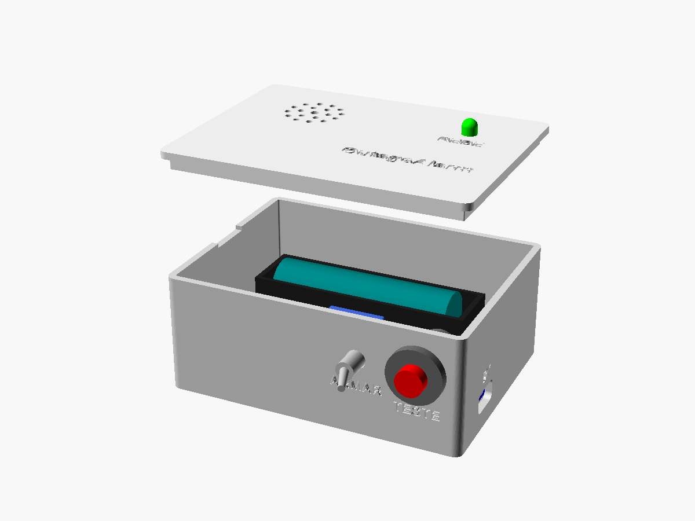
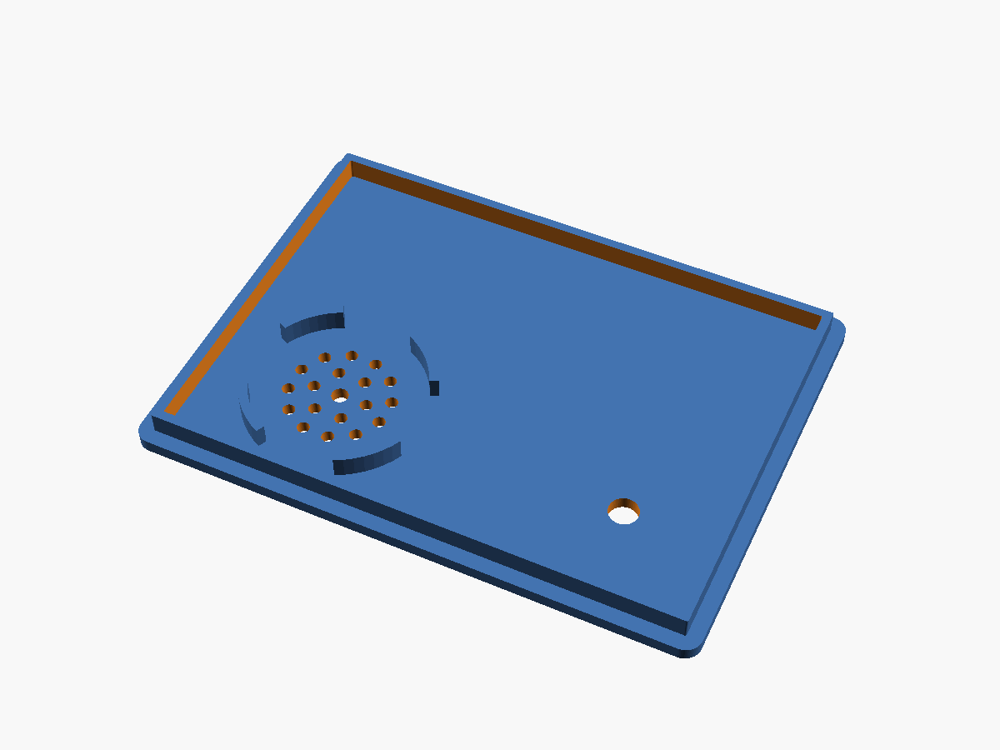

# Mecânica — OutageAlarm v1

A caixa tem duas peças impressas em 3D: a **base** e a **tampa de encaixe** (fica presa por atrito, sem parafusos). O modelo é paramétrico, em OpenSCAD: [`hardware/mecanica/caixa.scad`](../hardware/mecanica/caixa.scad).

| Montada | Explodida |
|---------|-----------|
|  |  |

| Traseira (USB-C) | Base por dentro | Tampa por baixo |
|------------------|-----------------|-----------------|
|  |  |  |

## Dimensões

- **Externas:** 94,8 × 70,8 × 40,4 mm (L × P × A). A base tem 38 mm de altura e a placa da tampa 2,4 mm.
- **Internas:** 90 × 66 × 36 mm.
- **Paredes:** 2,4 mm. **Fundo:** 2 mm.

## O que fica onde

Coordenadas a partir do canto interno frontal-esquerdo, sobre o fundo (X para a direita, Y para trás, Z para cima).

| Item | Onde | Como fica preso |
|------|------|-----------------|
| Bateria 9 V | deitada no canto esquerdo (X 0–27, Y 0–49), clip para trás | nervura lateral de 10 mm + fita dupla-face de espuma |
| Placa perfurada 4 × 6 cm | lado direito (X 48–88, Y 3–63), 5 mm acima do fundo | 4 espaçadores + parafusos M2 × 6 autoatarraxantes |
| USB-C (J1) | parede traseira, X = 38, centro a 9 mm do fundo | berço com duas guias em "L" + cola quente |
| Chave ARMAR (SW1) | parede frontal, X = 68, centro a 24 mm do fundo | porca da própria chave (furo de 6,4 mm) |
| LED REDE | tampa, sobre a placa (X 68, Y 50) | entra por baixo; a aba do LED trava na tampa + cola quente |
| Buzzer SFM-27 | tampa, sobre a bateria (X 18,5, Y 26) | anel centralizador de 4 segmentos + cola quente ou epóxi |

Gravados na peça: "OutageAlarm" e "REDE" na tampa, "ARMAR" abaixo da chave e "5V" acima do USB-C. Na borda esquerda há um entalhe para abrir a tampa com a unha.

### Folgas conferidas

- Fundo do buzzer a 21 mm do fundo da caixa, topo da bateria a 17,5 mm: sobram 3,5 mm.
- Corpo da chave vai até ≈ 30,6 mm de altura; a aba da tampa começa em 32 mm.
- O anel do buzzer fica a 1,3 mm da aba da tampa. Os vãos do anel (frente/trás) deixam passar as orelhas de fixação do SFM-27.
- As guias do USB-C ficam a 0,65 mm da borda da placa perfurada.
- O corpo da chave invade os ~18 mm da frente da placa. Por isso o relé vai na metade de trás (veja [eletronica.md](eletronica.md)).

## Impressão

| Configuração | Valor |
|--------------|-------|
| Material | PLA (ou PETG, se ficar num lugar quente) |
| Altura de camada | 0,2 mm |
| Paredes | 3 linhas ou mais |
| Preenchimento | 15–20 % |
| Suporte | **não precisa** |
| Aderência | saia (skirt) ou borda (brim) |

- **Base:** imprima com o fundo na mesa. O furo da chave e a abertura do USB-C são horizontais e pequenos o bastante para sair sem suporte.
- **Tampa:** o STL já sai virado, com o topo na mesa. O texto gravado sai na primeira camada e a aba de encaixe fica para cima.

## Ajustes no OpenSCAD

Abra o `caixa.scad` no OpenSCAD e use **Janela → Customizer**. Os parâmetros que você mais provavelmente vai mexer:

| Parâmetro | Padrão | Quando mudar |
|-----------|--------|--------------|
| `folga` | 0,25 mm | tampa muito justa (aumente para 0,3–0,35) ou frouxa (diminua) |
| `pcb_furo_margem` | 2,0 mm | meça do centro do furo da sua placa até a borda |
| `buzzer_d` | 30 mm | o SFM-27 varia entre 29 e 30 mm conforme o fabricante |
| `usb_pcb` | [15, 21] mm | tamanho da sua plaquinha USB-C (largura, comprimento) |
| `usb_z` | 9 mm | altura do centro do conector, se a sua plaquinha for diferente |
| `chave_d` | 6,4 mm | furo da chave (MTS-101 = rosca M6) |
| `parte` | `montagem` | `base` ou `tampa` para exportar; `explodida` para visualizar |

### Exportar os STLs

```
cd hardware/mecanica
openscad -o stl/caixa_base.stl  -D "parte=\"base\""  caixa.scad
openscad -o stl/caixa_tampa.stl -D "parte=\"tampa\"" caixa.scad
```

Sem o OpenSCAD instalado: a cada push que altera `hardware/mecanica/`, o GitHub Actions ([render-caixa.yml](../.github/workflows/render-caixa.yml)) gera os STLs e as imagens e publica tudo no artefato **caixa-render** da execução.

## Montagem

Material extra: 4 parafusos M2 × 6 autoatarraxantes, cola quente, fita dupla-face de espuma e, se quiser, 4 pés de borracha.

1. **Teste o encaixe da tampa** antes de montar qualquer coisa. Se precisar, ajuste `folga` e reimprima a tampa.
2. **Chave ARMAR:** tire a porca, passe a rosca pelo furo de dentro para fora e aperte a porca por fora.
3. **USB-C:** deslize a plaquinha entre as guias com o conector encostado na abertura. Ligue um cabo e confirme que o plugue entra até o fim. Só então fixe com cola quente nas guias.
4. **Placa perfurada:** já soldada, prenda nos espaçadores com os 4 parafusos M2.
5. **Bateria:** deite-a no canto esquerdo, entre a parede e a nervura, com o clip para trás. Prenda com fita dupla-face.
6. **Tampa:**
   - LED: empurre por baixo até a aba encostar e prenda com uma gota de cola quente.
   - Buzzer: encoste a face do som na tampa, dentro do anel, com as orelhas de fixação alinhadas na direção frente–trás (nos vãos do anel). Prenda com cola quente ou epóxi ao redor.
7. Deixe os fios do LED e do buzzer com folga (cerca de 15 cm) para conseguir abrir a tampa e trocar a bateria.
8. Faça o teste do [README](../README.md#teste) e encaixe a tampa.
