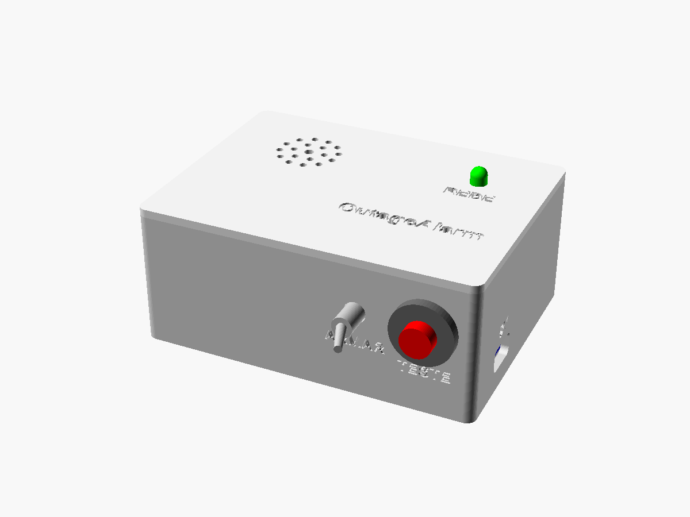
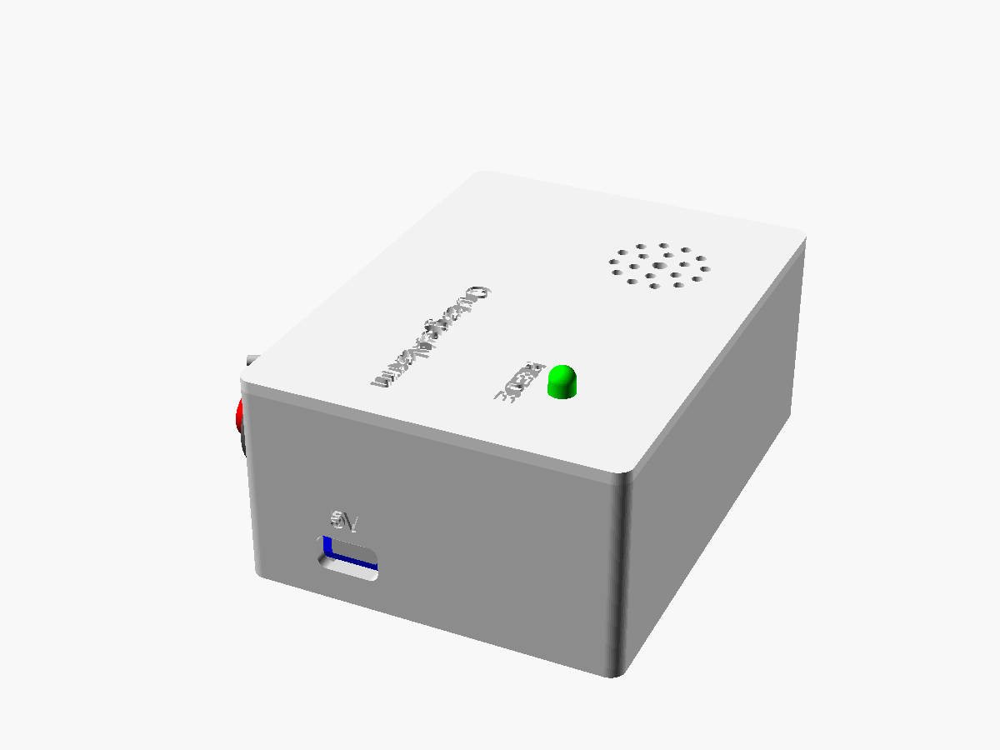
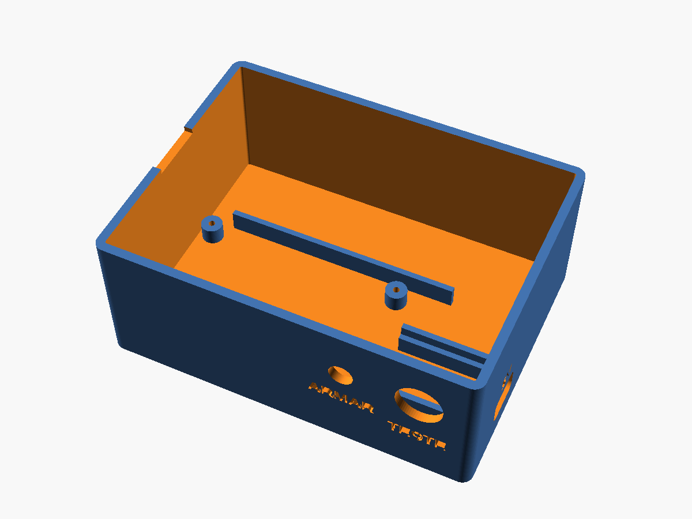

# Mecânica — OutageAlarm v1

A caixa tem duas peças impressas em 3D: a **base** e a **tampa de encaixe** (fica presa por atrito, sem parafusos). O modelo é paramétrico, em OpenSCAD: [`hardware/mecanica/caixa.scad`](../hardware/mecanica/caixa.scad).

| Montada | Explodida |
|---------|-----------|
|  |  |

| Lateral (USB-C) | Base por dentro | Tampa por baixo |
|-----------------|-----------------|-----------------|
|  |  |  |

## Dimensões

- **Externas:** 100,8 × 74,8 × 42,4 mm (L × P × A). A base tem 40 mm de altura e a placa da tampa 2,4 mm.
- **Internas:** 96 × 70 × 38 mm.
- **Paredes:** 2,4 mm. **Fundo:** 2 mm.

## O que fica onde

Coordenadas a partir do canto interno frontal-esquerdo, sobre o fundo (X para a direita, Y para trás, Z para cima).

| Item | Onde | Como fica preso |
|------|------|-----------------|
| Suporte 18650 (BT1) | encostado na parede traseira (X 2–80, Y 47,5–70) | nervura frontal de 6 mm + fita dupla-face de espuma |
| Placa perfurada 6 × 4 cm | frente à esquerda (X 2–62, Y 3–43), 5 mm acima do fundo | 4 espaçadores + parafusos M2 × 6 autoatarraxantes |
| Módulo TP4056 (U1) | parede direita, centro em Y = 19; USB-C a 8 mm do fundo | berço com duas guias em "L" + cola quente |
| Chave ARMAR (SW1) | parede frontal, X = 64, centro a 24 mm do fundo | porca da própria chave (furo de 6,4 mm) |
| Botão TESTE (SW2) | parede frontal, X = 84, centro a 24 mm do fundo | porca do próprio botão (furo de 12,2 mm) |
| LED REDE | tampa (X 78, Y 52) | entra por baixo; a aba do LED trava na tampa + cola quente |
| Buzzer SFM-27 | tampa, sobre o suporte da bateria (X 25, Y 50) | anel centralizador de 4 segmentos + cola quente ou epóxi |

Gravados na peça: "OutageAlarm" e "REDE" na tampa, "ARMAR" e "TESTE" abaixo da chave e do botão, "5V" acima do USB-C. Na borda esquerda há um entalhe para abrir a tampa com a unha.

### Folgas conferidas

- Fundo do buzzer a 23 mm do fundo da caixa, topo do suporte da bateria a 21 mm: sobram 2 mm.
- Corpos da chave e do botão vão até ≈ 30,6 mm de altura; a aba da tampa começa em 34 mm.
- O anel do buzzer fica a 1,25 mm da aba da tampa. Os vãos do anel deixam passar as orelhas de fixação do SFM-27 (alinhe as orelhas da esquerda para a direita).
- As guias do TP4056 começam em X = 67; a placa perfurada termina em X = 62.
- O relé fica na metade direita da placa, fora da área sob o buzzer (veja [eletronica.md](eletronica.md#montagem)).
- A nervura do suporte (Y = 45,9) fica a 1,9 mm dos espaçadores da placa.

## Impressão

| Configuração | Valor |
|--------------|-------|
| Material | PLA (ou PETG, se ficar num lugar quente) |
| Altura de camada | 0,2 mm |
| Paredes | 3 linhas ou mais |
| Preenchimento | 15–20 % |
| Suporte | **não precisa** |
| Aderência | saia (skirt) ou borda (brim) |

- **Base:** imprima com o fundo na mesa. Os furos da frente e a abertura do USB-C são horizontais e saem sem suporte (o furo de 12 mm pode ficar com o topo levemente caído; uma passada de lima resolve).
- **Tampa:** o STL já sai virado, com o topo na mesa. O texto gravado sai na primeira camada e a aba de encaixe fica para cima.

## Ajustes no OpenSCAD

Abra o `caixa.scad` no OpenSCAD e use **Janela → Customizer**. Os parâmetros que você mais provavelmente vai mexer:

| Parâmetro | Padrão | Quando mudar |
|-----------|--------|--------------|
| `folga` | 0,25 mm | tampa muito justa (aumente para 0,3–0,35) ou frouxa (diminua) |
| `sup_x`, `sup_y`, `sup_z` | 78 × 22 × 21 mm | tamanho do seu suporte de 18650 |
| `pcb_furo_margem` | 2,0 mm | meça do centro do furo da sua placa até a borda |
| `tp_pcb` | [29, 17,4] mm | tamanho do seu módulo TP4056 (comprimento, largura) |
| `tp_z` | 8 mm | altura do centro do conector, se o seu módulo for diferente |
| `buzzer_d` | 30 mm | o SFM-27 varia entre 29 e 30 mm conforme o fabricante |
| `chave_d`, `botao_d` | 6,4 / 12,2 mm | furos da chave e do botão |
| `parte` | `montagem` | `base` ou `tampa` para exportar; `explodida` para visualizar |

### Exportar os STLs

```
cd hardware/mecanica
openscad -o stl/caixa_base.stl  -D "parte=\"base\""  caixa.scad
openscad -o stl/caixa_tampa.stl -D "parte=\"tampa\"" caixa.scad
```

Sem o OpenSCAD instalado: a cada push que altera o `.scad`, o GitHub Actions ([render-caixa.yml](../.github/workflows/render-caixa.yml)) gera os STLs e as imagens e publica tudo no artefato **caixa-render** da execução.

## Montagem

Material extra: 4 parafusos M2 × 6 autoatarraxantes, cola quente, fita dupla-face de espuma e, se quiser, 4 pés de borracha.

1. **Teste o encaixe da tampa** antes de montar qualquer coisa. Se precisar, ajuste `folga` e reimprima a tampa.
2. **Chave ARMAR e botão TESTE:** tire as porcas, passe as roscas pelos furos de dentro para fora e aperte as porcas por fora.
3. **Módulo TP4056:** deslize o módulo entre as guias com o USB-C encostado na abertura. Ligue um cabo e confirme que o plugue entra até o fim. Só então fixe com cola quente nas guias.
4. **Placa perfurada:** já soldada, prenda nos espaçadores com os 4 parafusos M2.
5. **Suporte da bateria:** encoste-o na parede traseira, atrás da nervura, e prenda com fita dupla-face. Coloque a bateria só no fim, conferindo a polaridade.
6. **Tampa:**
   - LED: empurre por baixo até a aba encostar e prenda com uma gota de cola quente.
   - Buzzer: encoste a face do som na tampa, dentro do anel, com as orelhas de fixação alinhadas da esquerda para a direita (nos vãos do anel). Prenda com cola quente ou epóxi ao redor.
7. Deixe os fios do LED e do buzzer com folga (cerca de 15 cm) para conseguir abrir a tampa.
8. Faça o teste do [README](../README.md#teste) e encaixe a tampa.
