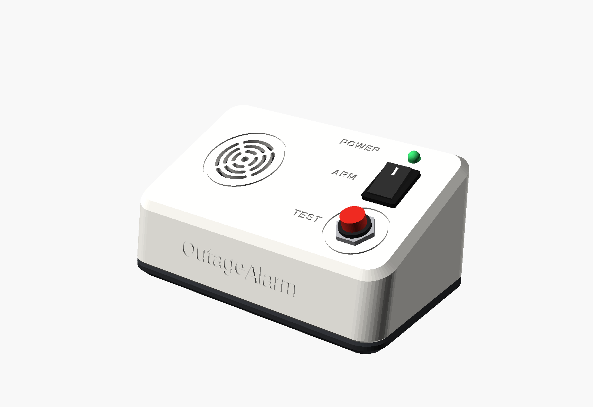
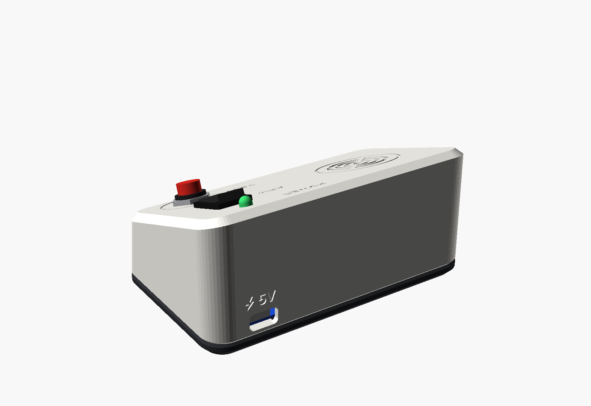
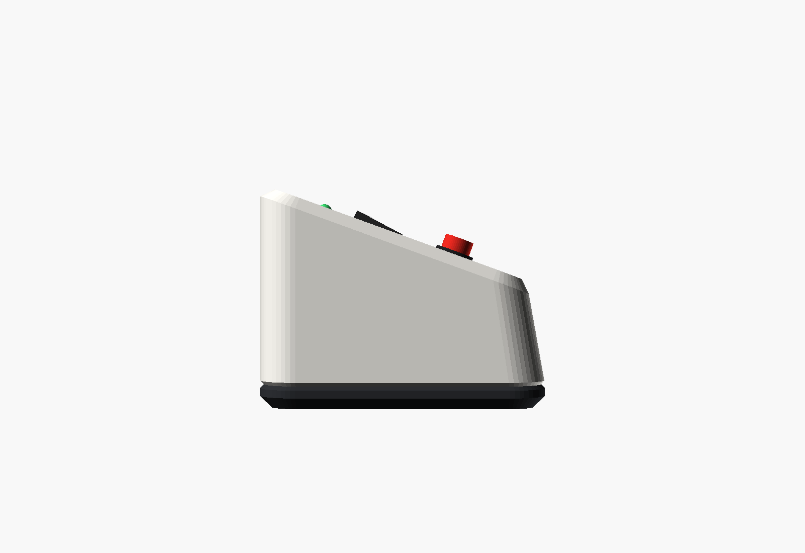
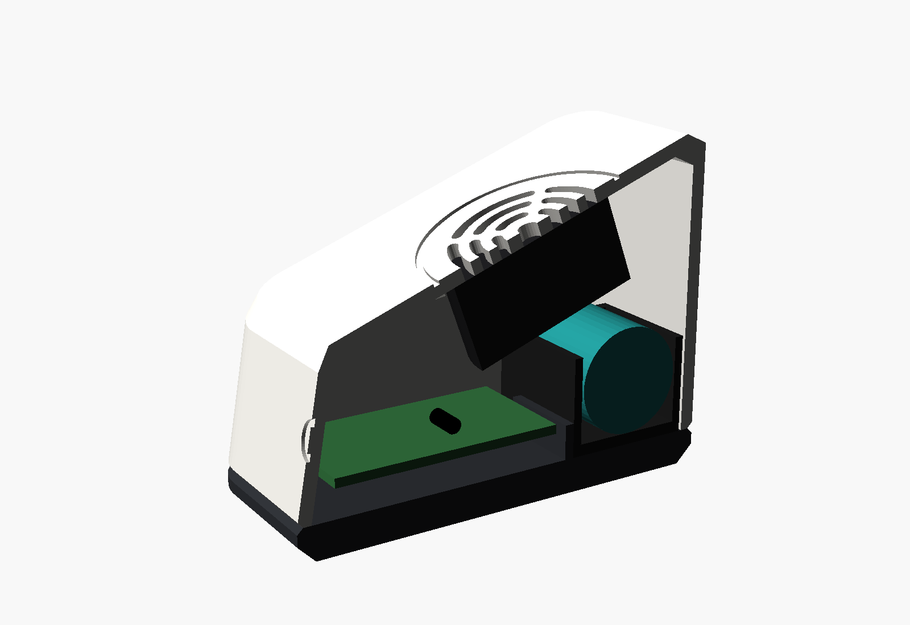
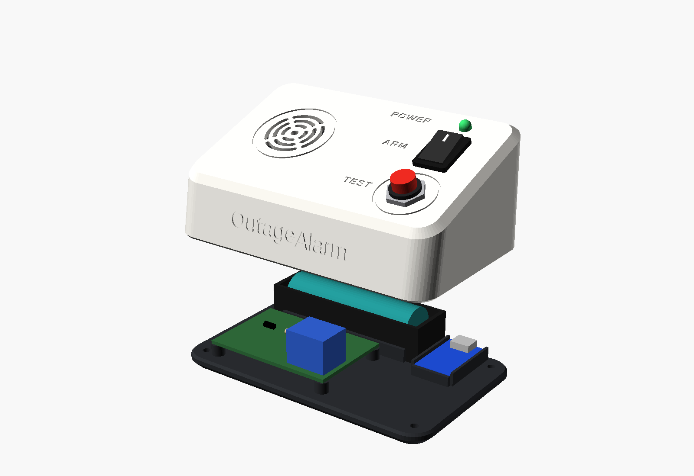
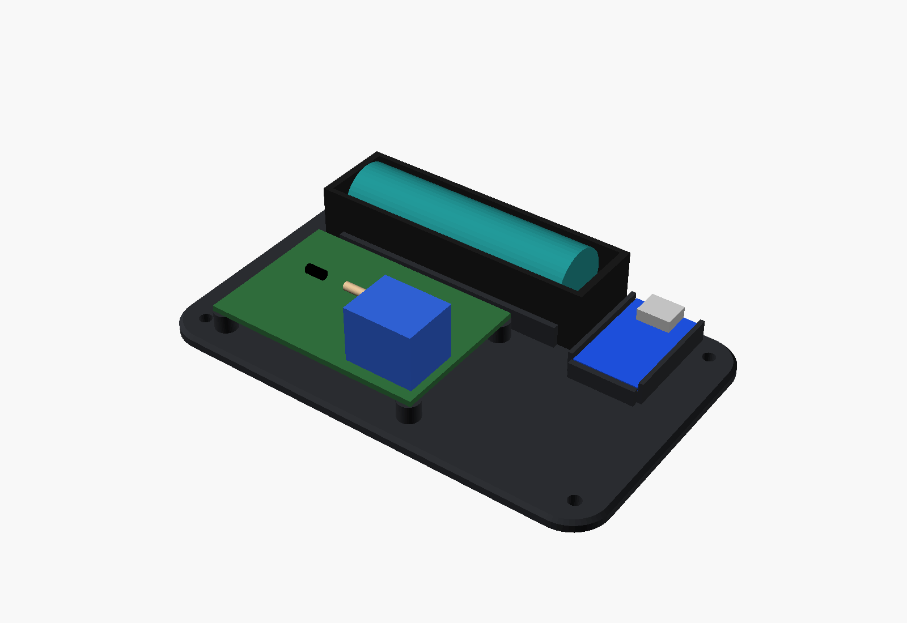
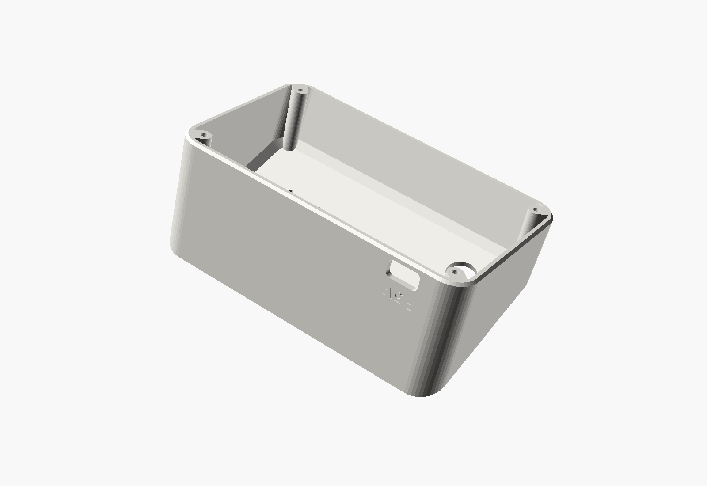
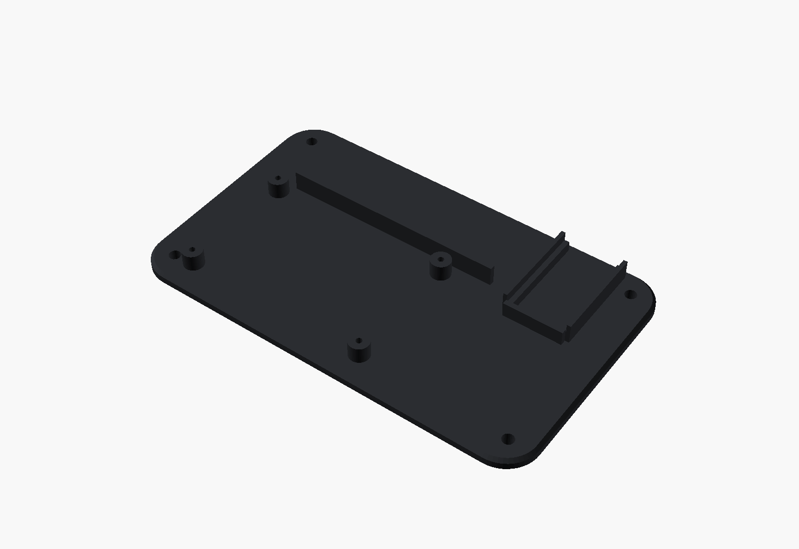

# Mechanical — OutageAlarm v1

The enclosure is a wedge. The control face tilts 20° toward you, so TEST, ARM and the POWER LED are easy to see and reach on a desk or shelf. The front leans back 10°. The white **shell** stands on a dark **base** whose undercut makes it look like it floats.

There are two printed parts, held together by 4 screws from below. The model is parametric, in OpenSCAD: [`hardware/mechanical/enclosure.scad`](../hardware/mechanical/enclosure.scad).



| Back (USB-C) | Profile |
|--------------|---------|
|  |  |

| Cutaway | Exploded |
|---------|----------|
|  |  |

| Inside, on the base | Shell, as printed | Base, as printed |
|---------------------|-------------------|------------------|
|  |  |  |

## Design

- **Wedge profile.** The face is tilted 20° and the front leans back 10°. The tall back holds the battery, and the buzzer hangs under the grille, where the face is high.
- **Floating base.** The base is dark, 6 mm thick, with a 45° undercut along its bottom edge. Its shadow separates the white shell from the table, and the chamfers on the shell and the base form a groove where they meet.
- **Clean face.** The face is printed on the bed, so it comes out flat and smooth. Everything on it is cut or engraved in the first layers: a slotted, round speaker grille with an engraved ring, a ring around TEST, and the labels.
- **No visible screws.** Four countersunk screws close the enclosure from below, into posts molded in the shell's corners.

## Dimensions

- **Outer:** 122.8 × 74.8 mm. Height: 33 mm at the front and 58.5 mm at the back, base included.
- **Inner:** 118 × 70 mm. The shell is 27 mm tall at the front.
- **Walls and face:** 2.4 mm. **Base:** 6 mm, with a 3 mm undercut.
- **Chamfer** around the face: 3 mm at 45°. Corner radius in top view: 10 mm.

## What goes where

Positions in top view (X to the right, Y to the back), measured from the inner front-left corner, on the top face of the base.

| Item | Where | How it's held |
|------|-------|---------------|
| 18650 holder (BT1) | against the back wall (X 8.8–86.8, Y 47.5–69.5) | rib in front of it + foam double-sided tape |
| 6 × 4 cm perfboard | front left (X 9.5–69.5, Y 4–44), 5 mm above the base | 4 standoffs + M2 × 6 self-tapping screws |
| Relay K1 | front-right corner of the perfboard | soldered to the board |
| TP4056 module (U1) | back right, centered at X = 98.3; USB-C through the back wall, 6 mm above the base | cradle with two L-shaped guides and an end stop + hot glue |
| SFM-27 buzzer (BZ1) | under the grille, at X 30, Y 38 | 4-segment centering ring + hot glue or epoxy |
| TEST button (SW2) | face, X 98, Y 19 | its own nut (12.2 mm hole) |
| ARM rocker switch (SW1) | face, X 98, Y 44 | snaps into a 19.2 × 12.9 mm cutout; the face is thinned to 2 mm around it so the clips catch |
| POWER LED (LED1) | face, X 98, Y 61 | inserted from below; its flange stops against the face + hot glue |
| Screw posts | the 4 inner corners | 4 × M3 × 12 countersunk self-tapping screws from below |

Engravings: "**Outage**Alarm" on the front (bold + regular); TEST, ARM and POWER on the face; a lightning bolt and "5V" above the USB-C opening.

### Checked clearances

The model checks these with `assert()`: if a change breaks one, OpenSCAD (and CI) stops with an error that names it.

- Buzzer above the 18650 holder (≥ 2 mm) and above the parts on the perfboard.
- Relay to the right of or in front of the buzzer, and clear of the leaning front wall.
- ARM switch body above the TP4056 module; TEST button body above the base.
- Holder, TP4056 cradle, perfboard and standoffs clear of the screw posts.
- Screw heads fully on the bottom face, inside the undercut.

## Printing

| Setting | Shell | Base |
|---------|-------|------|
| Material | PLA (or PETG for warm places), light color | PLA or PETG, black or graphite |
| Layer height | 0.2 mm | 0.2 mm |
| Walls | 3 lines or more | 3 lines or more |
| Infill | 15–20 % | 15–20 % |
| Supports | **not needed** | **not needed** |
| Orientation | already in the STL: control face on the bed | already in the STL: bottom on the bed |

- **Shell:** the face is the first layer, so it takes the texture of your bed: smooth PEI or glass gives a glossy face, textured PEI a matte one. The walls lean at most 30° and the face chamfer is exactly 45° in this orientation. Grille slots, holes and engravings form in the first layers.
- **Base:** prints flat. The undercut is 45°. The ribs, standoffs and the TP4056 cradle grow upward.
- **Two colors** give the intended look: a light shell (white, light gray) on a dark base. Any combination works.

## Customizing in OpenSCAD

Open `enclosure.scad` in OpenSCAD and use **Window → Customizer**. The parameters you're most likely to change:

| Parameter | Default | When to change |
|-----------|---------|----------------|
| `holder_x`, `holder_y`, `holder_z` | 78 × 22 × 21 mm | size of your 18650 holder |
| `pcb_hole_margin` | 2.0 mm | measure from your board's hole center to its edge |
| `chg_pcb` | [17.4, 29] mm | size of your TP4056 module (width, length) |
| `chg_z` | 6 mm | connector center height, if your module differs |
| `buzzer_d` | 30 mm | the SFM-27 varies between 29 and 30 mm by manufacturer |
| `rocker_cut` | [12.9, 19.2] mm | cutout of your rocker switch |
| `rocker_panel_t` | 2.0 mm | the switch's clips don't catch (thinner) or it rattles (thicker) |
| `test_d` | 12.2 mm | hole for your TEST button |
| `slope`, `lean`, `front_h` | 20°, 10°, 27 mm | shape of the wedge; the clearance checks tell you if things stop fitting |
| `part` | `assembled` | `shell` or `base` to export; `exploded`, `cutaway` or `interior` to preview |

### Exporting the STLs

```
cd hardware/mechanical
openscad -o stl/enclosure_shell.stl -D "part=\"shell\"" enclosure.scad
openscad -o stl/enclosure_base.stl  -D "part=\"base\""  enclosure.scad
```

Without OpenSCAD installed: on every push that changes the `.scad`, GitHub Actions ([render-enclosure.yml](../.github/workflows/render-enclosure.yml)) renders the STLs and images and publishes them in the run's **enclosure-render** artifact.

## Assembly

Extra hardware: 4 × M2 × 6 self-tapping screws (perfboard), 4 × M3 × 12 countersunk self-tapping screws (enclosure; 2.9 × 13 mm also works), hot glue, foam double-sided tape and, optionally, 4 small rubber feet.

1. **Check the fit** of the rocker switch and the TEST button in the shell before wiring anything.
2. **Shell:**
   - ARM rocker: snap it in from the outside, with "I" toward the back.
   - TEST button: remove the nut, push the button through from the inside, and tighten the nut on the face.
   - LED: push it in from below until the flange seats, and fix it with a dab of hot glue.
   - Buzzer: place its sound face against the face, inside the ring, and fix it with hot glue or epoxy around it.
3. **Base:**
   - TP4056 module: slide it into the cradle with the USB-C toward the back edge, against the end stop. Fix it with hot glue on the guides.
   - Perfboard, already soldered: screw it onto the standoffs with the 4 M2 screws.
   - Battery holder: against the back edge, behind the rib, with double-sided tape. Insert the cell last, checking the polarity.
4. Wire everything per [electronics.md](electronics.md). Give the wires to the shell parts about 15 cm, so the shell can lie next to the base while you work.
5. Run the [README](../README.md#test) test.
6. **Close:** fold the wires in, set the shell on the base, check that a USB-C cable plugs in fully through the back, and drive the 4 M3 screws from below.
