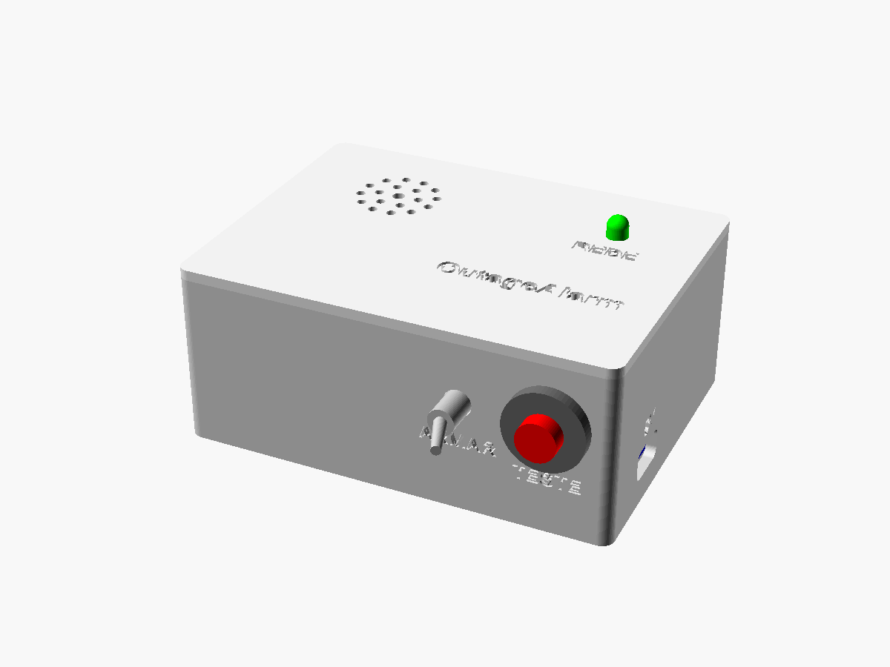
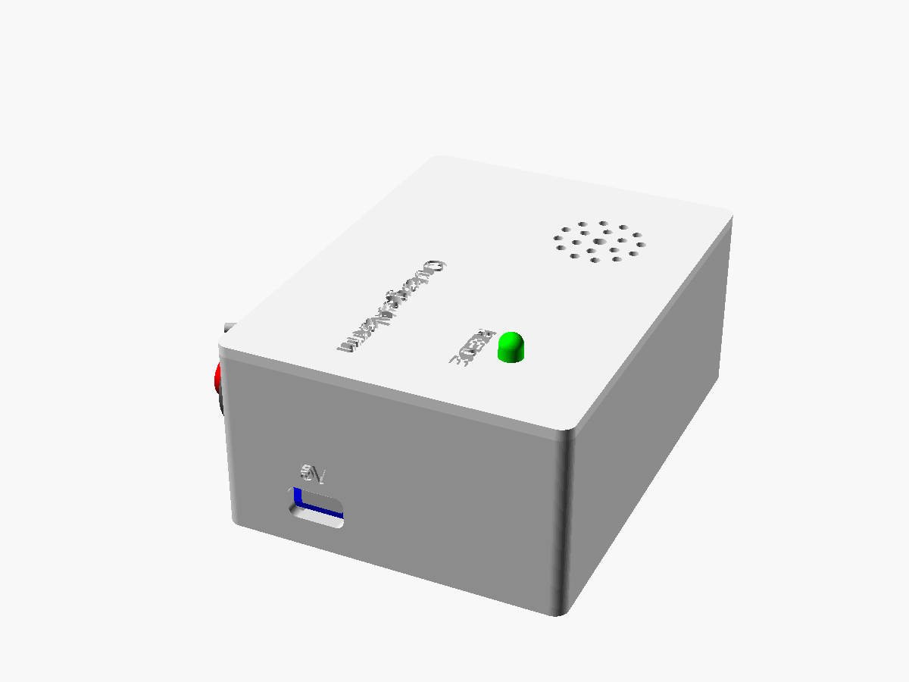
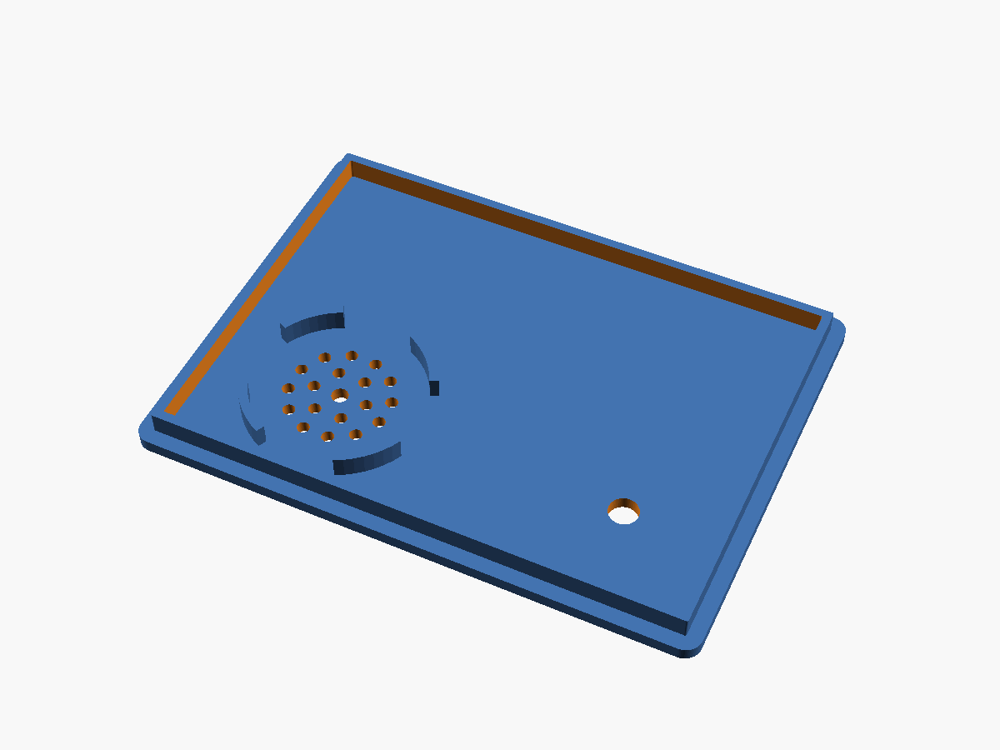

# Mechanical — OutageAlarm v1

The enclosure has two 3D-printed parts: the **base** and a **press-fit lid** (held by friction, no screws). The model is parametric, in OpenSCAD: [`hardware/mechanical/enclosure.scad`](../hardware/mechanical/enclosure.scad).

| Assembled | Exploded |
|-----------|----------|
|  |  |

| Side (USB-C) | Base interior | Lid underside |
|--------------|---------------|---------------|
|  |  |  |

## Dimensions

- **Outer:** 100.8 × 74.8 × 42.4 mm (W × D × H). The base is 40 mm tall and the lid plate is 2.4 mm.
- **Inner:** 96 × 70 × 38 mm.
- **Walls:** 2.4 mm. **Floor:** 2 mm.

## What goes where

Coordinates from the inner front-left corner, on top of the floor (X to the right, Y to the back, Z up).

| Item | Where | How it's held |
|------|-------|---------------|
| 18650 holder (BT1) | against the back wall (X 2–80, Y 47.5–70) | 6 mm front rib + foam double-sided tape |
| 6 × 4 cm perfboard | front left (X 2–62, Y 3–43), 5 mm above the floor | 4 standoffs + M2 × 6 self-tapping screws |
| TP4056 module (U1) | right wall, centered at Y = 19; USB-C 8 mm above the floor | cradle with two L-shaped guides + hot glue |
| ARM switch (SW1) | front wall, X = 64, center 24 mm above the floor | the switch's own nut (6.4 mm hole) |
| TEST button (SW2) | front wall, X = 84, center 24 mm above the floor | the button's own nut (12.2 mm hole) |
| POWER LED | lid (X 78, Y 52) | inserted from below; the LED flange stops against the lid + hot glue |
| SFM-27 buzzer | lid, above the battery holder (X 25, Y 50) | 4-segment centering ring + hot glue or epoxy |

Engraved on the parts: "OutageAlarm" and "POWER" on the lid, "ARM" and "TEST" below the switch and button, "5V" above the USB-C opening. The left rim has a notch to pry the lid open with a fingernail.

### Checked clearances

- Buzzer bottom 23 mm above the floor, battery holder top at 21 mm: 2 mm to spare.
- Switch and button bodies reach ≈ 30.6 mm high; the lid lip starts at 34 mm.
- The buzzer ring is 1.25 mm from the lid lip. The gaps in the ring let the SFM-27 mounting ears through (align the ears left to right).
- The TP4056 guides start at X = 67; the perfboard ends at X = 62.
- The relay sits on the right half of the board, outside the area under the buzzer (see [electronics.md](electronics.md#assembly)).
- The holder rib (Y = 45.9) is 1.9 mm behind the perfboard standoffs.

## Printing

| Setting | Value |
|---------|-------|
| Material | PLA (or PETG for warm locations) |
| Layer height | 0.2 mm |
| Walls | 3 lines or more |
| Infill | 15–20 % |
| Supports | **not needed** |
| Adhesion | skirt or brim |

- **Base:** print with the floor on the bed. The front holes and the USB-C opening are horizontal and print without supports (the top of the 12 mm hole may sag slightly; a file cleans it up).
- **Lid:** the STL is already flipped, top face on the bed. The engraved text prints in the first layer and the press-fit lip faces up.

## Customizing in OpenSCAD

Open `enclosure.scad` in OpenSCAD and use **Window → Customizer**. The parameters you're most likely to change:

| Parameter | Default | When to change |
|-----------|---------|----------------|
| `clearance` | 0.25 mm | lid too tight (increase to 0.3–0.35) or too loose (decrease) |
| `holder_x`, `holder_y`, `holder_z` | 78 × 22 × 21 mm | size of your 18650 holder |
| `pcb_hole_margin` | 2.0 mm | measure from your board's hole center to its edge |
| `chg_pcb` | [29, 17.4] mm | size of your TP4056 module (length, width) |
| `chg_z` | 8 mm | connector center height, if your module differs |
| `buzzer_d` | 30 mm | the SFM-27 varies between 29 and 30 mm by manufacturer |
| `switch_d`, `button_d` | 6.4 / 12.2 mm | switch and button holes |
| `part` | `assembled` | `base` or `lid` to export; `exploded` to preview |

### Exporting the STLs

```
cd hardware/mechanical
openscad -o stl/enclosure_base.stl -D "part=\"base\"" enclosure.scad
openscad -o stl/enclosure_lid.stl  -D "part=\"lid\""  enclosure.scad
```

Without OpenSCAD installed: on every push that changes the `.scad`, GitHub Actions ([render-enclosure.yml](../.github/workflows/render-enclosure.yml)) renders the STLs and images and publishes them in the run's **enclosure-render** artifact.

## Assembly

Extra hardware: 4 × M2 × 6 self-tapping screws, hot glue, foam double-sided tape and, optionally, 4 rubber feet.

1. **Test the lid fit** before assembling anything. If needed, adjust `clearance` and reprint the lid.
2. **ARM switch and TEST button:** remove the nuts, push the bushings through the holes from the inside, and tighten the nuts on the outside.
3. **TP4056 module:** slide the module between the guides with the USB-C connector against the opening. Plug in a cable and make sure the plug seats fully. Only then fix it with hot glue on the guides.
4. **Perfboard:** already soldered, screw it onto the standoffs with the 4 M2 screws.
5. **Battery holder:** place it against the back wall, behind the rib, and fix it with double-sided tape. Insert the cell last, checking the polarity.
6. **Lid:**
   - LED: push it in from below until the flange seats, and fix it with a dab of hot glue.
   - Buzzer: place the sound face against the lid, inside the ring, with the mounting ears aligned left to right (in the ring gaps). Fix it with hot glue or epoxy around it.
7. Leave slack in the LED and buzzer wires (about 15 cm) so the lid can be opened.
8. Run the [README](../README.md#test) test and press the lid on.
