# Mechanical — OutageAlarm v1

The enclosure is a wedge. The control face tilts 20° toward you, so TEST, ARM and the POWER LED are easy to see and reach on a desk or shelf. The front leans back 10°. The **shell** stands on a darker **base** whose undercut makes it look like it floats.

It follows the house style of the other 3DTesla kits:
- a **graphite body** with its corners cut at 45°;
- **white armor plates** with cut corners on the face, the front and the back;
- a **mech-style livery** in house yellow, like the markings on anime mechs, inlaid flush in the plates in a second filament.

A one-colour version of the plates, with only the labels engraved, is available too.

There are six printed parts:
- the **top**: the control face and its chamfer;
- the **sides**: the walls and the screw posts;
- the **base**;
- three **armor plates**: one on the face, one on the front, one on the back.

The top and the sides are glued together into the shell, which then screws onto the base from below. The plates are glued onto the shell. The shell and the base print in one colour; all the second colour is in the plates, which print together, face down, with the livery in their first 3 layers.

All the electronics sit on one perfboard that lies on the base, and the same screws clamp it.

The model is parametric, in OpenSCAD: [`hardware/mechanical/enclosure.scad`](../hardware/mechanical/enclosure.scad). The ready-to-print files are in [`hardware/mechanical/stl/`](../hardware/mechanical/stl/) and [`hardware/mechanical/3mf/`](../hardware/mechanical/3mf/). They are also attached to each [release](https://github.com/icefoxj/OutageAlarm/releases).

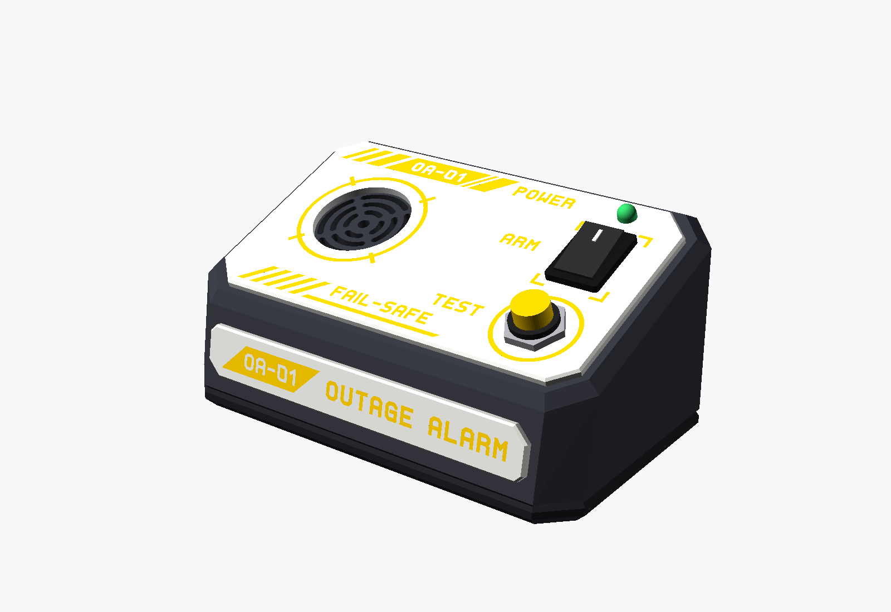

| Face, square on | Back (USB-C) |
|-----------------|--------------|
| 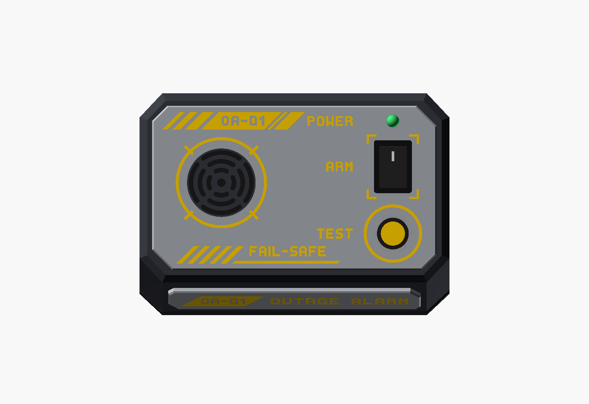 | 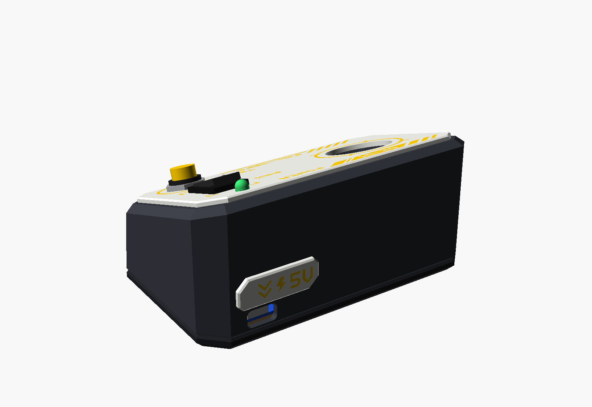 |

| Cutaway | Exploded |
|---------|----------|
| 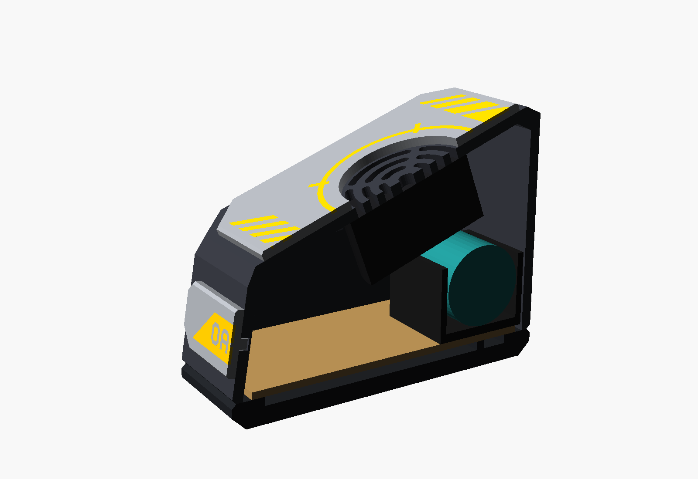 | 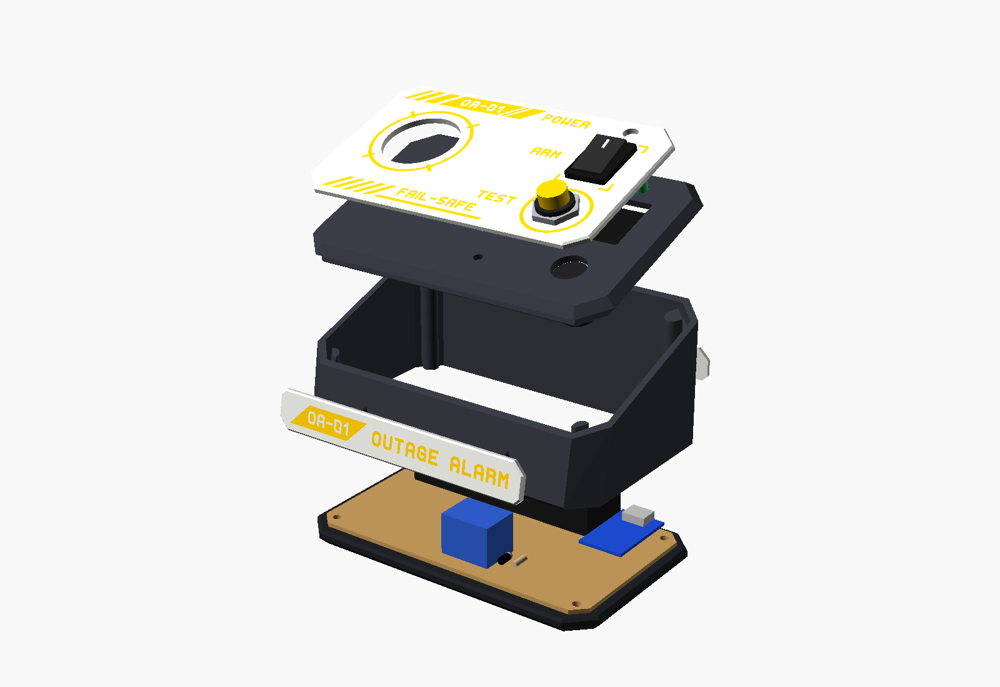 |

| Profile | Inside: the perfboard on the base |
|---------|---------------------|
| 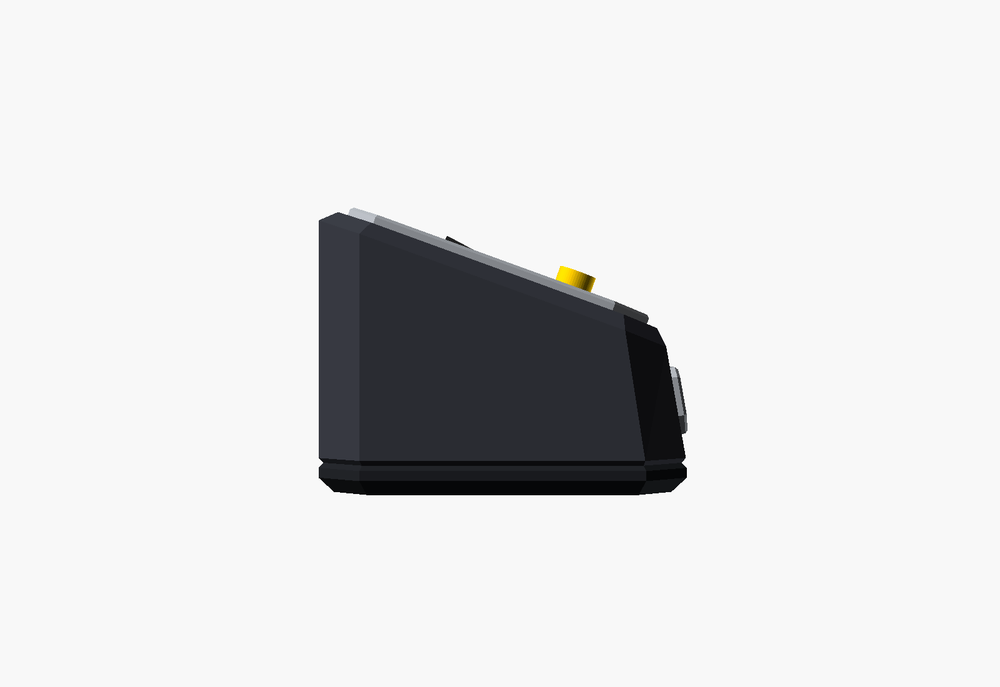 | 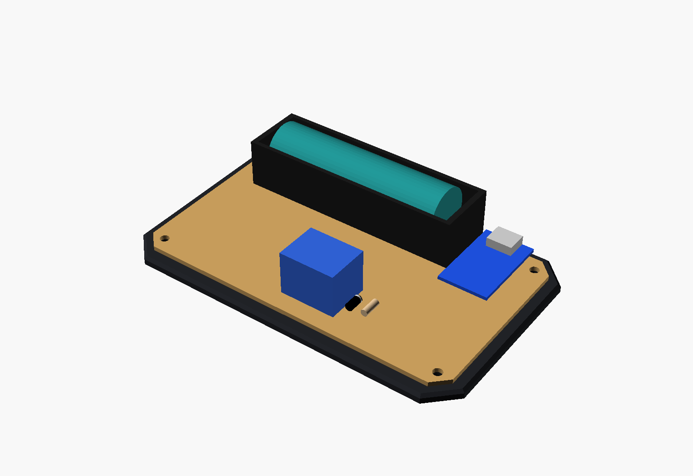 |

| Top, as printed | Sides, as printed | Base, as printed |
|-----------------|-------------------|------------------|
| 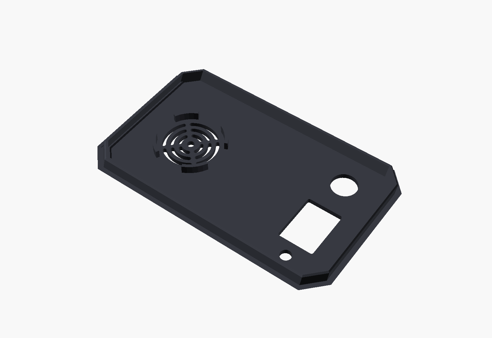 | 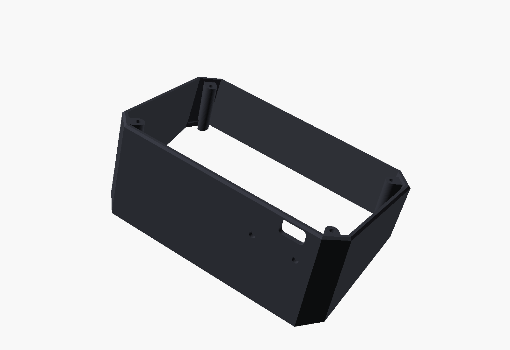 | 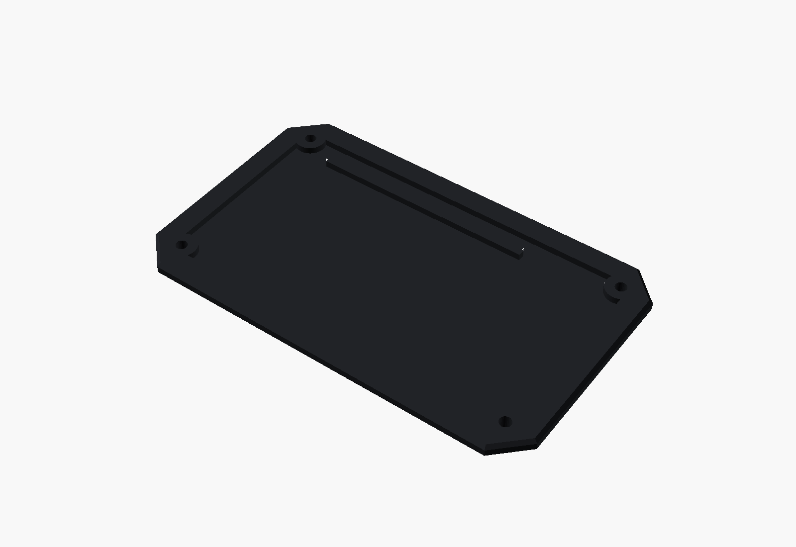 |

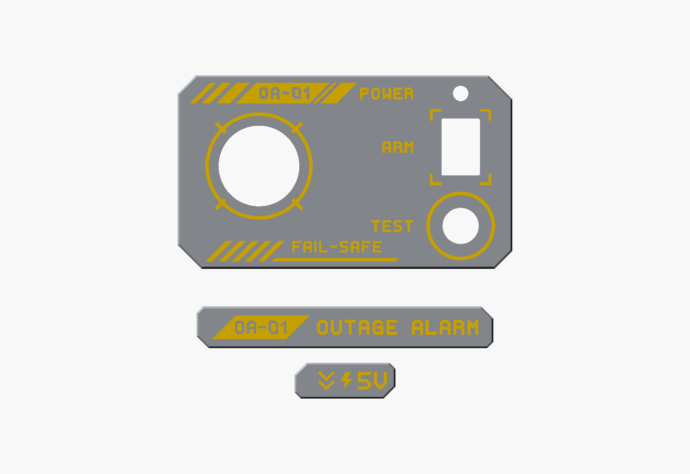

*The three armor plates, visible face up. They print face down.*

## Design

- **Wedge profile.** The face is tilted 20° and the front leans back 10°. The tall back holds the battery, and the buzzer hangs under the grille, where the face is high.
- **45° corners.** In top view, the corners of the shell and the base are cut at 45° (9 mm), like the bodies of the other kits.
- **Floating base.** The base is a darker graphite, 6 mm thick, with a 45° undercut along its bottom edge. Its shadow separates the shell from the table, and the chamfers on the shell and the base form a groove where they meet.
- **Armor plates.** Three flat white plates, 2 mm thick, with their corners cut at 45° and a 0.6 mm chamfer around the visible face. They stand 2 mm proud of the graphite body, which frames them. Each one is glued on and located by two pegs in blind holes, so it goes on in exactly one place.
  - **Face plate:** almost the whole face. It has a round window over the speaker grille, so the graphite grille shows through it, and the holes for TEST, ARM and POWER.
  - **Front plate:** the title band with "OA-01" knocked out, and "OUTAGE ALARM".
  - **Back plate:** over the USB-C, with chevrons pointing at it, a lightning bolt and "5V".
- **Mech livery.** It is made of straight lines and 45° cuts, in house yellow:
  - **Title band** at the back of the face: speed dashes, then a band with the unit code "OA-01" knocked out of it, two panel breaks and a 45° end.
  - **Reticle** around the grille window: a ring crossed by four ticks at 45°.
  - **Hazard stripes** at the front left, then a rule with "FAIL-SAFE" over it. The alarm sounds whenever the 5 V is lost.
  - A **ring around TEST**, **corner brackets** around ARM, and the labels TEST, ARM and POWER.
  - All the lettering uses a chamfered, straight-line stroke font, the same as on the other kits, drawn in the model (`mech_glyphs`).
- **Hidden seam.** The top and the sides meet along the crease under the face chamfer, so the joint is part of an edge the shell already has.
- **No visible screws.** Four countersunk screws close the enclosure from below, into posts molded in the corners of the sides.
- **One board, no standoffs.** The perfboard covers the floor. On their way up, the four screws pass through its corners, and the posts press it onto the base. Its solder side sits over a shallow pocket.

## Dimensions

- **Outer:** 122.8 × 74.8 mm. Height: 33 mm at the front and 58.5 mm at the back, base included, plus the plates.
- **Inner:** 118 × 70 mm. The shell is 27 mm tall at the front.
- **Walls and face:** 2.4 mm. **Base:** 6 mm, with a 3 mm undercut.
- **Chamfer** around the face: 3 mm at 45°. Corners in top view: cut at 45°, 9 mm.
- **Armor plates:** 2 mm thick, 0.6 mm edge chamfer. Two pegs each, 3 mm × 1.6 mm, into blind holes 3.3 mm × 1.9 mm in the shell.
  - Face plate: 112.8 × 65.2 mm on the face, 2 mm in from the face's flat part. Corners cut 8, 6, 8 and 6 mm (front left, front right, back right, back left).
  - Front plate: 100 × 14 mm, centered on the front wall.
  - Back plate: 34 × 12 mm, over the USB-C opening.
- **Inlay / engraving depth:** 0.6 mm.
- **Perfboard:** 114.3 × 66.0 mm (45 × 26 hole spacings), 1.6 mm thick, corners cut at 45°.
  - The base's pocket under it is 2 mm deep.
  - A 3 mm rim under the outer row of holes carries it, with a pad around each screw and a rib under the 18650 holder.
- **Joint:**
  - Lip: 4 mm high and 1.6 mm thick.
  - Glue gap: 0.15 mm per side.
  - Seam: 3 mm under the face, square to it.

## What goes where

Positions in top view (X to the right, Y to the back), measured from the inner front-left corner, on the top face of the base.

| Item | Where | How it's held |
|------|-------|---------------|
| Perfboard | the whole floor, inside the walls (X 1.85–116.15, Y 1.98–68.02), on the base | clamped by the 4 screw posts; the shell screws pass through it |
| 18650 holder (BT1) | on the board, against the back wall (X 10.5–88.5, Y 47.5–69.5) | thin double-sided tape |
| Relay K1, D1, R1 | front middle of the board (relay at X 53.8–73.4, Y 8.3–23.7) | soldered to the board ([layout](../hardware/electronics/perfboard.svg)) |
| TP4056 module (U1) | on the board, back right, centered at X = 98.3; USB-C through the back wall, 5.4 mm above the base | 1 mm double-sided foam tape |
| SFM-27 buzzer (BZ1) | under the grille, at X 30, Y 38 | 4-segment centering ring + hot glue or epoxy |
| TEST button (SW2) | face, X 98, Y 19 | its own nut, through the face plate and the face (12.2 mm hole, 4.4 mm thick) |
| ARM rocker switch (SW1) | face, X 98, Y 44 | snaps into a 19.2 × 12.9 mm cutout in the face plate. The face is cut away 1 mm wider under it, so the clips catch under the 2 mm plate |
| POWER LED (LED1) | face, X 98, Y 61 | inserted from below through the face and the plate; its flange stops against the face + hot glue |
| Screw posts | the 4 inner corners (X 6.9 and 111.1, Y 7.1 and 62.9), part of the sides, from the board up to the seam | 4 × M3 × 16 countersunk self-tapping screws from below, through the base and the board |
| Top | on the sides, its lip inside the walls | glued (see [Joint](#joint-between-the-top-and-the-sides)) |
| Armor plates | on the face, the front wall and the back wall | glued, located by two pegs each |

**Marks on both versions of the plates:**
- TEST, ARM and POWER on the face plate;
- the rings around the grille and around TEST;
- "OUTAGE ALARM" on the front plate;
- a lightning bolt and "5V" on the back plate.

The one-colour plates have them engraved 0.6 mm deep. The two-colour ones have them inlaid, along with the rest of the livery. The shell itself carries no marks.

### Checked clearances

The model checks these with `assert()`: if a change breaks one, OpenSCAD (and CI) stops with an error that names it.

- Buzzer above the 18650 holder (≥ 2 mm) and above the parts on the perfboard.
- Relay to the right of or in front of the buzzer, and clear of the leaning front wall and of D1.
- ARM switch body above the TP4056 module; TEST button body above the perfboard, and no part under it.
- Holder and TP4056 module clear of the screw posts and of each other.
- The perfboard:
  - inside the walls, its cut corners clear of the shell's cut inner corners;
  - at least 1 mm of board between each screw hole and the cut corner;
  - its outer row of holes, and only that row, on the rim of the base's pocket.
- Screws long enough to bite 6 mm into the posts, and no longer than their pilot holes.
- Screw heads fully on the bottom face, inside the undercut.
- The top's lip:
  - clear of the relay, the 18650 holder, the buzzer and the ARM switch;
  - thick enough, with room for glue;
  - the buzzer ring stays on the top.
- The plates:
  - the face plate at least 1.5 mm inside the flat part of the face, and thin enough for the rocker's clips;
  - the front and back plates on the flat parts of their walls, clear of the corners;
  - the LED hole far enough from the plate's edge.
- Livery:
  - At least 1.8 mm from the plates' edges and corners, the grille window, the TEST ring, the brackets and the labels.
  - The TEST ring clear of the button's nut.
  - The unit code fits in its bands, the caption fits over its rule, and the wordmark fits on the front plate.
  - Strokes and gaps are wide enough to print.

## Printing

| Setting | Top | Sides | Base | Armor plates |
|---------|-----|-------|------|--------------|
| File, one colour | `stl/enclosure_top.stl` | `stl/enclosure_sides.stl` | `stl/enclosure_base.stl` | `stl/enclosure_plate_face.stl`, `_front.stl`, `_back.stl` |
| File, two colours | — | — | — | `3mf/enclosure_plates_2color.3mf` (all three) |
| Material | PLA (or PETG for warm places), graphite or black | same as the top | PLA or PETG, black or a darker graphite | PLA or PETG, white, + yellow for the livery |
| Layer height | 0.2 mm (first layer 0.2 mm too) | 0.2 mm | 0.2 mm | 0.2 mm (first layer 0.2 mm too) |
| Walls | 3 lines or more | 3 lines or more | 3 lines or more | 3 lines or more |
| Infill | 15–20 % | 15–20 % | 15–20 % | 100 % |
| Supports | **not needed** | **not needed** | **not needed** | **not needed** |
| Orientation (already in the file) | face on the bed | seam on the bed | bottom on the bed | visible face on the bed |
| Height as printed | 6.8 mm | 46 mm | 6 mm | 3.6 mm with the pegs |

- **Top:**
  - The face is the first layer, so it comes out flat: the face plate sits on it without gaps.
  - The chamfer is exactly 45° in this orientation, and the lip rises at 20° from vertical.
  - The grille slots and holes form in the first layers. The blind holes for the face plate's pegs open on the bed side.
- **Sides:**
  - They print upside down, standing on the seam. The surface that seats the top is the first layer, so it comes out flat and true, and the top sits on it without gaps.
  - The walls lean at most 30°.
  - The posts are bridged over the notches for the lip (2 mm).
  - The seam face is a 2.4 mm wide ring plus the post tops. Use a brim if your bed doesn't hold thin first layers well.
- **Base:** prints flat. The undercut is 45°. The pocket for the perfboard is on top, so it needs no support.
- **Armor plates:**
  - The visible face is the first layer, so it takes the texture of your bed: smooth PEI or glass gives a glossy face, textured PEI a matte one.
  - The edge chamfer is 45°, and the pegs grow upward from the back.
- **Colours:** the intended look is the house style of the kits: a graphite shell, a darker base, white plates and a yellow livery. Any combination works.

## Two-colour livery (3MF)

One 3MF holds the three armor plates with the livery inlaid, laid out side by side on the bed, so they print together. It needs a printer that changes filament within a layer: a multi-material unit such as Creality's CFS, Bambu's AMS or Prusa's MMU, or a printer with two extruders. The top, the sides and the base print in one colour on any printer.

| Object in [`enclosure_plates_2color.3mf`](../hardware/mechanical/3mf/enclosure_plates_2color.3mf) | Part | What it is | Filament | Two-colour layers at 0.2 mm |
|------|------|------------|----------|-----------------------------|
| OutageAlarm face plate | `face_plate` | the face plate, with the livery recessed 0.6 mm | 1: white | — |
| | `face_livery` | the whole livery and the labels on the face | 2: yellow | 3 (Z 0.0–0.6 mm) |
| OutageAlarm front plate | `front_plate` | the front plate, recessed | 1: white | — |
| | `front_livery` | the title band with "OA-01" and "OUTAGE ALARM" | 2: yellow | 3 (Z 0.0–0.6 mm) |
| OutageAlarm back plate | `back_plate` | the back plate, recessed | 1: white | — |
| | `back_livery` | the chevrons, the bolt and "5V" | 2: yellow | 3 (Z 0.0–0.6 mm) |

Each inlay fills its recess exactly and sits flush with the plate's face. Every inlay is in the same first 3 layers of a print 3.6 mm tall, so the whole livery costs **3 two-colour layers, about 6 filament changes**, and the prime tower stays short.

**Printing them (Creality Print; other slicers work the same way):**
1. Open the 3MF. It loads three objects, "OutageAlarm face plate", "front plate" and "back plate", each made of its plate and its livery, already in print orientation.
   - The file follows the basic 3MF spec: it stores white and yellow as the parts' display colours, but no filament assignments, and slicers may ignore those colours.
2. Give the plate parts your white filament and the livery parts your yellow one.
3. Use 0.2 mm layers with a 0.2 mm first layer, so the 0.6 mm inlay is exactly 3 layers. 0.15 mm or 0.12 mm also divide 0.6 mm.
4. Keep the prime tower on and print without supports.

**To print the plates in one colour,** use the three `stl/enclosure_plate_*.stl`: the labels, the rings, the wordmark and the "5V" come out engraved, without the decorative livery.

**Fine detail:** printed flat, the lettering has strokes of 0.8 mm or more, two lines of a 0.4 mm nozzle, so each stroke is whole in each of its 3 layers.

> **Not test-printed yet.** CI checks the 3MF before writing it: every mesh is closed and consistently oriented, each plate lies on the bed, and each inlay is exactly a 0.6 mm slab, so it never thins out over an edge, a chamfer or a hole. Watch the first layers.

## Joint between the top and the sides

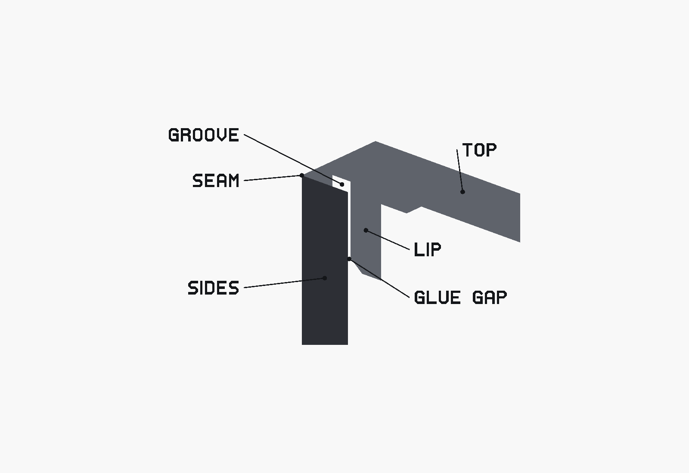

*Section through the back wall: the top in light graphite, the sides in graphite.*

- **Seam:** the top sits on the sides along the crease under the face chamfer. Seen from outside, the joint is just that edge.
- **Lip:** a lip under the top, 4 mm high and 1.6 mm thick, fits inside the walls all around. It locates the top precisely and carries the glue joint.
- **Glue gap:** there is 0.15 mm between the lip and the walls on each side (`glue_gap`). That is room for the glue film and for normal printing tolerance.
- **Lead-in:** a 0.6 mm chamfer on the lip's bottom edge helps it into the walls.
- **Groove:** a 0.8 × 0.6 mm groove in the top, over the inner edge of the walls, takes the glue pushed out of the joint, so it doesn't squeeze out of the seam.
- **Posts:** the screw posts reach up to the seam and are notched for the lip, so they also support the top in the corners.

**Gluing:**
1. Dry-fit first. The lip should slide in with light friction, and the seam should close all around.
   - If it's tight, sand the outside of the lip lightly, or reprint with `glue_gap` at 0.2–0.25 mm.
   - If it's loose, the glue fills up to about 0.3 mm.
2. Use **CA glue (gel)** or **5-minute epoxy**. For PETG, use epoxy, or CA with a primer.
3. Put a thin bead on the outside of the lip, near its root, and a few dots on the inner half of the walls' top edge. Keep the outer half of that edge dry.
4. Press the top on, check that the seam is closed all around, and hold it with tape or clamps until the glue sets.

## Customizing in OpenSCAD

Open `enclosure.scad` in OpenSCAD and use **Window → Customizer**. The parameters you're most likely to change:

| Parameter | Default | When to change |
|-----------|---------|----------------|
| `holder_x`, `holder_y`, `holder_z` | 78 × 22 × 21 mm | size of your 18650 holder |
| `pcb_t` | 1.6 mm | thickness of your perfboard: the screw posts stop on top of it |
| `k1_hole`, `d1_hole`, `r1_hole` | [22, 3], [29, 3], [31, 2] | the parts' holes on the board; change them in `perfboard.py` too |
| `chg_pcb` | [17.4, 29] mm | size of your TP4056 module (width, length) |
| `chg_lift` | 1 mm | the tape under the module; it sets the USB-C height |
| `buzzer_d` | 30 mm | the SFM-27 varies between 29 and 30 mm by manufacturer |
| `rocker_cut` | [12.9, 19.2] mm | cutout of your rocker switch |
| `rocker_panel_t` | 2.0 mm | the most panel your rocker's clips take: the face plate must not be thicker |
| `test_d` | 12.2 mm | hole for your TEST button |
| `slope`, `lean`, `front_h` | 20°, 10°, 27 mm | shape of the wedge; the clearance checks tell you if things stop fitting |
| `corner_c` | 9 mm | the 45° cut on the corners, top view |
| `glue_gap` | 0.15 mm | the lip is tight (0.2–0.25) or loose (0.1) in the walls |
| `lip_h`, `lip_t` | 4, 1.6 mm | the lip under the top |
| `plate_t`, `plate_gap` | 2, 2 mm | thickness of the plates; face plate to the edge of the face |
| `face_plate_cuts`, `front_plate`, `back_plate` | [8, 6, 8, 6], 100 × 14, 34 × 12 mm | shape and size of the plates |
| `peg_clear` | 0.3 mm | the plates' pegs are tight (more) or loose (less) in their holes |
| `unit_code`, `caption`, `logo_text` | "OA-01", "FAIL-SAFE", "OUTAGE ALARM" | your own markings, in upper case (the font has A–Z, 0–9 and a few signs, in `mech_glyphs`) |
| `inlay_depth` | 0.6 mm | depth of the inlay (and of the engraved marks) |
| `shell_color`, `base_color`, `plate_color`, `livery_color` | graphite, darker graphite, white, yellow | the colours in the renders |
| `show_livery` | `true` | `false` previews the one-colour plates |
| `part` | `assembled` | to export: `top`, `sides`, `base`, `plate_face`, `plate_front`, `plate_back`, their `_2color` versions, `inlay_face`, `inlay_front`, `inlay_back`. To preview: `exploded`, `cutaway`, `interior`, `joint`, `plates` |

The livery itself is drawn in `face_art()`, `front_art()` and `back_art()`, in coordinates on each plate.

> The previews compute the shell and the plates as meshes (CGAL) because of the many small strokes in the livery, so **F5** takes a few seconds.

### Exporting the STLs and the 3MF

```
cd hardware/mechanical
for p in top sides base plate_face plate_front plate_back; do
  openscad -o stl/enclosure_$p.stl -D "part=\"$p\"" enclosure.scad
done

for p in plate_face_2color plate_front_2color plate_back_2color inlay_face inlay_front inlay_back; do
  openscad -o parts/$p.stl -D "part=\"$p\"" enclosure.scad
done
python3 make_3mf.py parts 3mf
```

[`make_3mf.py`](../hardware/mechanical/make_3mf.py) uses only Python's standard library. It checks the parts, lays the plates out on the bed, packs them into the 3MF and prints the layers that hold each inlay.

Without OpenSCAD installed: on every push that changes the `.scad` or `make_3mf.py`, GitHub Actions ([render-enclosure.yml](../.github/workflows/render-enclosure.yml)) renders the STLs, the 3MF and the images. It publishes them in the run's **enclosure-render** artifact.

## Assembly

Extra hardware: 4 × M3 × 16 countersunk self-tapping screws (2.9 × 16 mm also works), CA glue (gel) or epoxy, hot glue, thin and 1 mm foam double-sided tape and, optionally, 4 small rubber feet.

1. **Check the fit** of the plates' pegs in their holes, of the rocker switch and the TEST button in the face plate, and dry-fit the top on the sides, before wiring anything.
2. **Glue the top onto the sides** (see [Joint](#joint-between-the-top-and-the-sides)). From here on, the two are the shell.
3. **Glue the armor plates on.** Put a few small dots of CA gel or epoxy on the back of each plate, away from its edges and holes, push its pegs into their holes, and press it flat until the glue sets. On the face, line the plate's holes up with the face's.
4. **Shell** (reach the underside of the face through the open bottom):
   - ARM rocker: snap it into the face plate from the outside, with "I" toward the back.
   - TEST button: remove the nut, push the button through from the inside, and tighten the nut on the face plate.
   - LED: push it in from below until the flange seats, and fix it with a dab of hot glue.
   - Buzzer: place its sound face against the face, inside the ring, and fix it with hot glue or epoxy around it.
5. **Perfboard:** cut, drill and solder it per [electronics.md](electronics.md#perfboard), then stick the battery holder and the TP4056 module on it. Insert the cell last, checking the polarity.
6. Solder the wires from the shell parts to the board's pads. Give them about 15 cm, so the shell can lie next to the base while you work.
7. Run the [README](../README.md#test) test.
8. **Close:**
   - Lay the board on the base, solder side down, so its screw holes line up with the base's.
   - Fold the wires in and set the shell over it: the posts come down on the board's screw holes.
   - Check that a USB-C cable plugs in fully through the back.
   - Drive the 4 M3 screws from below: through the base and the board, into the posts.
