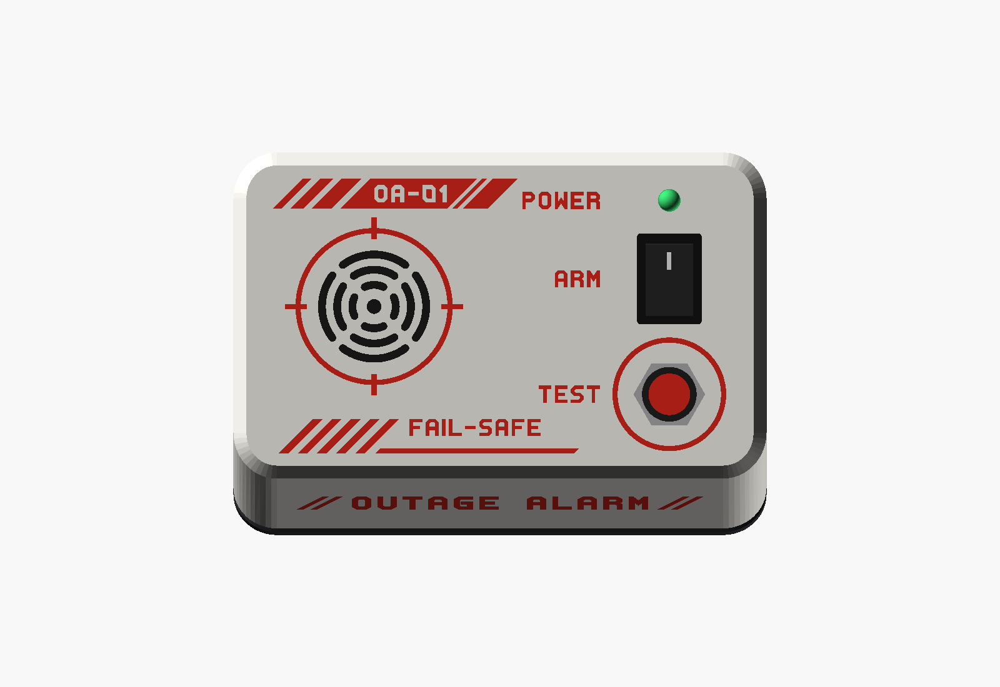

# Mechanical — OutageAlarm v1

The enclosure is a wedge. The control face tilts 20° toward you, so TEST, ARM and the POWER LED are easy to see and reach on a desk or shelf. The front leans back 10°. The white **shell** stands on a dark **base** whose undercut makes it look like it floats.

The shell wears a **mech-style livery**, like the markings on anime mechs, inlaid flush in a second filament. A one-colour version, with only the labels engraved, is available too.

There are two printed parts, held together by 4 screws from below. The model is parametric, in OpenSCAD: [`hardware/mechanical/enclosure.scad`](../hardware/mechanical/enclosure.scad).


| Face, square on | Back (USB-C) |
|-----------------|--------------|
|  |  |

| Cutaway | Exploded |
|---------|----------|
|  |  |

| Profile | Inside, on the base |
|---------|---------------------|
|  |  |

| Shell, as printed | Base, as printed |
|-------------------|------------------|
|  |  |

## Design

- **Wedge profile.** The face is tilted 20° and the front leans back 10°. The tall back holds the battery, and the buzzer hangs under the grille, where the face is high.
- **Floating base.** The base is dark, 6 mm thick, with a 45° undercut along its bottom edge. Its shadow separates the white shell from the table, and the chamfers on the shell and the base form a groove where they meet.
- **Clean face.** The face is printed on the bed, so it comes out flat and smooth. Everything on it is cut or inlaid in the first layers: the slotted, round speaker grille, the livery and the labels.
- **Mech livery.** It is made of straight lines and 45° cuts, in a second colour (red by default):
  - **Title band** at the back of the face: speed dashes, then a band with the unit code "OA-01" cut out of it, two panel breaks and a 45° end.
  - **Reticle** around the grille: a ring crossed by four ticks.
  - **Hazard stripes** at the front left, then a rule with "FAIL-SAFE" over it. The alarm sounds whenever the 5 V is lost.
  - A **ring around TEST**, and the labels TEST, ARM and POWER.
  - **Front:** the wordmark "// OUTAGE ALARM //".
  - **Back:** a lightning bolt and "5V" over the USB-C.
  - All the lettering uses a chamfered, straight-line stroke font, drawn in the model (`mech_glyphs`).
- **No visible screws.** Four countersunk screws close the enclosure from below, into posts molded in the shell's corners.

## Dimensions

- **Outer:** 122.8 × 74.8 mm. Height: 33 mm at the front and 58.5 mm at the back, base included.
- **Inner:** 118 × 70 mm. The shell is 27 mm tall at the front.
- **Walls and face:** 2.4 mm. **Base:** 6 mm, with a 3 mm undercut.
- **Chamfer** around the face: 3 mm at 45°. Corner radius in top view: 10 mm.
- **Inlay / engraving depth:** 0.6 mm.

## What goes where

Positions in top view (X to the right, Y to the back), measured from the inner front-left corner, on the top face of the base.

| Item | Where | How it's held |
|------|-------|---------------|
| 18650 holder (BT1) | against the back wall (X 8.8–86.8, Y 47.5–69.5) | rib in front of it + foam double-sided tape |
| 6 × 4 cm perfboard | front left (X 9.5–69.5, Y 4–44), 5 mm above the base | 4 standoffs + M2 × 6 self-tapping screws |
| Relay K1 | front-right corner of the perfboard | soldered to the board |
| TP4056 module (U1) | back right, centered at X = 98.3; USB-C through the back wall, 6 mm above the base | cradle with two L-shaped guides and an end stop + hot glue |
| SFM-27 buzzer (BZ1) | under the grille, at X 30, Y 38 | 4-segment centering ring + hot glue or epoxy |
| TEST button (SW2) | face, X 98, Y 19 | its own nut (12.2 mm hole) |
| ARM rocker switch (SW1) | face, X 98, Y 44 | snaps into a 19.2 × 12.9 mm cutout; the face is thinned to 2 mm around it so the clips catch |
| POWER LED (LED1) | face, X 98, Y 61 | inserted from below; its flange stops against the face + hot glue |
| Screw posts | the 4 inner corners | 4 × M3 × 12 countersunk self-tapping screws from below |

**Marks on both versions:**
- TEST, ARM and POWER on the face;
- the rings around the grille and around TEST;
- "OUTAGE ALARM" on the front;
- a lightning bolt and "5V" above the USB-C opening.

The one-colour shell has them engraved 0.6 mm deep. The two-colour shell has them inlaid, along with the rest of the livery.

### Checked clearances

The model checks these with `assert()`: if a change breaks one, OpenSCAD (and CI) stops with an error that names it.

- Buzzer above the 18650 holder (≥ 2 mm) and above the parts on the perfboard.
- Relay to the right of or in front of the buzzer, and clear of the leaning front wall.
- ARM switch body above the TP4056 module; TEST button body above the base.
- Holder, TP4056 cradle, perfboard and standoffs clear of the screw posts.
- Screw heads fully on the bottom face, inside the undercut.
- Livery:
  - At least 1.8 mm from the face's edges and corners, the grille, the TEST ring and the labels.
  - The unit code fits in its band and the caption fits over its rule.
  - The wordmark fits on the flat part of the front.
  - Strokes and gaps are wide enough to print.

## Printing

| Setting | Shell | Base |
|---------|-------|------|
| File | one colour: `stl/enclosure_shell.stl`; two colours: `3mf/enclosure_shell_2color.3mf` | `stl/enclosure_base.stl` |
| Material | PLA (or PETG for warm places), light color | PLA or PETG, black or graphite |
| Layer height | 0.2 mm (first layer 0.2 mm too) | 0.2 mm |
| Walls | 3 lines or more | 3 lines or more |
| Infill | 15–20 % | 15–20 % |
| Supports | **not needed** | **not needed** |
| Orientation | already in the file: control face on the bed | already in the STL: bottom on the bed |

- **Shell:**
  - The face is the first layer, so it takes the texture of your bed: smooth PEI or glass gives a glossy face, textured PEI a matte one.
  - The walls lean at most 30°, and the face chamfer is exactly 45° in this orientation.
  - The grille slots, holes and livery form in the first layers.
- **Base:** prints flat. The undercut is 45°. The ribs, standoffs and the TP4056 cradle grow upward.
- **Colours:** the intended look is a light shell (white, light gray) on a dark base, with a red livery. Any combination works; a black livery matches the base.

## Two-colour livery (3MF)

[`3mf/enclosure_shell_2color.3mf`](../hardware/mechanical/3mf/enclosure_shell_2color.3mf) holds the shell in four parts. It needs a printer that changes filament within a layer: a multi-material unit such as Creality's CFS, Bambu's AMS or Prusa's MMU, or a printer with two extruders.

| Part | What it is | Filament | Layers at 0.2 mm |
|------|------------|----------|------------------|
| `shell` | the shell, with the livery recessed 0.6 mm | 1: white | all |
| `face_livery` | the whole livery and the labels on the face | 2: red | 3 (Z 0.0–0.6 mm) |
| `front_wordmark` | "// OUTAGE ALARM //" on the front | 2: red | 27 (Z 10.2–15.6 mm) |
| `back_5v` | the bolt and "5V" on the back | 2: red | 29 (Z 32.6–38.4 mm) |

Each inlay fills its recess exactly and sits flush with the surface. The face livery is the cheap part: the face prints on the bed, so all of it is in the first 3 layers.

**Printing it (Creality Print; other slicers work the same way):**
1. Open the 3MF. It loads as one object, "OutageAlarm shell", made of the four parts, already in print orientation.
   - The file follows the basic 3MF spec: it stores white and red as the parts' display colours, but no filament assignments, and slicers may ignore those colours.
2. Give `shell` your white filament and the three livery parts your red one.
3. Use 0.2 mm layers with a 0.2 mm first layer, so the 0.6 mm inlay is exactly 3 layers. 0.15 mm or 0.12 mm also divide 0.6 mm.
4. Keep the prime tower on and print without supports.

**Filament changes:** each layer that holds a livery part needs up to two filament changes.

| What you print | Two-colour layers | Filament changes, about |
|----------------|-------------------|-------------------------|
| All four parts | 59 | 120 |
| Without `front_wordmark` and `back_5v` | 3 | 6 |

To skip the walls, delete those two parts in the slicer. Their text then stays engraved in the shell's colour. To cut the waste from the changes you keep, use your slicer's options to flush into the infill or into the object.

**Fine detail:**
- **Face:** printed flat, its lettering has 0.8 mm strokes and gaps of at least 0.8 mm.
- **Walls:** each layer cuts the inlay into a strip about 0.7 mm wide. That is why the wall lettering uses 1.4 mm strokes and keeps its gaps at 0.7 mm or more.

> **Not test-printed yet.** CI checks the 3MF before writing it: all four meshes are closed and consistently oriented, and each inlay is exactly a 0.6 mm slab, so it never thins out over an edge, a chamfer or a hole. Watch the first layers of the face.

## Customizing in OpenSCAD

Open `enclosure.scad` in OpenSCAD and use **Window → Customizer**. The parameters you're most likely to change:

| Parameter | Default | When to change |
|-----------|---------|----------------|
| `holder_x`, `holder_y`, `holder_z` | 78 × 22 × 21 mm | size of your 18650 holder |
| `pcb_hole_margin` | 2.0 mm | measure from your board's hole center to its edge |
| `chg_pcb` | [17.4, 29] mm | size of your TP4056 module (width, length) |
| `chg_z` | 6 mm | connector center height, if your module differs |
| `buzzer_d` | 30 mm | the SFM-27 varies between 29 and 30 mm by manufacturer |
| `rocker_cut` | [12.9, 19.2] mm | cutout of your rocker switch |
| `rocker_panel_t` | 2.0 mm | the switch's clips don't catch (thinner) or it rattles (thicker) |
| `test_d` | 12.2 mm | hole for your TEST button |
| `slope`, `lean`, `front_h` | 20°, 10°, 27 mm | shape of the wedge; the clearance checks tell you if things stop fitting |
| `unit_code`, `caption`, `logo_text` | "OA-01", "FAIL-SAFE", "OUTAGE ALARM" | your own markings. The font only has the glyphs used so far: add more to `mech_glyphs` |
| `inlay_depth` | 0.6 mm | depth of the inlay (and of the engraved marks) |
| `livery_color` | red | the second colour in the renders |
| `show_livery` | `true` | `false` previews the one-colour shell |
| `part` | `assembled` | to export: `shell`, `base`, `shell_2color`, `inlay_face`, `inlay_front`, `inlay_back`. To preview: `exploded`, `cutaway`, `interior` |

The livery itself is drawn in `face_art()`, `front_art()` and `back_art()`, in coordinates on each surface.

> The previews compute the shell as a mesh (CGAL) because of the many small strokes in the livery, so **F5** takes a few seconds.

### Exporting the STLs and the 3MF

```
cd hardware/mechanical
openscad -o stl/enclosure_shell.stl -D "part=\"shell\"" enclosure.scad
openscad -o stl/enclosure_base.stl  -D "part=\"base\""  enclosure.scad

for p in shell_2color inlay_face inlay_front inlay_back; do
  openscad -o parts/$p.stl -D "part=\"$p\"" enclosure.scad
done
python3 make_3mf.py parts 3mf/enclosure_shell_2color.3mf
```

[`make_3mf.py`](../hardware/mechanical/make_3mf.py) uses only Python's standard library. It checks the parts, packs them into the 3MF and prints the layers that hold each inlay.

Without OpenSCAD installed: on every push that changes the `.scad` or `make_3mf.py`, GitHub Actions ([render-enclosure.yml](../.github/workflows/render-enclosure.yml)) renders the STLs, the 3MF and the images. It publishes them in the run's **enclosure-render** artifact.

## Assembly

Extra hardware: 4 × M2 × 6 self-tapping screws (perfboard), 4 × M3 × 12 countersunk self-tapping screws (enclosure; 2.9 × 13 mm also works), hot glue, foam double-sided tape and, optionally, 4 small rubber feet.

1. **Check the fit** of the rocker switch and the TEST button in the shell before wiring anything.
2. **Shell:**
   - ARM rocker: snap it in from the outside, with "I" toward the back.
   - TEST button: remove the nut, push the button through from the inside, and tighten the nut on the face.
   - LED: push it in from below until the flange seats, and fix it with a dab of hot glue.
   - Buzzer: place its sound face against the face, inside the ring, and fix it with hot glue or epoxy around it.
3. **Base:**
   - TP4056 module: slide it into the cradle with the USB-C toward the back edge, against the end stop. Fix it with hot glue on the guides.
   - Perfboard, already soldered: screw it onto the standoffs with the 4 M2 screws.
   - Battery holder: against the back edge, behind the rib, with double-sided tape. Insert the cell last, checking the polarity.
4. Wire everything per [electronics.md](electronics.md). Give the wires to the shell parts about 15 cm, so the shell can lie next to the base while you work.
5. Run the [README](../README.md#test) test.
6. **Close:** fold the wires in, set the shell on the base, check that a USB-C cable plugs in fully through the back, and drive the 4 M3 screws from below.
