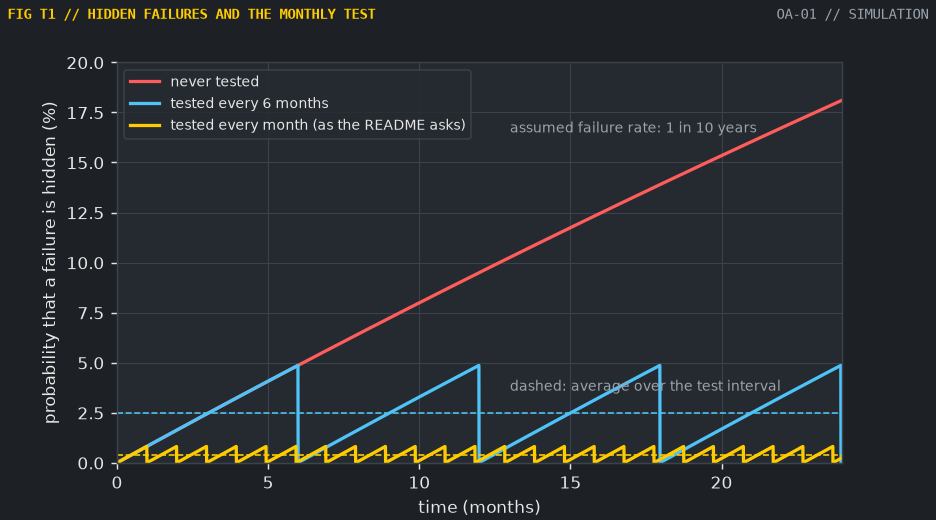

# 1. The fail-safe principle

An alarm is a strange machine: it spends almost all its life doing nothing, and it is judged on the few seconds when it must act. The worst thing an alarm can do is not a false alarm; it is to stay silent when it should sound. This chapter explains how OA-01 is arranged so that the natural way for it to fail is to sound, and how the TEST button checks the parts that could still fail silently.

## 1.1 What the alarm must do

The requirement is short: when the wall outlet loses power, sound immediately, and keep sounding without that power. Two consequences follow at once.

- The alarm needs **its own energy store**, ready at all times: an 18650 Li-ion cell (BT1), kept full by a TP4056 charger module (U1) that runs from a USB charger in the outlet.
- It needs a **detector** that tells "outlet alive" from "outlet dead". OA-01 uses the 5 V of the USB charger itself: it exists only while the outlet has power.

Between the detector and the buzzer sits one relay, K1. Its coil is fed by the 5 V; its normally closed (NC) contact connects the buzzer to the cell. That is the whole architecture.

## 1.2 Energise to alarm, or de-energise to alarm

There are two ways to wire a detector to an alarm:

- **Energise to alarm.** The detector applies energy to the alarm when it sees the event: a contact *closes* on a fault, a transistor *turns on*. At rest the alarm circuit is dead.
- **De-energise to alarm.** The detector holds the alarm off with energy while all is well. When the event happens, or when *anything* in the holding chain fails, the energy disappears and the alarm goes off by itself.

Fire-alarm loops with an end-of-line resistor, the dead-man's handle of a train, the brakes of a lift held open by an electromagnet and the "trip on loss of signal" of safety relays are all of the second kind. They share one property: **the failure modes that are most likely (a broken wire, a dead supply, a burnt coil, a loose connector) cause the safe action, not its absence.** This is what *fail-safe* means.

OA-01 is de-energise to alarm. The 5 V *holds the relay pulled in*, and the pulled-in relay *holds the NC contact open*. Remove the 5 V for any reason and a spring, not a circuit, closes the contact.

| Event on the mains side | Is the 5 V lost? | Result |
|---|---|---|
| power outage | yes | alarm |
| tripped breaker on that circuit | yes | alarm |
| USB charger dead | yes | alarm |
| USB cable broken or pulled out | yes | alarm |
| relay coil open (burnt, bad solder joint) | the coil loses its current | alarm |
| TEST button pressed | the coil loses its current | alarm (that is the test) |

The price of fail-safe is the occasional *nuisance alarm*: a charger that dies at three in the morning wakes you up exactly like an outage. The kit accepts that on purpose: an alarm that is silent because its charger died is far worse.

## 1.3 The circuit as Boolean logic

Although there is no processor, the circuit computes a logical function. Define the binary variables:

- $P$: the 5 V from USB is present;
- $T$: the TEST button (SW2, an NC pushbutton) is pressed;
- $A$: the ARM switch (SW1) is on;
- $B$: the protected output of U1 (OUT+/OUT−) is live, i.e. the cell is above the protection's cut-off;
- $K$: relay K1 is energised;
- $Z$: the buzzer sounds.

The coil is in series with the 5 V and SW2's contact, which conducts when the button is *released*:

$$K = P \land \lnot T$$

The buzzer is in series with the cell's output, SW1 and the NC contact, which conducts when the relay is *released*:

$$Z = B \land A \land \lnot K = B \land A \land (\lnot P \lor T)$$

The second form reads like the specification: the buzzer sounds when the alarm is armed and has energy, and either the power is gone or the test is pressed. Series contacts are AND, parallel paths would be OR, and a relay's NC contact is a NOT. This is **relay logic**, the technique that ran telephone exchanges, lifts and industrial machines before programmable controllers; ladder diagrams in today's PLCs still draw it.

Two signals matter that are not in the formula. The POWER LED (LED1, with R1) sits across the 5 V **before** SW2, so it shows $P$, not $K$: during a test the LED stays lit, telling you that the sound comes from the button and not from an outage. And K1's NO contact is not connected: the relay is used only as a NOT.

## 1.4 States and transitions

A state machine is the natural way to describe what the user sees. OA-01's state is set by the switches, the 5 V and the cell:

| State | $P$ | $T$ | $A$ | $B$ | K1 | Buzzer | Cell |
|---|---|---|---|---|---|---|---|
| STANDBY (armed, power present) | 1 | 0 | 1 | 1 | energised | silent | kept full by U1 |
| ALARM (outage) | 0 | – | 1 | 1 | released | **sounds** | discharges |
| TEST | 1 | 1 | 1 | 1 | released | **sounds** | being charged at the same time |
| DISARMED | – | – | 0 | – | either | silent | charged when $P$ = 1 |
| EXHAUSTED (very long outage) | 0 | – | 1 | 0 | released | silent | output cut to protect it |

Transitions happen at the speed of physics: a few hundred milliseconds from outage to sound (chapter 2), a few milliseconds from TEST to sound (chapter 3). When the power returns, the relay pulls in again and the buzzer stops: OA-01 has no memory, so it does not latch the alarm and it keeps no record of the outage. A latching alarm, a log and a "power is back" beep need memory and logic, which is why they are on the roadmap for v2, with an ESP32.

## 1.5 What the alarm sees and what it does not

The detector is the USB charger, so OA-01 sees exactly one thing: **whether that outlet delivers enough energy for the charger to make 5 V**. Three consequences follow, and they are limitations, not bugs.

- It watches **one circuit** of the installation: the breaker that feeds that outlet. An outage on another circuit of the house goes unseen.
- It must not be plugged into a **UPS** or a battery-backed stabiliser: those keep the outlet alive during an outage, and the alarm will never see it.
- It cannot tell an outage from a **charger failure**: both remove the 5 V. That is the fail-safe trade-off of section 1.2.

## 1.6 Failure modes

A failure-modes analysis asks, for every part, *how can it fail, and what does the alarm do then?* The answers split into two classes.

| Part | Failure | Effect | Class |
|---|---|---|---|
| USB charger, cable, connector | no output | alarm sounds | **revealed** (safe) |
| K1 coil, its solder joints | open | alarm sounds | **revealed** (safe) |
| SW2 (TEST) | contact open | alarm sounds | **revealed** (safe) |
| BT1 cell | flat, aged, missing | silent in an outage | **hidden** |
| SW1 (ARM) | left off, contact failed open | silent in an outage | **hidden** |
| K1 NC contact | dirty, oxidised, worn | silent in an outage | **hidden** |
| BZ1 buzzer | dead, wired backwards | silent in an outage | **hidden** |
| U1 protection | output latched off | silent in an outage | **hidden** |
| K1 mechanism | armature stuck in the pulled-in position | silent in an outage | **hidden** |

Everything on the 5 V side fails *safe and loud*. Everything on the battery side fails *silent*, and nothing tells you, because in standby the battery side is not used. These are **latent** (dormant) failures, and every fail-safe system has some. The only defence against them is a test that exercises them.

## 1.7 Hidden failures and the TEST button

Reliability engineering has a simple model for a dormant failure. If a part fails at a constant rate $\lambda$ (failures per hour) and nothing reveals the failure, the probability that it has failed by time $t$ is

$$P(t) = 1 - e^{-\lambda t} \approx \lambda t \quad (\lambda t \ll 1)$$

It keeps growing for as long as nobody looks. A **proof test** every $T_i$ hours finds the failure and resets the clock. Averaged over the interval, the probability that the alarm is unable to work when the outage comes (the *probability of failure on demand*, PFD) is

$$\overline{\mathrm{PFD}} \approx \frac{1}{T_i}\int_0^{T_i} \lambda t\, dt = \frac{\lambda T_i}{2}$$

Halving the test interval halves the risk. With an illustrative failure rate of one hidden failure in ten years, a test every six months leaves a 2.5 % average chance of a silent alarm; a test every month leaves 0.4 %.

*Figure T1 (simulation): probability that a hidden failure is present, for an assumed rate of one hidden failure in ten years, without tests, with a test every six months and with the monthly test the kit's README asks for. Dashed lines: the averages $\lambda T_i/2$.*

The formula only holds if the test exercises **everything** that can fail hidden. This is why OA-01's TEST button is an NC pushbutton **in series with the coil**, not a button that connects the buzzer to the cell. Pressing it makes the circuit go through exactly the same transition as an outage: the coil loses its current, the spring releases the armature, the NC contact closes, and the cell feeds the buzzer through U1's protection and the ARM switch. One press checks the cell, the protection, SW1, the relay's mechanism and contact and the buzzer. A shortcut button that bypassed the relay would leave the NC contact, the most likely mechanical failure, untested.

The test also tells you something about the cell: a buzzer that sounds clearly and steadily on the cell is a cell that holds its voltage under load. OA-01 has no battery gauge in v1; the TEST button is how you check the battery.

What the test does *not* check is the charger's response to a real outage, and the detection of the outage by the charger: for that, pull the charger out of the wall once in a while (the README's step 4).

## 1.8 Summary

| Idea | In OA-01 |
|---|---|
| De-energise to alarm | the 5 V holds K1 in; a spring closes the NC contact when anything removes it |
| Relay logic | $Z = B \land A \land (\lnot P \lor T)$: series = AND, NC = NOT |
| No memory | the alarm stops when power returns; latching and logging wait for v2 |
| Revealed failures | everything on the 5 V side sounds the alarm |
| Hidden failures | cell, ARM switch, NC contact, buzzer, protection: found only by testing |
| Proof test | TEST cuts the coil like an outage; average risk ≈ $\lambda T_i / 2$, hence the monthly test |

Next: [chapter 2, mains, isolation and the 5 V signal](02-mains-and-isolation.md).
