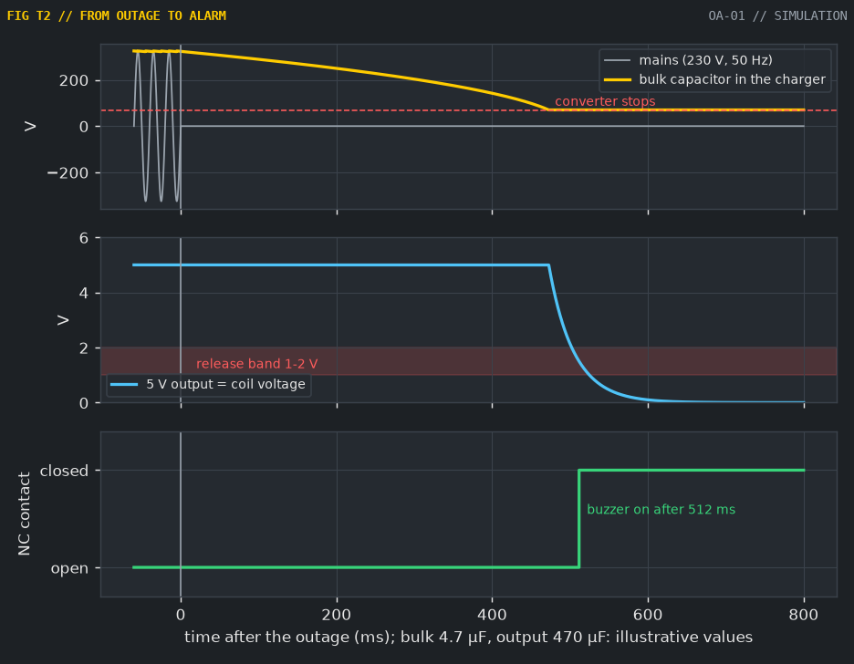
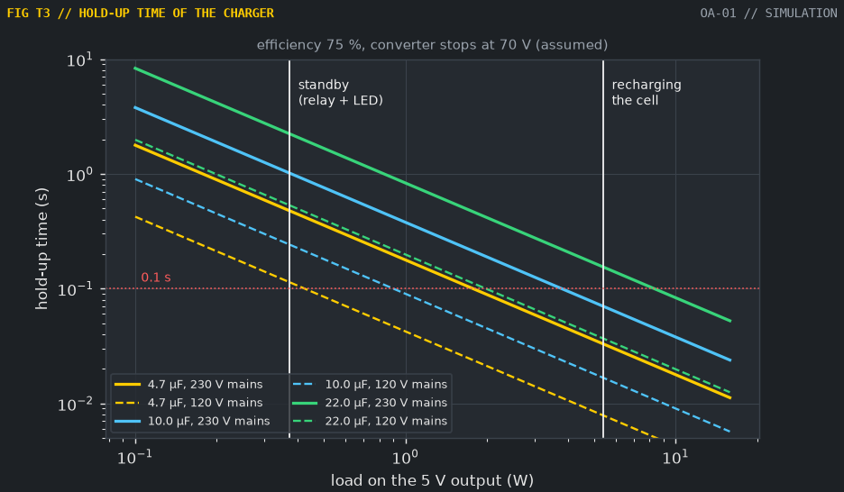

# 2. Mains, isolation and the 5 V signal

OA-01 detects a power outage without a single wire of its own touching the mains. The detector is an ordinary certified USB charger, and the signal is its 5 V output. This chapter explains why that is the right choice for a kit, what happens inside the charger, and how fast the 5 V disappears when the outlet dies.

## 2.1 The mains supply

The outlet delivers a sinusoidal voltage, 230 V at 50 Hz in Europe and most of the world, 120 V at 60 Hz in North America, 127 V or 220 V at 60 Hz in Brazil depending on the region. The quoted value is the **RMS** value, the DC voltage that would heat a resistor equally. The peak is $\sqrt{2}$ times larger:

$$v(t) = V_{RMS}\sqrt{2}\,\sin(2\pi f t), \qquad 230\ \text{V} \rightarrow 325\ \text{V peak}, \qquad 120\ \text{V} \rightarrow 170\ \text{V peak}$$

Those voltages can drive a lethal current through the human body, and the installation behind the outlet can deliver hundreds of amperes into a short circuit before a breaker opens. An outage is any interruption of that supply: a fault upstream, a tripped breaker or a blown fuse on the circuit, or a planned cut.

## 2.2 Why no mains on the board

A circuit that senses the mains directly (an optocoupler fed through resistors, a small transformer, a capacitive divider) has to cross from the mains world to the low-voltage world somewhere. Doing that safely needs things a perfboard built at home does not have:

- **isolation** rated for the mains voltage plus the transient overvoltages of the installation (surges of a few kilovolts);
- **creepage and clearance distances**, the minimum distances along a surface and through air between mains and accessible parts, typically several millimetres for reinforced insulation at 230 V;
- a **fuse** and flame-retardant materials, because a fault on the mains side can release a lot of energy;
- **type testing** against a safety standard.

A certified USB charger already contains all of that, designed and tested by its maker. OA-01's design rule is therefore: **mains only enters through the certified charger**. Inside the enclosure there is nothing above 5 V, and the 3.7 V cell. The kit's documentation asks for a reputable certified charger (Inmetro in Brazil, UL or CE elsewhere), plugged straight into the wall, and never opened.

## 2.3 Inside a USB charger

Almost every USB charger is a small **flyback converter**, an isolated switched-mode power supply:

1. A bridge rectifier turns the AC into pulsating DC, and a **bulk capacitor** smooths it to roughly the peak value (≈ 325 V at 230 V).
2. A high-voltage transistor switches that DC across the primary winding of a small transformer at tens or hundreds of kilohertz. While it is on, the transformer's core stores energy; when it turns off, the energy flows out of the secondary winding.
3. A diode and output capacitors on the secondary make the DC output.
4. A feedback path, usually through an **optocoupler**, tells the primary side how much energy to send so that the output stays at 5 V.

The transformer and the optocoupler are the only things that cross from the primary to the secondary side, and both are built as an **isolation barrier**: the energy and the feedback cross as a magnetic field and as light, never as a conductive path. Because the transformer works at high frequency, it is tiny compared with a 50 Hz transformer of the same power: the core size scales roughly with power divided by frequency.

The output of such a charger is **SELV** (safety extra-low voltage): isolated from the mains by double or reinforced insulation, and low enough to touch. That is the voltage OA-01 works with.

## 2.4 Creepage, clearance and certification

Two distances define an isolation barrier on a circuit board:

- **clearance**: the shortest distance through air between the two sides. It must withstand the impulse voltages of the installation without a spark;
- **creepage**: the shortest distance *along the surface* of the insulating material. Dust and humidity form conductive films on surfaces, so creepage must be longer than clearance; slots milled in the board lengthen it.

The values depend on the voltage, the pollution degree and the material, and are tabulated in the safety standards that chargers are tested against. A certification mark on the charger is the user's only evidence that someone checked those distances, the transformer's insulation and the behaviour under faults. This is why the choice of the charger is a safety item in OA-01's bill of materials, and why a counterfeit or uncertified charger is not acceptable even though it would make the alarm work.

## 2.5 USB-C: the charger has to see a device

OA-01's TP4056 module has a USB-C receptacle. A USB-C source, unlike the old USB-A ports, does **not** turn its 5 V on by default. It watches the two **CC** (configuration channel) pins: the source pulls them up, and a device (a *sink*) pulls them down with a 5.1 kΩ resistor, $R_d$. The source sees the voltage on CC fall to a known range, knows that a sink is attached, and only then switches on $V_{BUS}$. This protects the user and the connector: a USB-C cable lying on the table has no voltage on its pins.

Not every TP4056 USB-C module has the two 5.1 kΩ resistors. Without them, a USB-C to USB-C cable gives no power at all. The kit's workaround is a **USB-A to USB-C cable**: the USB-A side has no such handshake, and a USB-A charger always puts 5 V on its port. (Inside such a cable, a pull-up resistor tells the sink side what the legacy port can deliver.)

For OA-01 the detail matters twice. First, with the wrong cable the alarm sounds even with the outlet alive: it is fail-safe, so the build is never silently broken, but it looks broken. Second, the 5 V is the alarm's sensor; whatever the cable, the only question the circuit asks is *is there 5 V or not?*

## 2.6 The 5 V as a sensor

From the circuit's point of view, the charger is a sensor whose output is

$$V_{USB} = \begin{cases} 5\ \text{V} & \text{outlet alive, charger working} \\ 0\ \text{V} & \text{otherwise} \end{cases}$$

Its load in standby is small and constant: K1's coil (≈ 72 mA) and the LED (≈ 2.9 mA), about 0.37 W, plus the cell's top-up current when U1 decides to recharge. The 5 V is not a perfect sensor:

- it **does not fall instantly** when the outlet dies (sections 2.7 and 2.8);
- a weak charger can sag under load: a charger smaller than the ≥ 1.5 A the kit asks for, recharging the cell at 1 A, might drop its voltage, but a 5 V relay only releases far below 5 V, so the margin is large (chapter 3).

## 2.7 Hold-up: the charger does not die at once

When the mains disappears, the charger keeps running on the energy stored in its bulk capacitor $C_b$. The converter regulates its output as long as the bulk voltage stays above the lowest voltage its controller works at, $V_{min}$. The energy available is the difference of the capacitor energies:

$$E = \tfrac{1}{2} C_b \left(V_{pk}^2 - V_{min}^2\right)$$

Drawn at the input power $P_{out}/\eta$ (output power over efficiency), it lasts

$$t_{hold} = \frac{\eta\, C_b \left(V_{pk}^2 - V_{min}^2\right)}{2 P_{out}}$$

After that, the converter stops and the output capacitor $C_o$ discharges into the load. For OA-01's load (coil and LED, mostly resistive) the output decays exponentially with the time constant $\tau = R_c C_o$, and K1 releases when it crosses the release voltage, ≈ 1–2 V according to the kit's documentation:

$$t_{release} = R_c C_o \ln\frac{V_{USB}}{V_{rel}}$$

The kit does not specify the charger, so the capacitors are unknown. With illustrative values for a small charger ($C_b$ = 4.7 µF, $C_o$ = 470 µF, 75 % efficiency, controller stopping at 70 V) the simulation gives:

*Figure T2 (simulation): mains cut at t = 0 at the peak of the wave. The bulk capacitor carries the charger for about 0.47 s, then the 5 V decays into the coil with $\tau = R_c C_o$ ≈ 33 ms, and K1 releases when it crosses 1.5 V: the buzzer starts about half a second after the outage. Capacitor values are illustrative.*

The hold-up time depends on the load, the capacitor and the mains voltage:

*Figure T3 (simulation): hold-up time against the load on the 5 V output, for three bulk capacitors at 230 V and 120 V. In standby (0.37 W) a small charger rides through hundreds of milliseconds; while it recharges the cell (≈ 5.4 W) only tens of milliseconds.*

Two practical facts come out of this:

- In standby the load is tiny, so the charger's own reserve, not the relay, sets most of the delay. The behaviour the kit's documentation expects, "the buzzer sounds in under 1 second" (README, test step 4), fits this picture.
- At 120 V the bulk capacitor is charged to a lower voltage and stores about $(170/325)^2$ ≈ 27 % of the energy, so hold-up is shorter in 120 V countries.

## 2.8 Short blips and the response time

The same reserve that delays the alarm also filters it. A mains interruption shorter than the hold-up time never reaches the 5 V output, and the relay never moves. The kit's documentation says that very short blips, under about 0.1 s, are usually ignored. Figure T3 shows why that is a typical, not a guaranteed, figure: it depends on the charger and on whether the cell is being recharged at that moment.

Is a delay of half a second a problem? Not for this job. The purpose is to tell someone that the freezer, the aquarium pump or the medical device has lost power; half a second is irrelevant to that, and ignoring flickers that a lamp would barely show avoids nuisance alarms. A designer who wanted a faster detector would have to sense the mains directly (section 2.9); one who wanted to ignore longer interruptions would add a delay, which in OA-01's relay logic could be a larger capacitor across the coil, at the cost of a slower test.

## 2.9 Sensing the mains directly (the v3 idea)

The kit's roadmap mentions, for a future v3 with a custom board, optional **direct mains sensing with proper isolation**. The usual circuits are:

- an **optocoupler** whose LED is fed from the mains through high-value resistors (or a capacitive dropper) and a rectifier; the phototransistor on the low-voltage side gives a pulse train at 100 or 120 Hz, and a timer detects missing pulses within one or two cycles;
- a small **mains transformer** whose secondary is rectified and compared with a threshold.

Both detect an outage in tens of milliseconds and can even measure the mains voltage. Both also bring the mains onto the alarm's own board, with every requirement of section 2.2: a fuse, isolation rated for the installation, creepage and clearance, and an explicit safety review. The kit's design principles state that such a change requires exactly that. In v1, the certified charger is both the power supply and the isolated sensor, which is the simplest safe solution.

## 2.10 Summary

| Fact | Consequence for OA-01 |
|---|---|
| Mains peak is 325 V (230 V) or 170 V (120 V) | nothing of the kit touches it; only the certified charger does |
| A flyback charger isolates with a transformer and an optocoupler | its 5 V output is SELV and can be handled |
| Creepage, clearance, fuse, certification | reasons to use a certified charger, plugged straight into the wall |
| USB-C sources need 5.1 kΩ on CC | without them, use a USB-A to USB-C cable |
| The charger's bulk capacitor holds the output up | the alarm starts within about a second; short blips (< ~0.1 s) are usually ignored |
| Hold-up falls with load and with 120 V mains | the delay varies; it is typical, not guaranteed |

Next: [chapter 3, the relay K1](03-the-relay.md).
