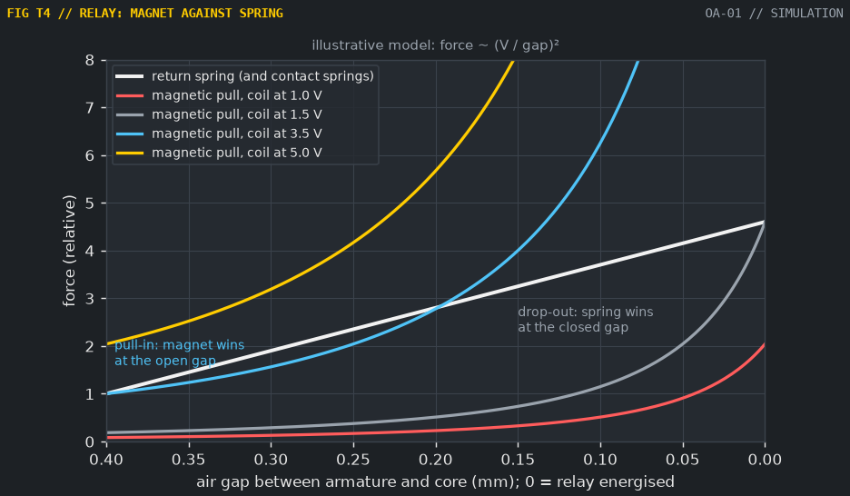
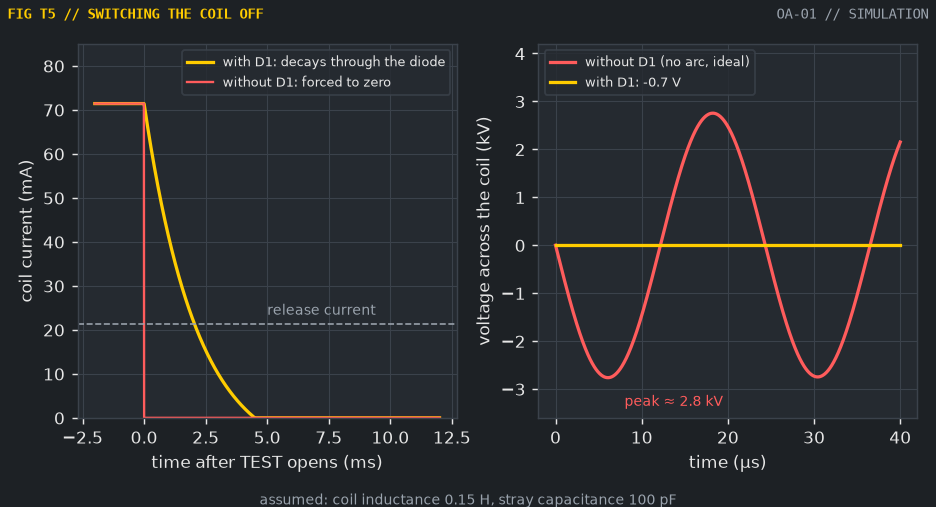

# 3. The relay K1

K1 is the decision maker of OA-01. It turns the 5 V signal into a mechanical position, and that position into a closed or open path from the cell to the buzzer. It also isolates the two halves of the circuit: the 5 V side drives the coil, the battery side runs through the contact, and the only link between them is a moving piece of iron. This chapter explains how a relay works, why it has two thresholds, why D1 is there, and how long each step takes.

## 3.1 Anatomy of the SRD-05VDC-SL-C

K1 is an SRD-05VDC-SL-C, the ubiquitous small "sugar cube" relay. Its parts:

- a **coil** of fine copper wire around an iron **core**: 5 V rated, 0.36 W, ≈ 70 Ω;
- a hinged iron **armature**, held away from the core by a **return spring**;
- a moving contact on the armature, the **COM** (common) terminal, which rests against the **NC** (normally closed) contact and moves to the **NO** (normally open) contact when the coil pulls the armature in;
- an iron **yoke** that closes the magnetic path around the coil.

The contact is SPDT (single pole, double throw), rated 10 A. OA-01 uses COM and NC only; NO is soldered to the board for strength and left unconnected. The kit's documentation explains how to find the pins with a multimeter: the two coil pins measure ≈ 70 Ω, COM is the lone pin at one end, NC is the one connected to COM with the relay off, NO the one connected only when 5 V is on the coil.

## 3.2 The magnetic circuit

The coil of $N$ turns carrying a current $I$ produces a **magnetomotive force** $NI$ (ampere-turns). It drives a magnetic flux $\Phi$ around the loop of core, yoke and armature, against the loop's **reluctance** $\mathcal{R}$, in the same way as a voltage drives a current against a resistance:

$$\Phi = \frac{NI}{\mathcal{R}}, \qquad \mathcal{R} = \sum \frac{\ell_k}{\mu_k A_k}$$

Iron has a permeability thousands of times that of air, so the reluctance of the loop is dominated by the **air gap** $g$ between the armature and the core:

$$\mathcal{R} \approx \frac{g + g_0}{\mu_0 A}$$

where $A$ is the pole area and $g_0$ is a small equivalent gap that remains even when the armature touches the core (surface roughness, a non-magnetic shim that prevents sticking, and the iron's own reluctance). The attractive force on the armature is

$$F = \frac{\Phi^2}{2\mu_0 A} = \frac{\mu_0 A (NI)^2}{2(g+g_0)^2}$$

The force grows with the **square of the current** and falls with the **square of the gap**. The second fact is the important one: the same current pulls much harder once the armature is close to the core.

## 3.3 Pull-in, drop-out and hysteresis

Against the magnet stands the return spring, plus the contact springs that load the armature at the ends of its travel. When the armature is open (large gap, $g$ ≈ a few tenths of a millimetre), the magnet is weak and needs a large current to beat the spring: that current, or the coil voltage that produces it, is the **pull-in** (must-operate) value. Once the armature is in, the gap is tiny and the magnetic force is many times larger for the same current; the current must fall far below the pull-in value before the spring can win again: the **drop-out** (must-release) value.

*Figure T4 (illustrative model): magnetic pull for four coil voltages and the spring force, against the air gap. At 3.5 V the magnet just beats the spring at the open gap (pull-in); at 1.5 V it just loses at the closed gap (drop-out). Between the two, the relay stays where it is.*

This **hysteresis** is not a defect, it is what makes a relay a clean binary device. A slowly falling or noisy coil voltage does not make the armature hover: it stays fully in until the voltage reaches the drop-out value, then snaps fully out, because as the gap opens the magnetic force falls faster than the spring force. Small 5 V relays of this class are typically guaranteed to pull in below about 75 % of the rated voltage and to release above about 10 % of it; the kit's documentation puts K1's practical release at ≈ 1–2 V.

For OA-01 this gives a wide margin on both sides:

- a charger sagging to 4.5 V, or even well below, keeps the relay pulled in: no false alarm from a weak 5 V;
- the alarm only starts once the 5 V has really collapsed, below ≈ 1–2 V.

## 3.4 The coil as an inductor

The coil is not just a resistor: its turns link the flux they create, so it has an **inductance** $L_c$. The relay's documentation gives its resistance (≈ 70 Ω) and power (0.36 W), not its inductance; for the numbers below we assume an illustrative $L_c$ = 0.15 H. The coil is then an RL circuit with the time constant

$$\tau_c = \frac{L_c}{R_c} = \frac{0.15\ \text{H}}{70\ \Omega} \approx 2.1\ \text{ms}$$

When the 5 V is applied, the current rises as $I_c(1 - e^{-t/\tau_c})$ toward its final value

$$I_c = \frac{V_{USB}}{R_c} = \frac{5\ \text{V}}{70\ \Omega} \approx 71\ \text{mA} \qquad \left(\text{or } \frac{P_c}{V_{USB}} = \frac{0.36\ \text{W}}{5\ \text{V}} = 72\ \text{mA}\right)$$

(In a real relay the inductance also grows as the armature closes, because the gap shrinks; the moving armature induces a back-EMF that shows as a small dip in the current, the classic signature engineers use to check that a relay actually moved.)

The coil stores magnetic energy:

$$E = \tfrac{1}{2} L_c I_c^2 = \tfrac{1}{2} \times 0.15 \times 0.0714^2 \approx 0.38\ \text{mJ}$$

That small energy is the reason for D1.

## 3.5 Switching the coil off: D1

An inductor resists any change of its current: $v = L\,di/dt$. When SW2 opens (a test) or the 5 V vanishes abruptly (a cable pulled out), the circuit tries to force the coil current to zero in microseconds. The coil answers with whatever voltage it takes to keep the current flowing. Without a path, that voltage rises until something conducts: the stray capacitance of the wiring, an arc across the opening contact of SW2, or the output stage of the charger in reverse. With a stray capacitance of the order of 100 pF, the ideal peak would be

$$V_{peak} \approx I_c \sqrt{\frac{L_c}{C_s}} = 0.0714 \sqrt{\frac{0.15}{100 \times 10^{-12}}} \approx 2.8\ \text{kV}$$

In practice an arc forms long before that, eating the button's contacts a little at every test.

D1, a 1N4007, sits across the coil with its cathode on the positive side. In normal operation it is reverse-biased and does nothing. When the current is interrupted, the coil's voltage reverses, D1 conducts, and the current keeps circulating through the coil and the diode, decaying with the same $\tau_c$ while the diode holds the coil voltage at about −0.7 V. The 0.38 mJ is dissipated harmlessly in the coil's resistance.

*Figure T5 (simulation, assumed $L_c$ = 0.15 H, stray capacitance 100 pF): left, the coil current after TEST opens, with D1 (exponential decay, ≈ 2 ms) and without (forced to zero); right, the voltage across the coil without D1 (an ideal ringing of almost 3 kV) and with it (−0.7 V).*

The kit's documentation lists what D1 protects: the charger's output and SW2's contact. The price is a slightly slower release, because the current decays through the diode instead of stopping at once: the armature lets go a couple of milliseconds later. For an outage alarm that is irrelevant. A 1N4148 small-signal diode works as well: the peak current is only the coil's 72 mA, and the reverse voltage it must block is 5 V. In v2, where a transistor will drive the coil, the diode becomes mandatory, because a transistor does not survive an inductive kick the way a mechanical contact does.

## 3.6 Contacts: rating, wetting current and bounce

K1's contact is rated 10 A, and OA-01 asks it to carry the buzzer's 5–10 mA at 3.7 V. One might think that an oversized contact is simply a reliable one. It is not quite so.

- **Wetting current.** Relay contacts made for power (silver alloys) grow thin oxide and sulphide films in air. A contact that switches a real load breaks those films with a small arc and with the current itself. A contact that switches only a few milliamperes at a few volts, a so-called *dry* circuit, never cleans itself, and its resistance can creep up over years. Relay makers usually state a minimum switching load for this reason. The kit's documentation suggests a **signal relay with gold contacts** (Omron G5V-1, ≈ 30 mA coil) as an alternative: gold does not oxidise and is made for low currents. It needs a layout change, which is why v1 keeps the common SRD.
- **Monthly TEST.** Every test closes the NC contact under the buzzer's load and wipes it mechanically, which is another good reason for the monthly test of chapter 1.
- **Contact bounce.** When a contact closes, the moving blade hits the fixed one and bounces a few times, for of the order of a millisecond, before it settles. The buzzer does not care: at worst it chirps for a millisecond before sounding steadily. A **digital input** would care: a microcontroller reading the contact would see several closures. That is why firmware reading switches *debounces* them, typically by accepting a new state only after it has been stable for 10–20 ms, or by sampling at a slow rate. OA-01 v1 has no firmware and needs no debouncing; v2, with an ESP32 reading the power state and a silence button, will.

## 3.7 Timing of the whole chain

Putting chapters 2 and 3 together, the sequence after an outage is:

| Step | What happens | Typical duration |
|---|---|---|
| 1 | the charger runs on its bulk capacitor | tens to hundreds of ms (figure T3) |
| 2 | the converter stops; the 5 V decays into the coil | tens of ms ($R_c C_o$) |
| 3 | the coil current falls below the drop-out value; the armature flies out | a few ms |
| 4 | the NC contact closes and bounces | ≈ 1 ms |
| 5 | the buzzer's oscillator starts | well under 1 ms |

The total is dominated by step 1 and stays under about a second. For a TEST press, steps 1 and 2 disappear: the coil is cut directly, so the buzzer answers within a few milliseconds of pressing the button. When the button is released, or the power returns, the coil current rises with $\tau_c$, reaches the pull-in value and the NC contact opens: the buzzer stops as fast as it started.

## 3.8 Summary

| Fact | Consequence for OA-01 |
|---|---|
| Magnetic force ∝ $(NI)^2/(g+g_0)^2$ | strong hold once pulled in, weak pull at the open gap |
| Pull-in well above drop-out (hysteresis) | no false alarm from a sagging 5 V; release only below ≈ 1–2 V |
| Coil: 70 Ω, 72 mA, 0.36 W | it is the main standby load (chapter 6) |
| Coil inductance stores ≈ 0.4 mJ (assumed 0.15 H) | without D1, kilovolt spikes; with D1, −0.7 V and a 2 ms decay |
| 10 A contact on a 10 mA load is a dry circuit | monthly test; a gold-contact signal relay is the documented alternative |
| Contacts bounce for about 1 ms | harmless for the buzzer; firmware in v2 must debounce |

Next: [chapter 4, the cell, the charger and the protection](04-cell-and-charger.md).
