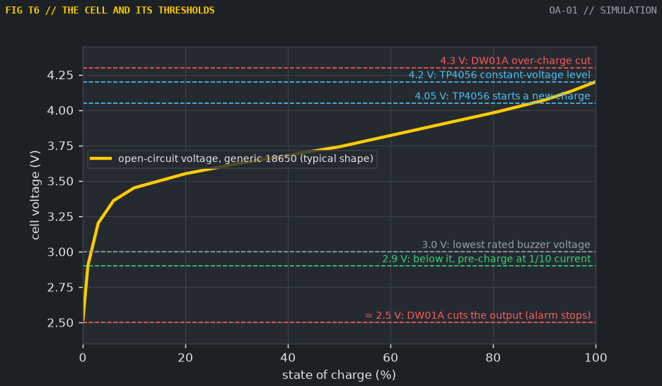
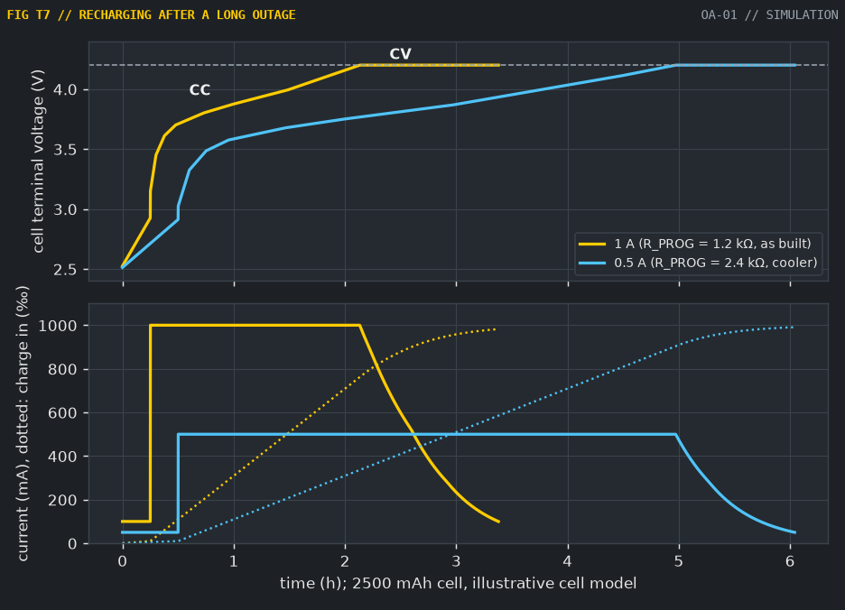
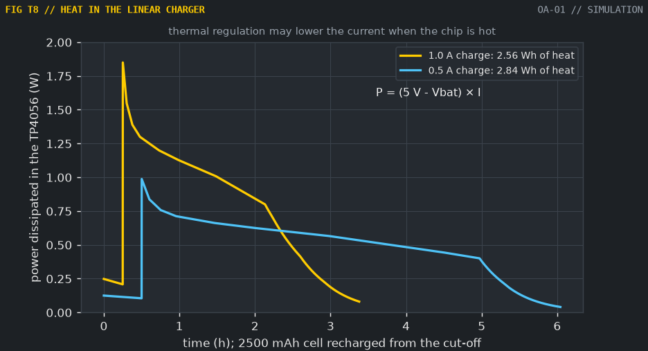

# 4. The cell, the charger and the protection

The alarm's energy lives in one 18650 lithium-ion cell (BT1), 2000–3500 mAh. One small board, the TP4056 USB-C module with protection (U1), does three jobs for it: it charges it from the 5 V, it keeps it within its safe voltage and current limits, and it gives the rest of the circuit a protected output. This chapter explains the cell, the charging algorithm and the protection, with the kit's numbers.

## 4.1 How a Li-ion cell stores energy

A lithium-ion cell has two electrodes that can both host lithium ions in their crystal structure: a **graphite** negative electrode and a **lithium metal oxide** positive electrode (in common 18650s, a nickel–manganese–cobalt or nickel–cobalt–aluminium oxide). Between them, a porous **separator** soaked in an organic **electrolyte** lets ions through but not electrons.

- **Charging** pushes lithium ions out of the oxide, through the electrolyte, into the graphite, while the charger drives the same number of electrons around the outside circuit.
- **Discharging** lets them go back. The ions cross inside the cell; the electrons must take the external path, through the load: that current is what runs the buzzer.

The cell voltage is the difference of the two electrodes' chemical potentials, and it depends on how much lithium each holds, i.e. on the **state of charge** (SOC). It is about 4.2 V full and about 3.0 V nearly empty, with a long gentle slope in between around the **nominal** 3.6–3.7 V. Both limits are hard limits:

- **above about 4.2 V**, the positive electrode becomes unstable and the electrolyte oxidises: capacity is lost, gas forms, and in the extreme the cell can go into thermal runaway;
- **below about 2.5 V**, the copper current collector of the negative electrode can start to dissolve, and the cell may be damaged or become unsafe to recharge.

Every rule in this chapter comes from those two limits. The kit's safety notes add the practical ones: use a reputable cell in good condition (Samsung, LG, Sony/Murata, Panasonic), never a dented or swollen one or a dubious "9900 mAh" cell (no 18650 holds that much).

## 4.2 Voltage, capacity and energy

**Capacity** is the charge the cell delivers from full to empty, in ampere-hours: 2500 mAh means 2.5 A for one hour, or 10 mA for 250 hours ($1\ \text{mAh} = 3.6\ \text{C}$). **Energy** is charge times voltage:

$$E = C \cdot V_{nom} = 2.5\ \text{Ah} \times 3.7\ \text{V} \approx 9.3\ \text{Wh}$$

(7.4 Wh for a 2000 mAh cell, 12.9 Wh for a 3500 mAh one.) Currents are often expressed as a **C-rate**, the current divided by the capacity: OA-01 charges a 2500 mAh cell at 1 A, i.e. 0.4 C, and discharges it into the buzzer at about 10 mA, i.e. C/250. Both are gentle; the discharge in particular is so slow that the cell delivers its full rated capacity (chapter 6).

*Figure T6 (typical curve, not a datasheet): open-circuit voltage of a generic 18650 against its state of charge, with the thresholds of the TP4056 and the DW01A and the lowest rated voltage of the buzzer.*

The figure shows where each part of U1 acts. The TP4056 charges up to 4.2 V and starts a new charge when the cell falls to about 4.05 V. The DW01A only steps in outside the normal range: at about 4.3 V if the charger fails, and at about 2.4–2.5 V at the end of a very long outage (the kit's documentation says ≈ 2.5 V).

## 4.3 The TP4056 module

U1 is a small board, about 29 × 17 mm, with three chips and six pads:

- **TP4056**: a linear Li-ion charger. Its input is the 5 V from USB-C (IN+/IN−); its output goes to the cell's positive terminal (B+).
- **DW01A**: a battery protection controller that watches the cell voltage and the current.
- **8205A**: two N-channel MOSFETs in one package, in series in the cell's **negative** lead, which the DW01A switches on or off.

The cell connects to B+ and B−, and nothing else does. The loads connect to OUT+ and OUT−: OUT+ is the same as B+, and OUT− is the cell's negative *after* the MOSFETs. On the module, IN− and OUT− are the same ground. The charge current flows through the MOSFETs too, so the DW01A can stop a charge as well as a discharge.

This is why one of OA-01's design rules is that loads connect to OUT+/OUT−, **never to B+/B−**: anything connected to B− would bypass the protection and could drain the cell below its safe limit. The buzzer circuit (through SW1 and K1's NC contact) runs from OUT+ to OUT−; the coil and the LED run from IN+ to IN−, the 5 V side.

## 4.4 Constant current, constant voltage

Li-ion cells are charged with the **CC/CV** algorithm, and the TP4056 implements it in silicon:

1. **Pre-charge.** If the cell is below 2.9 V, it is charged at one tenth of the set current until it recovers. A deeply discharged cell is fragile, and a gentle current also avoids heating a cell that might be damaged.
2. **Constant current (CC).** From 2.9 V the full set current flows (1 A in OA-01). The terminal voltage rises as the cell fills.
3. **Constant voltage (CV).** When the terminal voltage reaches 4.2 V (±1 %), the charger holds it there. The current now falls by itself, because the cell's internal voltage approaches 4.2 V and less and less voltage is left across its internal resistance.
4. **Termination.** When the current has fallen to one tenth of the set value, the charge ends, and the module's LED changes from red (charging) to blue (full).
5. **Recharge.** If the cell later falls below about 4.05 V, a new cycle starts.

The CV phase is why the last 20–30 % of the charge takes a large share of the time. A simple model of the cell, an open-circuit voltage source with an effective series resistance of 0.25 Ω standing for the internal resistance, the contacts and the slower polarisation effects, reproduces the shape:

*Figure T7 (simulation, illustrative cell model): recharge of a 2500 mAh cell from the protection's cut-off, at 1 A (as built) and at 0.5 A (with a 2.4 kΩ program resistor). Top: terminal voltage; bottom: current (solid) and charge returned (dotted, in thousandths of the capacity).*

At 1 A the model enters CV after about 2.1 h and terminates after about 3.4 h. The kit's own estimate, $2500\ \text{mAh} / 1\ \text{A} \approx 3$ h, is the CC-only lower bound; the CV tail adds the rest. At 0.5 A, the charge takes about 6 h. Either way, a cell that was fully drained by a long outage is full again the same day; after an ordinary short outage it is topped up in minutes.

## 4.5 Setting the current: the program resistor

The TP4056 sets its charge current with one resistor, $R_{PROG}$, from its PROG pin to ground. The chip holds the PROG pin at 1 V during CC and mirrors the current through the resistor, multiplied by 1200, into the cell:

$$I_{chg} = \frac{1\ \text{V}}{R_{PROG}} \times 1200 = \frac{1200\ \text{V}}{R_{PROG}}$$

On OA-01's module the resistor (usually marked R3) is 1.2 kΩ, so $I_{chg}$ = 1 A. The kit's documentation offers the alternative of replacing it with 2.4 kΩ, which gives 500 mA: half the current, a longer charge, and much less heat in the enclosure (section 4.6 and chapter 7). The PROG pin voltage also falls in proportion to the current during CV, which is how the chip knows when to terminate (at 0.1 V, i.e. one tenth of the current).

## 4.6 Heat in a linear charger

The TP4056 is a **linear** charger: between its 5 V input and the cell there is a transistor working as a variable resistor. Whatever voltage the cell does not take is dropped across that transistor, and the power it represents is heat:

$$P_{U1} = (V_{USB} - V_{bat})\, I_{chg}$$

At the start of the CC phase, with the cell around 3.3 V, that is $(5 - 3.3) \times 1 = 1.7$ W; near the end of CC, at 4.2 V, 0.8 W. The kit's documentation rounds it to about 1 W.

*Figure T8 (simulation): power dissipated in the TP4056 along the recharges of figure T7. At 1 A it peaks near 1.8 W and averages about 1.1 W in the CC phase; at 0.5 A it stays under 1 W.*

Two remarks:

- At 0.5 A the total heat is not smaller: the same charge flows through the same voltage difference, over twice the time. What changes is the **power**, which sets the temperature (chapter 7).
- The TP4056 has **thermal regulation**: if its die reaches about 120 °C, it reduces the current on its own instead of overheating. A charge in a warm enclosure may therefore be a little slower than the figure, never hotter.

A switching charger would waste much less, but for a cell that is almost always full, and is only recharged for a few hours after an outage, the linear charger's simplicity wins. This is the trade-off the kit makes.

## 4.7 The protection: DW01A and 8205A

The DW01A is a tiny comparator chip that sits across the cell and controls the gates of the two MOSFETs in the 8205A. The two MOSFETs are connected source-to-source, so that each blocks current in one direction: one stops **discharge**, the other stops **charge**. Their body diodes point in opposite directions, so when one is off and the other on, current can still flow the other way through the body diode of the one that is off. That is how the module lets a charger revive a cell that was cut off for over-discharge.

| Condition | Typical DW01A threshold | Action |
|---|---|---|
| over-charge | cell above ≈ 4.3 V | charge MOSFET off |
| over-discharge | cell below ≈ 2.4–2.5 V | discharge MOSFET off; the chip goes into a low-power state |
| over-current | voltage across the MOSFETs above ≈ 0.15 V (a few amperes) | discharge MOSFET off |
| short circuit | much higher voltage across the MOSFETs | off within microseconds |

In OA-01 the protection has two roles. In normal life it is just a pair of switches that are on, with a few tens of milliohms of resistance, and a controller that draws a few microamperes: the only standby drain on the cell. At the end of a very long outage it is what stops the alarm, at about 2.5 V, so that the cell is not destroyed (chapter 6). When the power returns, the TP4056 starts in pre-charge and the cell recovers normally.

One quirk the kit's documentation points out: some DW01-based modules keep OUT switched off right after a cell is inserted, until a charger is connected for the first time. The over-discharge state of the DW01A is released by the presence of a charger, and a freshly inserted cell can look like one coming out of over-discharge. Plugging in USB once clears it. The kit uses **unprotected** cells for the same reason it puts the loads on OUT: the module already protects the cell, and protected cells, with their own small protection board, are longer and may not fit the holder.

## 4.8 Living at full charge

OA-01's cell spends almost its entire life full: the TP4056 charges it to 4.2 V, lets it drift down by self-discharge, and starts again at about 4.05 V. This is the opposite of a phone, which is cycled every day, and it has its own ageing mechanism.

- **Cycle ageing** is negligible: a few outages a year are a few cycles.
- **Calendar ageing**, the slow growth of passivation layers inside the cell, is faster at high state of charge and high temperature. A cell kept near 4.2 V in a warm place loses capacity faster than one kept half full in a cool place.

In a device whose whole purpose is to be ready, full is the right place to be: the alarm cannot know when the outage will come. The consequences are practical ones: keep OA-01 away from heat sources (chapter 7 shows the enclosure itself adds only a few kelvin), and use the monthly TEST to notice when an old cell no longer holds the buzzer up. With 2000–3500 mAh and a 10 mA load, even a cell that has lost half its capacity still runs the alarm for days.

## 4.9 Summary

| Fact | Consequence for OA-01 |
|---|---|
| Li-ion: 4.2 V full, ≈ 2.5 V absolute empty | the TP4056 stops at 4.2 V; the DW01A cuts at ≈ 2.5 V |
| 2500 mAh × 3.7 V ≈ 9.3 Wh | a lot of energy for a 10 mA buzzer |
| CC/CV with pre-charge and C/10 termination | ≈ 3–3.5 h to recharge a drained 2500 mAh cell at 1 A |
| $I_{chg} = 1200\ \text{V} / R_{PROG}$ | 1.2 kΩ → 1 A; 2.4 kΩ → 0.5 A |
| Linear charger: $P = (5 - V_{bat}) I$ | ≈ 1 W while recharging; thermal regulation if hot |
| Protection MOSFETs in the negative lead | loads on OUT+/OUT−, never on B+/B− |
| Kept at full charge | calendar ageing; keep it cool, test it monthly |

Next: [chapter 5, the alarm sound](05-the-sound.md).
