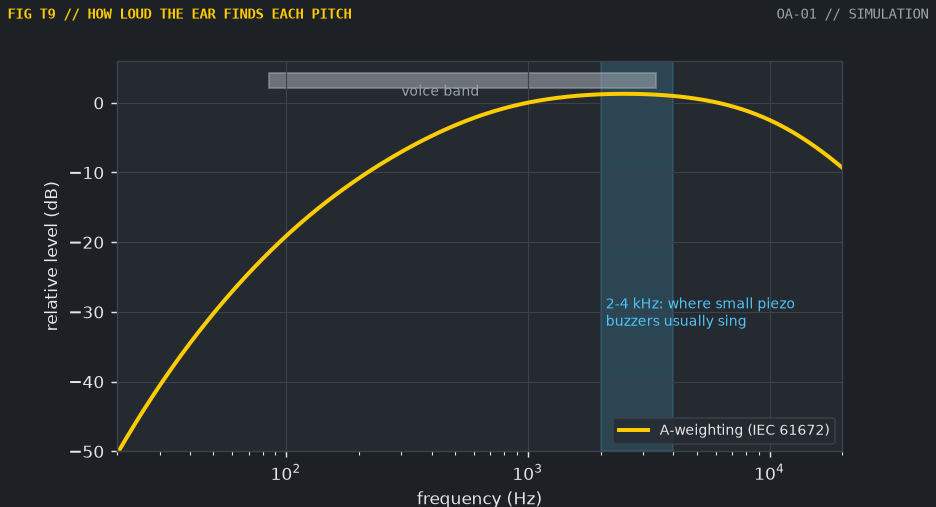
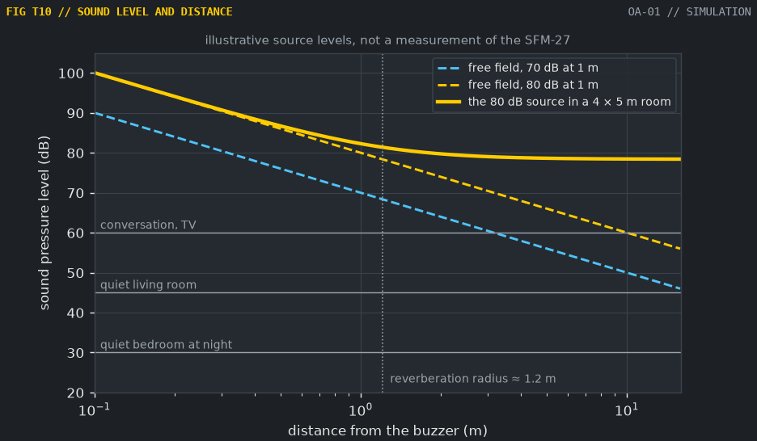
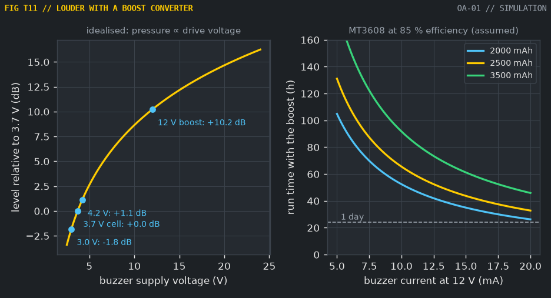

# 5. The alarm sound

The whole of OA-01 exists to move air: when the power fails, BZ1 must make a sound that people notice, possibly in another room, possibly at night, for days. This chapter explains how sound is measured, how the ear weighs it, how an active buzzer makes it, how it fades with distance, what the grille in the face does, and how the boost converter option makes it louder. The kit has not been measured: sound levels in the figures are **illustrative**, chosen to show the physics, not specifications of the SFM-27.

## 5.1 What sound is: pressure, level, decibels

Sound is a small pressure wave travelling through the air at $c$ ≈ 343 m/s (at 20 °C). Its strength is the RMS **sound pressure** $p$, the deviation from atmospheric pressure, in pascals. The ear spans an enormous range: about 20 µPa at the threshold of hearing to about 20 Pa at the threshold of pain, a factor of a million. A logarithmic scale is the only practical one, the **sound pressure level**:

$$L_p = 20 \log_{10} \frac{p}{p_0}\ \text{dB}, \qquad p_0 = 20\ \mu\text{Pa}$$

The factor 20 (not 10) appears because the level is defined on power quantities and acoustic power goes as the square of pressure; the **intensity** (power per unit area) of a plane wave is $I = p^2/(\rho c)$, with $\rho c$ ≈ 413 Pa·s/m for air. Rules of thumb that follow:

- doubling the pressure adds 6 dB; doubling the power adds 3 dB;
- +10 dB is ten times the power, and is heard as roughly **twice as loud**;
- two equal sources together are 3 dB louder than one, not twice the decibels.

The **wavelength** $\lambda = c/f$ sets the scale of everything acoustic. At 3 kHz, $\lambda$ = 343 / 3000 ≈ 11 cm: bigger than the 30 mm buzzer, much bigger than the 1.8 mm slots of the grille.

## 5.2 The ear and A-weighting

The ear is not equally sensitive at all frequencies. It is deaf at the extremes (below about 20 Hz and above 15–20 kHz), and most sensitive between about 1 and 5 kHz, partly because the ear canal, a tube about 25 mm long closed by the eardrum, resonates near 3 kHz. Sound level meters imitate this with the **A-weighting** curve, and levels weighted this way are written dB(A).

*Figure T9: the standard A-weighting curve (IEC 61672). Small piezo buzzers usually sing between about 2 and 4 kHz, right where the ear is most sensitive.*

This is no accident. A warning device wants the most loudness per milliwatt, and a tone around 2–4 kHz is heard far better than the same acoustic power at 200 Hz (about 12 dB better at 3 kHz than at 200 Hz, read from the curve). High tones have a second advantage for an alarm: they stand out from the low-frequency rumble of a house (fans, traffic, the fridge). Their weakness is that walls and doors block high frequencies more than low ones (section 5.6).

## 5.3 Inside an active piezo buzzer

A **piezoelectric** material changes shape when a voltage is applied to it, and produces a voltage when it is deformed. A piezo buzzer bonds a thin disc of piezoceramic to a brass disc. A voltage makes the ceramic expand or contract radially; the brass does not, so the pair bends like a bimetal strip, and the disc's centre moves up or down. An alternating voltage makes it flex back and forth and push the air.

The disc is mounted at its vibration node, in a plastic housing whose cavity and front hole are tuned to the disc's mechanical resonance. Near resonance a small drive gives a large motion, so the buzzer is loud at one frequency and very quiet elsewhere: it plays a single tone.

A **passive** piezo buzzer needs an external oscillator at that frequency. An **active** buzzer, such as the SFM-27, has it built in: a small transistor oscillator inside the housing, often using a third, feedback electrode on the disc so that it oscillates at the disc's own resonance. From outside, an active buzzer is a two-terminal DC load: apply a DC voltage the right way round and it sounds. Two consequences for OA-01:

- it can be switched by a simple contact, K1's NC, with no electronics around it;
- it is **polarised**: wired backwards, its oscillator does not run. The kit's troubleshooting table lists a reversed buzzer as a cause of a silent TEST.

(Magnetic buzzers, with a coil and a small iron diaphragm, also exist; they draw more current at low voltage. Buzzers like the SFM-27 are generally piezoelectric, which is what lets them run on milliamperes.)

## 5.4 The SFM-27 on a 3.7 V cell

The SFM-27 is rated **3 to 24 V**, under 20 mA. That wide range is why the kit chose it: it runs **directly from the cell**, with no converter, while the small 12 mm "5 V" buzzers the kit's documentation mentions work poorly below 4 V. On the 3.7 V cell, the kit estimates the current at **5–10 mA**.

A piezo element is, electrically, mostly a capacitor. The oscillator charges and discharges it each cycle, and the acoustic output grows with the voltage swing across the disc, which is set by the supply. In an idealised view, the sound pressure is proportional to the drive voltage, so the level changes by $20\log_{10}(V/V_{ref})$:

| Supply | Level relative to 3.7 V (idealised) |
|---|---|
| 3.0 V (nearly empty cell) | −1.8 dB |
| 3.7 V (nominal cell) | 0 dB |
| 4.2 V (full cell) | +1.1 dB |
| 12 V (boost option) | +10.2 dB |

Real buzzers depart from this (the oscillator has its own losses, and the disc saturates at high drive), but the trend is right, and it is what the kit's documentation says: on 3.7 V the SFM-27 is quieter than at 12 V. The table also shows something reassuring: over the whole useful discharge of the cell, from 4.2 V to about 3.4 V, the level changes by only about 2 dB, a difference the ear barely notices. The buzzer sounds almost the same on day 1 and day 8 of an outage (chapter 6).

## 5.5 Level and distance

A small source in open air spreads its power $W$ over spheres of growing area. The intensity at distance $r$ is $I = Q W / (4\pi r^2)$, where $Q$ is the **directivity factor**: 1 in free space, 2 for a source on a hard surface radiating into a half-space, as OA-01 does from a shelf. Every doubling of distance spreads the same power over four times the area: **−6 dB per doubling of distance**, the inverse-square law.

$$L_p(r) = L_p(r_0) - 20 \log_{10} \frac{r}{r_0}$$

Indoors, sound also bounces off walls, ceiling and furniture. After many reflections it forms a roughly uniform **reverberant field**, whose level depends on the room's absorption, not on the distance. Sabine's theory gives the total level as the sum of the direct and reverberant parts:

$$L_p(r) = L_W + 10 \log_{10}\left(\frac{Q}{4\pi r^2} + \frac{4}{R}\right), \qquad R = \frac{S\bar\alpha}{1 - \bar\alpha}$$

where $L_W$ is the source's sound power level, $S$ the room's surface area and $\bar\alpha$ its average absorption coefficient. The distance where the two parts are equal is the **reverberation radius** $r_c = \sqrt{QR/16\pi}$.

*Figure T10 (illustrative levels): free-field decay of sources giving 70 and 80 dB at 1 m, and the 80 dB source in a 4 × 5 × 2.5 m room with an average absorption of 0.3 (reverberation radius ≈ 1.2 m). Grey lines: typical background levels.*

The room changes the picture completely. In free field, the 80 dB source falls to 68 dB at 4 m; in the room it stays near 79 dB everywhere beyond a couple of metres. Inside the room where it stands, the alarm is about as loud in the far corner as at arm's length. What matters for being heard is the margin over the **background**: a quiet bedroom at night is around 30 dB(A), a living room with a conversation or a TV around 60 dB. A tone in the ear's most sensitive band, 20 dB or more above the background, is very hard to miss.

## 5.6 Walls, doors and the grille

**Walls and doors.** Sound leaving the room must pass through a partition, which reflects most of it. A partition's **transmission loss** grows with its mass per unit area and with frequency (the *mass law*: about +6 dB per doubling of either), so high tones are blocked more than low ones. A closed interior door, with its gaps, typically costs of the order of 20 dB, a solid wall much more. In practice: put OA-01 where it can be heard, in the room or the corridor where people are, not in a closed cupboard next to the fuse box.

**The grille.** In the enclosure, the buzzer hangs under the control face with its sound face pressed against it, held centred by a 4-segment ring and glued. Above it the face has a round grille: a 3.4 mm centre hole and three rings of four arc slots at radii 5, 8.5 and 12 mm, each slot 1.8 mm wide, with 1.6 mm bridges between them, through the 2.4 mm face. The open area is

$$A_{open} \approx \frac{\pi\, 3.4^2}{4} + \sum_{r} 4\left[r\left(\frac{\pi}{2} - \frac{1.8 + 1.6}{r}\right) 1.8 + \frac{\pi\, 1.8^2}{4}\right] \approx 255\ \text{mm}^2$$

about 36 % of the 30 mm face of the buzzer (figures.py computes it from the enclosure parameters). Because the slots are tiny compared with the wavelength, the grille does not diffract or block the sound the way a wall would. Acoustically it behaves as a small **mass of air** in the slots, which with the thin air gap behind the face forms a Helmholtz-type resonator; with more than a third of the area open and a thin face, its effect is small at the buzzer's frequency. The thing to avoid is a gap between the buzzer and the face: the glue and the centring ring keep the buzzer's own front hole sealed against the grille, so its sound goes out of the box rather than into it.

The grille is cut in the first layers of the print, with the face on the bed (chapter 7): the slots come out with clean straight edges and the face stays smooth.

## 5.7 More volume: the boost option

The kit's documentation describes one way to make OA-01 much louder: add an **MT3608 boost converter**, set to 12 V, **after** the NC contact (between K1 NC and BZ1 +, with its ground on OUT−). A boost converter stores energy in an inductor from the low input voltage and releases it, through a diode, at a higher output voltage; its output power is its input power times its efficiency $\eta$:

$$I_{bat} = \frac{V_{out}\, I_{out}}{\eta\, V_{bat}}$$

Placed after the contact, the converter is powered only while the alarm sounds, so it draws nothing in standby and does not touch the fail-safe logic. The cost is energy: at 12 V the buzzer draws more current, and the converter multiplies it by the voltage ratio. With the buzzer at, say, 20 mA (its rated maximum) and an assumed 85 % efficiency, the cell supplies $12 \times 0.02 / (0.85 \times 3.7)$ ≈ 76 mA instead of 5–10 mA.

*Figure T11 (idealised and assumed values): left, level against supply voltage if the pressure is proportional to the drive voltage (12 V gives about +10 dB over 3.7 V); right, run time with the boost for three cell capacities against the buzzer's current at 12 V, at 85 % efficiency.*

About +10 dB, roughly twice as loud to the ear, for about a day of run time with a 2500 mAh cell instead of more than a week: exactly the trade-off the kit's documentation states ("much louder, but run time drops to about 1 day"). Which is right depends on the use: in a small flat, the direct version is heard everywhere and lasts the longest outage; in a large house, or next to noisy machines, the boost may be worth it.

## 5.8 Summary

| Fact | Consequence for OA-01 |
|---|---|
| $L_p = 20\log_{10}(p/20\ \mu\text{Pa})$; +10 dB ≈ twice as loud | levels add logarithmically |
| The ear peaks at 1–5 kHz (A-weighting) | a piezo buzzer at 2–4 kHz gets the most loudness per milliwatt |
| Active buzzer: built-in oscillator, polarised | switched by K1's NC contact, nothing else needed; mind the polarity |
| SFM-27: 3–24 V, < 20 mA; 5–10 mA at 3.7 V (estimate) | runs directly from the cell; only ≈ 2 dB change over the discharge |
| −6 dB per doubling of distance, but rooms are reverberant | loud anywhere in its room; doors cost ≈ 20 dB |
| Grille: ≈ 255 mm² open, 36 % of the buzzer face | nearly transparent at the buzzer's wavelength |
| Boost to 12 V after the NC contact | ≈ +10 dB, run time about 1 day, no standby drain |

Next: [chapter 6, power budget and autonomy](06-power-budget.md).
