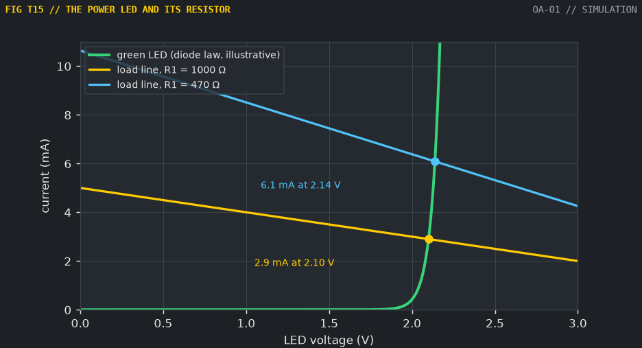
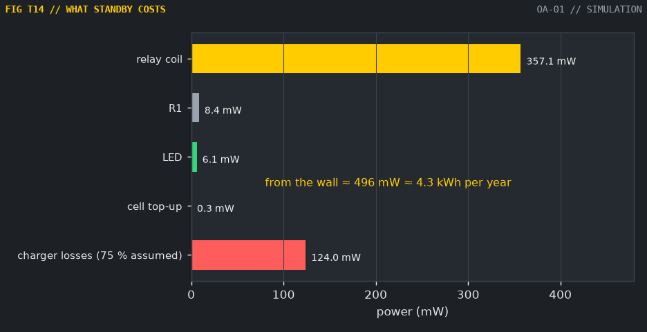
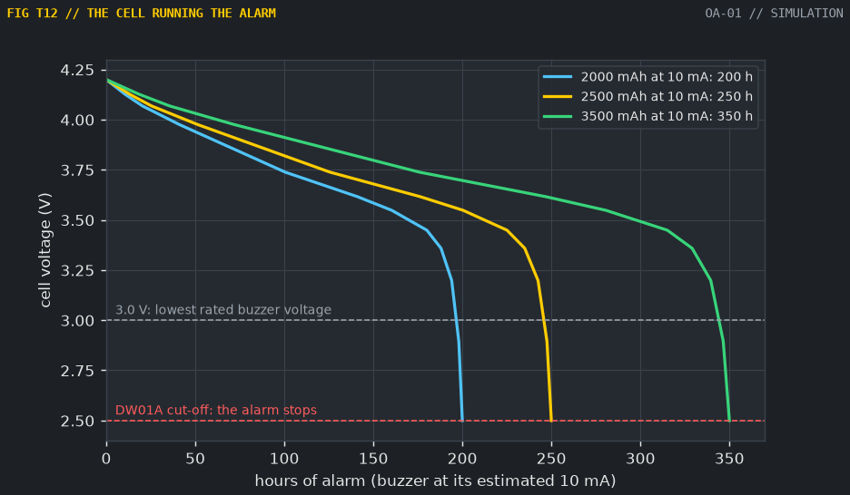
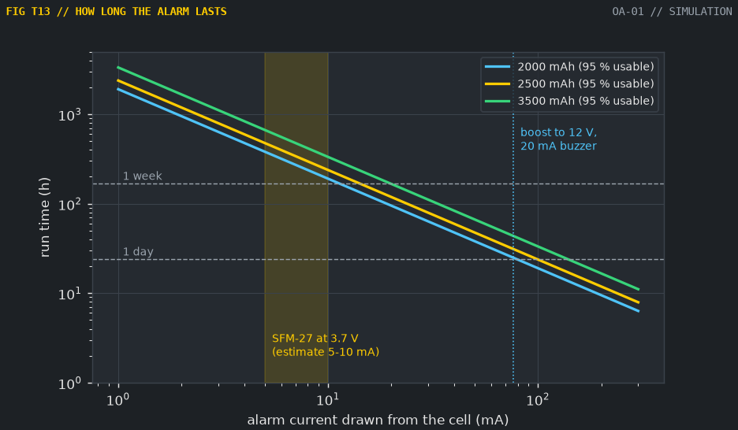

# 6. Power budget and autonomy

A power budget answers three questions for OA-01: how big must the USB charger be, what does it cost to keep the alarm armed all year, and how long does the alarm sound on its cell. The answers come from the currents of chapters 3 to 5, added up on each side of the circuit. Values marked as estimates come from the kit's documentation; the cell curve and the charger efficiency are illustrative.

## 6.1 Two power domains

OA-01 has two separate power domains, which meet only inside U1 and through K1's magnetic field:

- the **5 V domain**, present only while the outlet has power: IN+/IN− of U1, the LED with R1, SW2 and K1's coil with D1;
- the **battery domain**, always available: the cell on B+/B−, U1's protected output OUT+/OUT−, SW1, K1's contact and the buzzer.

In standby, the 5 V domain does all the work and the battery domain carries no current at all, apart from the protection's microamperes and the occasional top-up. During an outage, the 5 V domain is dead and the battery domain feeds the buzzer. The two never need to share a load, which keeps the budget simple.

## 6.2 The USB side: sizing the charger

The worst case for the charger is the hour after an outage, when the cell is recharged at full current while the relay and the LED are on:

| Load | Calculation | Current |
|---|---|---|
| K1 coil | 0.36 W / 5 V | ≈ 72 mA |
| LED1 + R1 | (5 − 2.1) V / 1 kΩ | ≈ 2.9 mA |
| cell charge (CC phase) | 1200 V / 1.2 kΩ | 1 A |
| **peak** | | **≈ 1.075 A** |

The kit asks for a charger of **at least 1.5 A**. The margin is not luxury: a charger run at its limit runs hot and its voltage can sag, and while the TP4056 tolerates a low input (it simply charges more slowly), a cheap charger at 100 % load is a charger that ages fast. With 1.5 A the peak is about 70 % of the rating; in standby the load is about 5 % of it.

## 6.3 The POWER LED

The LED shows that the 5 V is present. An LED is a diode: its current grows exponentially with its voltage above a threshold, so it must never be connected directly to a voltage source. The series resistor R1 sets the current:

$$I_{LED} = \frac{V_{USB} - V_f}{R_1} = \frac{5 - 2.1}{1000} \approx 2.9\ \text{mA}$$

Graphically, the operating point is where the LED's characteristic meets the resistor's **load line**, the straight line from 5 V (zero current) to $5\ \text{V} / R_1$ (zero LED voltage).

*Figure T15 (illustrative LED curve): the green LED's characteristic and the load lines of R1 = 1 kΩ and 470 Ω. Because the curve is so steep, the LED voltage barely moves (≈ 2.1 V) while the current follows the resistor.*

2.9 mA is a modest current for a 5 mm LED, chosen to be clearly visible without glaring in a dark room at night. The kit's documentation suggests 470 Ω for a brighter LED, about 6 mA. R1 dissipates $I^2 R$ ≈ 8.4 mW, the LED about 6 mW; a 1/4 W resistor is far more than enough.

## 6.4 Standby cost

The alarm is armed 24 hours a day, so its standby consumption is the energy it costs over a year. On the 5 V side:

$$P_{5V} = \frac{V_{USB}^2}{R_c} + V_{USB}\, I_{LED} \approx 357 + 14.5 \approx 372\ \text{mW}$$

The coil is 96 % of it. The cell adds almost nothing: if it self-discharges by about 2 % a month (a typical figure for a good Li-ion cell), replacing that charge in a 2500 mAh cell costs a fraction of a milliwatt on average. The charger itself is not perfect; at light load a small charger may be around 70–80 % efficient, so with an assumed 75 %:

*Figure T14 (simulation, assumed charger efficiency 75 %): standby power by item. About 0.5 W from the wall, about 4.3 kWh per year.*

Half a watt is the price of the fail-safe principle: the relay must be energised all the time so that it can drop out. A latching relay or an electronic detector could do with microwatts, but then a failure of the detector would no longer sound the alarm by itself (chapter 1). The kit's documentation mentions a signal relay (Omron G5V-1) with a coil of about 30 mA, which would cut the standby power by more than half while keeping the principle.

## 6.5 The battery side at rest

In standby the cell sees only:

- the DW01A protection controller and the leakage of the 8205A and of the TP4056 through its battery pin: **a few µA** in total, according to the kit's documentation;
- its own **self-discharge**, of the order of a few percent per month.

Both are replenished by U1 whenever the cell falls below its recharge threshold (about 4.05 V). Without USB, a few microamperes would take decades to empty a 2500 mAh cell, so the standby drain is irrelevant to the alarm's readiness. ARM (SW1) off disconnects the buzzer, but it is not needed for storage: in standby the buzzer circuit is already open at K1's NC contact.

## 6.6 Autonomy during an outage

During an outage, the cell feeds only the buzzer, at the kit's estimated 5–10 mA. The ideal run time is capacity divided by current:

$$t_{run} = \frac{C}{I_{bz}} = \frac{2500\ \text{mAh}}{10\ \text{mA}} = 250\ \text{h} \approx 10\ \text{days}$$

and twice that at 5 mA. The kit's documentation states it conservatively as "> 100 h (several days)". Three corrections usually matter for batteries; none matters much here:

- **Rate.** A cell gives somewhat less than its rated capacity at high currents, because of its internal resistance and slow ion diffusion (the effect Peukert described for lead-acid batteries). At C/250 the cell gives at least its rated capacity, which is measured at a much higher current (typically C/5).
- **Cut-off.** The capacity counts down to the protection's cut-off at about 2.5 V. The last few percent of a Li-ion cell lie below 3.3 V, on the steep part of the curve, so the cut-off costs little.
- **Temperature and age.** A cold cell or an old one gives less. That is what the margin between "> 100 h" and 250 h is for.

*Figure T12 (simulation, typical cell curve, buzzer at its estimated 10 mA): cell voltage during an outage for 2000, 2500 and 3500 mAh. The voltage stays above 3.4 V for more than 90 % of the run, then falls steeply to the protection's cut-off.*

The same curve answers the question raised in chapter 5: the buzzer's rated minimum is 3.0 V, and the cell spends only the last few hours of a 200–350 h outage below it. The level changes by about 2 dB from full to nearly empty.

*Figure T13 (simulation, 95 % of the rated capacity usable): run time against the current drawn from the cell, log-log, for three capacities. The band is the SFM-27 estimate at 3.7 V; the dotted line is the boost option of chapter 5 with the buzzer at 20 mA and 12 V.*

On a log–log plot, $t = C/I$ is a straight line of slope −1: halve the current, double the time. The plot puts the design choices side by side: the direct buzzer lasts one to three weeks, the boost option about a day; a bigger cell moves every line up in proportion.

## 6.7 The end of a very long outage

If an outage outlasts the cell, the DW01A switches the output off at about 2.5 V and the alarm stops. This is deliberate. Below that voltage the cell would be damaged, and a fail-safe alarm that has been sounding for over a week has done its job: someone either heard it or nobody is there. The protection then draws a fraction of a microampere, so the cell can wait in that state for a long time without falling further.

When the power returns, the TP4056 finds a cell below 2.9 V and starts with the gentle pre-charge of chapter 4, then the normal CC/CV charge. Some modules need USB present to release the protection, which is exactly what the returning power provides.

## 6.8 Recharge after the outage

The energy to put back is what the buzzer took, plus the charger's losses. After a typical outage of an hour, the buzzer took about 10 mAh, 0.4 % of the cell: the TP4056 tops it up in less than a minute at 1 A. After a week-long outage that drained the cell, the recharge takes about 3–3.5 h at 1 A (figure T7) and about 6 h with the 2.4 kΩ program resistor. During that recharge the charger dissipates about 1 W (figure T8) and the enclosure warms by a few kelvin (chapter 7).

There is one more subtle point. During the recharge, the alarm is ready again, but with a partly charged cell: if a second outage arrives one hour after the first one ended, the alarm still has the energy for days. The design never leaves the alarm without energy as long as the cell is healthy.

## 6.9 Summary

| Quantity | Value (design or estimate) |
|---|---|
| peak USB load | ≈ 1.075 A → charger ≥ 1.5 A |
| LED current | ≈ 2.9 mA (1 kΩ), ≈ 6 mA (470 Ω) |
| standby power on the 5 V side | ≈ 0.37 W, 96 % of it the relay coil |
| standby from the wall | ≈ 0.5 W, ≈ 4.3 kWh per year (75 % efficiency assumed) |
| standby drain on the cell | a few µA, replenished by USB |
| alarm current | 5–10 mA (estimate) |
| run time, 2500 mAh | > 100 h documented; ≈ 250 h at 10 mA in the model |
| run time with the 12 V boost | about 1 day |
| end of the run | DW01A cut at ≈ 2.5 V; recharge when the power returns |
| recharge of a drained cell | ≈ 3–3.5 h at 1 A, ≈ 6 h at 0.5 A |

Next: [chapter 7, the enclosure](07-enclosure.md).
