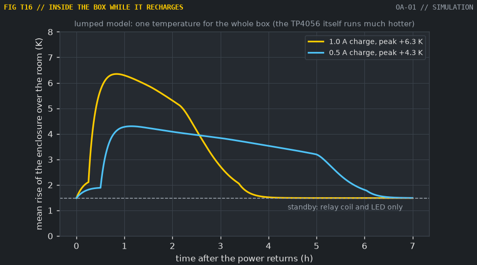

# 7. The enclosure

OA-01's enclosure is a 3D-printed wedge in three parts: the **top** (the control face), the **sides** (the walls and the screw posts) and a dark **base**. It holds one perfboard with all the electronics, puts the controls where hands and eyes find them, lets the buzzer out, keeps the charger's heat in check and carries the mech livery. The model is parametric, in OpenSCAD, and it has not been test-printed yet: the numbers below are the design values of the model, and the thermal results are estimates from a simple model.

## 7.1 The wedge

Seen from the side, the shell is a wedge: the control face tilts **20°** toward the user and the front leans back **10°**. The outer footprint is 122.8 × 74.8 mm, with corners rounded to 10 mm in top view; the whole unit is 33 mm tall at the front and 58.5 mm at the back, base included. Walls and face are 2.4 mm thick (six lines of a 0.4 mm nozzle), and a 3 mm, 45° chamfer runs around the face.

The shape follows the parts and the user:

- **The tilt** turns the face toward someone standing or sitting in front of a desk or a shelf, so the POWER LED is seen and the TEST button and the ARM switch are reached without lifting the unit. A face tilted by $\theta$ is foreshortened by $\cos\theta$ seen from above and by $\sin\theta$ seen from the front; 20° keeps it readable from both.
- **The tall back** gives room for the tallest parts: the 18650 holder (about 21 mm high with the cell) against the back wall, and the TP4056 module with its USB-C receptacle facing the back, 5.4 mm above the base.
- **The buzzer** (30 mm wide, 15 mm deep) hangs under the grille where the face is high enough, and the relay sits in front and to its right. The model checks every one of these clearances with `assert()` statements, so a change of a parameter that makes two parts collide stops the build.
- **The base** is 6 mm thick with a 45° undercut of 3 mm along its bottom edge: from normal viewing angles its own shadow separates the white shell from the table, and the unit seems to float.

## 7.2 Heat inside a closed box

The enclosure has no vents (the grille is the only opening, and the buzzer seals it). Two things warm it: K1's coil, 0.36 W all the time, and the TP4056 while it recharges the cell, about 1 W for a few hours after an outage (chapter 4).

Heat leaves a closed box through its outer surface by **natural convection** and **radiation**. Both together can be lumped into a heat transfer coefficient $h$, typically 5–10 W/(m²·K) for a small object in still air (about half of it radiation, for a matt plastic surface). The steady temperature rise of the box over the room is then

$$\Delta T = \frac{P}{h A}$$

OA-01's outer surface, without the bottom that stands on the shelf, is about 280 cm² (0.028 m²). With $h$ ≈ 9 W/(m²·K), the box sheds about 0.25 W per kelvin:

- **standby** (coil and LED, 0.37 W): ΔT ≈ 1.5 K;
- **recharging at 1 A** (≈ 1.4 W in total): about 6 K at the peak.

The box does not reach that at once. Its parts have a **heat capacity** $C_{th}$: the printed plastic, the cell and the board, roughly 190 J/K together (estimated from typical masses and specific heats). The rise follows a first-order lag with the time constant

$$\tau_{th} = \frac{C_{th}}{hA} \approx \frac{190}{0.25} \approx 750\ \text{s} \approx 13\ \text{min}$$

*Figure T16 (simulation, lumped thermal model, assumed h = 9 W/(m²·K), 190 J/K): mean temperature rise of the enclosure over the room after the power returns from a long outage, with the charger at 1 A and at 0.5 A.*

The mean rise is small. The local one is not: the TP4056 chip concentrates its watt in a few square millimetres and runs much hotter than the air around it, which is why it has thermal regulation (it throttles at about 120 °C die temperature). The hot phase is short, because the cell is almost always full: the kit's documentation notes that it only happens for a few hours after an outage. For less heat it offers the 2.4 kΩ program resistor, which halves the charge current and roughly halves the heat power (peak mean rise about 4 K instead of 6 K in the model).

## 7.3 Materials and temperature

The kit prints the top and the sides in PLA or PETG, light-coloured, and the base in a dark one. The two materials differ mainly in how they behave when warm:

- **PLA** softens around its glass transition, about 55–60 °C. A light-coloured PLA box in a room, warmed by a few kelvin, is far from it.
- **PETG** softens around 75–80 °C. The kit's documentation recommends it "for warm places": an attic, a garage in summer, a shelf in the sun, or next to a heater, where a dark PLA part could creep under the screws over months.

The colours are not only for the look. A light shell absorbs less sunlight than a dark one; the dark base is in the shadow of the shell. The cell inside cares too: lithium-ion cells are generally charged between about 0 and 45 °C and age faster when kept hot at full charge (chapter 4). An outage alarm should live somewhere a person would be comfortable.

## 7.4 Printing without supports: the 45° rule

A fused-filament printer lays each line of plastic on top of the previous layer. A wall that leans out by an angle $\theta$ from the vertical makes each layer step out by

$$\Delta = h \tan\theta$$

where $h$ is the layer height. With $h$ = 0.2 mm and a 0.4 mm wide line, a 45° overhang steps out 0.2 mm per layer: each new line rests on half of the one below, which is about the limit that prints cleanly without supports. Steeper overhangs droop; horizontal ones need **bridges** (lines stretched between two supports, which work over short spans) or supports.

All three parts of OA-01 are oriented to stay within that rule:

- **The top** prints **face down**. The face is the first layer, so it takes the texture of the bed (glossy on smooth PEI or glass, matt on textured PEI) and the grille, the holes and the livery form in the first layers. In this orientation the face chamfer is exactly 45° and the lip underneath rises at 20° from the vertical. The part is only 6.8 mm tall.
- **The sides** print **upside down, standing on the seam**. The surface that seats the top is the first layer, so it is flat and true and the top sits on it without gaps. The walls lean at most 30° in this orientation, and the screw posts are bridged over the 2 mm notches made for the lip.
- **The base** prints flat; its undercut is a 45° overhang, and the pocket for the perfboard's solder side is on top.

No supports means no support scars, no post-processing and exact surfaces where parts meet. The orientations are already in the print files.

## 7.5 A livery in three layers

The mech livery (a title band with the unit code OA-01, a reticle around the grille, hazard stripes with "FAIL-SAFE", the labels TEST, ARM and POWER, the wordmark on the front and "5V" on the back) is **inlaid** flush in a second filament, 0.6 mm deep. A printer with a multi-material unit changes filament within a layer; every layer that holds a second colour costs up to two filament changes and some purged plastic, so the geometry of the inlay decides the cost.

- On **the face**, printed flat on the bed, the inlay is a slab parallel to the layers: 0.6 mm is exactly **3 layers** of 0.2 mm (0.15 or 0.12 mm layers also divide it). The whole face livery costs 3 two-colour layers, about 6 filament changes.
- On **the walls**, which stand up in the print, the inlay is a thin skin across many layers: the wordmark on the front spans 27 layers, the "5V" on the back 29, 56 in all, about 110 changes. That is why the kit keeps the decorative livery on the face and puts only the essential marks on the walls.

Resolution follows from the same geometry. On the face the lettering is drawn with 0.8 mm strokes and gaps of at least 0.8 mm, two lines of a 0.4 mm nozzle, so each stroke is whole in each of its 3 layers. On a wall, each layer cuts the inlay into a strip only about 0.7 mm wide, so the wall lettering uses wider 1.4 mm strokes and gaps of at least 0.7 mm. A one-colour version, with the marks engraved 0.6 mm deep instead, needs no second filament at all.

## 7.6 The glued joint

The top and the sides are printed separately (so that the two-colour face print is only 6.8 mm tall) and glued into one shell. The joint is designed as a small exercise in tolerances:

- a **lip** under the top, 4 mm high and 1.6 mm thick, fits inside the walls and locates the top;
- a **glue gap** of 0.15 mm per side between the lip and the walls: room for the glue film and for the normal dimensional error of a print, which is typically of the order of ±0.1 mm;
- a 0.6 mm **lead-in chamfer** on the lip's bottom edge guides it in;
- a **groove** 0.8 × 0.6 mm in the top, over the inner edge of the walls, collects the glue pushed out of the joint, so it does not squeeze out of the visible seam;
- the **seam** itself runs along the crease under the face chamfer, 3 mm under the face, so the joint hides in an edge the shell already has.

Gap-filling glues work only within a thickness: a CA gel fills up to about 0.3 mm, a 5-minute epoxy more. The kit's documentation gives the corrections: if the dry fit is tight, sand the lip or reprint with a gap of 0.2–0.25 mm; if it is loose, the glue still fills up to about 0.3 mm. A lap joint like this one loads the glue in **shear** over the whole area of the lip, the way adhesives are strongest, rather than in peel.

## 7.7 One board, four screws

All the electronics sit on one perfboard, 114.3 × 66.0 mm (45 × 26 hole spacings of 2.54 mm), 1.6 mm thick, with its corners cut at 45° to clear the rounded inner corners of the shell. It needs no screws of its own:

- four **M3 × 16 countersunk self-tapping screws** come up from below, through the base and through the board's corner holes, into the screw posts moulded in the sides; they bite 6 mm into the posts;
- the posts stop on top of the board, so tightening the screws **clamps the board** between the posts and a 3 mm rim of the base that carries its outer row of holes;
- the solder side faces down into a 2 mm pocket in the base, which is why every lead must be trimmed to 1.5 mm or less.

A self-tapping screw forms its own thread in a pilot hole slightly smaller than its diameter (2.5 mm for M3 in the model), displacing the plastic rather than cutting it. Thread-forming in plastic holds well as long as it is not over-tightened and not unscrewed too often; the shell is meant to be closed once, after the test, and opened rarely. The heads sit fully on the bottom face, inside the undercut, so they are invisible and the unit stands flat.

## 7.8 Summary

| Fact | Consequence for OA-01 |
|---|---|
| Face tilted 20°, front leaning 10° | controls readable and reachable on a desk; tall back for the holder and U1 |
| Closed box: $\Delta T = P / (hA)$, $\tau \approx C_{th}/(hA)$ | ≈ 1.5 K in standby, ≈ 6 K peak while recharging at 1 A (model); the TP4056 itself runs hot |
| PLA softens ≈ 55–60 °C, PETG ≈ 75–80 °C | PLA indoors, PETG for warm places |
| Overhang step $h \tan\theta$; 45° is the limit | every part printed without supports, in the orientation stored in the files |
| Face inlay = 3 layers; wall inlays = 56 layers | livery on the face; ≈ 6 vs ≈ 110 filament changes |
| Lip with 0.15 mm glue gap, groove, hidden seam | precise fit, glue in shear, clean seam |
| Four screws through the board | the board is clamped, no standoffs; leads ≤ 1.5 mm |

Back to the [index](README.md).
